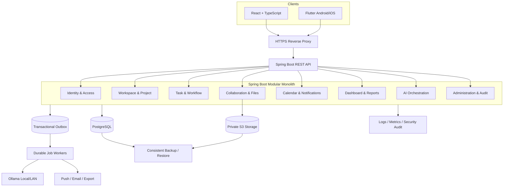
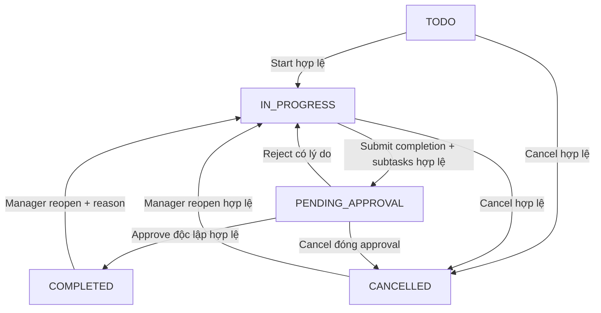
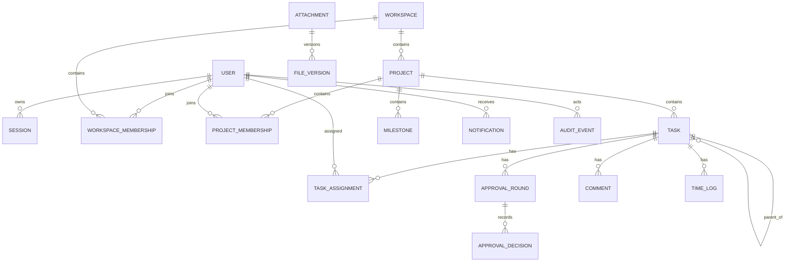

# SMART TASK MANAGEMENT

## ĐẶC TẢ TỔNG HỢP YÊU CẦU & KIẾN TRÚC TỔNG THỂ

**Phiên bản:** 1.0 — Baseline yêu cầu và kiến trúc  
**Ngày tổng hợp:** 11/10/2026  
**Trạng thái:** 11 nhóm yêu cầu **FROZEN**; ARCH-01–ARCH-10 **FROZEN**  
**Phạm vi tài liệu:** Phân tích nghiệp vụ, quy tắc, kiến trúc, dữ liệu khái niệm, luồng nghiệp vụ, API ở mức nhóm, bảo mật, vận hành, kiểm thử và lộ trình.  
**Chưa thực hiện:** Viết mã, tạo/cập nhật database, ERD vật lý, đặc tả OpenAPI chi tiết, kiểm thử thực tế hoặc triển khai.

---

## 1. Tóm tắt điều hành

Smart Task Management là hệ thống quản lý công việc cá nhân và nhóm, sử dụng chung **React + TypeScript (Web)** và **Flutter (Android/iOS)**, Backend **Spring Boot / Java REST API**, **PostgreSQL**, **Object Storage tương thích S3 (private)** và **Ollama Local/LAN**. Hệ thống tổ chức dữ liệu theo Account → Workspace → Project → Task/Subtask; một Task có thể có nhiều người phụ trách; từng Project bật/tắt nghiệm thu; AI chỉ đề xuất, không tự thay đổi nghiệp vụ.

V1 áp dụng **Modular Monolith** và có khả năng tách worker/AI sau này. Quyền được xét theo tài khoản, phiên, Workspace, Project, đối tượng, trạng thái và hành động; vai trò System Admin hoặc Workspace Owner **không tự động được đọc nội dung Project/Workspace riêng tư**. Mọi quyền được kiểm tra ở Backend.

### 1.1. Phạm vi chức năng V1

- Tài khoản, phiên đăng nhập một thiết bị, mời/duyệt người dùng, phục hồi và quản trị.
- Personal Workspace và Team Workspace; Project với nhiều Manager; Milestone.
- Task/Subtask một cấp, nhiều assignee, dependency cảnh báo, checklist, comment, attachment, time log.
- Workflow có/không nghiệm thu; nhiều vòng nghiệm thu, không tự duyệt, audit đầy đủ.
- Lịch, deadline, nhắc việc, realtime, push/email, ICS export.
- Dashboard, thống kê, báo cáo PDF/XLSX/CSV, báo cáo lịch sử theo sự kiện.
- AI Local hỗ trợ tạo bản nháp Task, gợi ý Subtask/priority/deadline/assignee, tìm kiếm, planner/review; tính năng phân tích rủi ro nâng cao theo giai đoạn.
- Quản lý file private, versioning, kiểm tra quyền tại mỗi lần preview/download.
- Audit, security events, background jobs, backup, monitoring và vận hành.

### 1.2. Nguyên tắc nguồn chân lý

1. Các quyết định **FROZEN** ở mục 2–13 là baseline bắt buộc.
2. Các phần mang nhãn **ĐỀ XUẤT / CHƯA FROZEN** không tự trở thành quyết định đã duyệt.
3. Nếu thiết kế chi tiết phát hiện xung đột, phải ghi nhận change request thay vì âm thầm sửa baseline.
4. Hệ thống thực tế chỉ được công nhận đạt NFR sau khi có bằng chứng kiểm thử.

---

## 2. Nhóm 01 — Account & Authentication [FROZEN]

- Tài khoản có các trạng thái `PENDING_APPROVAL`, `ACTIVE`, `REJECTED`, `SUSPENDED`, `DISABLED`, `DELETED`; khóa tạm thời là trạng thái/điều kiện bảo mật riêng.
- Tự đăng ký chỉ khi System Admin bật cấu hình; tài khoản tự đăng ký phải được duyệt. System Admin hoặc Workspace Admin được cấp `ACCOUNT_APPROVE_GLOBAL` có thể duyệt; quyền duyệt **không kéo theo quyền đọc dữ liệu riêng tư**.
- Tài khoản do Admin hợp lệ tạo được ACTIVE ngay; Workspace Admin chỉ tạo tài khoản thường trong phạm vi quyền.
- Đăng nhập username/email + mật khẩu; **mỗi tài khoản chỉ có một phiên hoạt động**. Đăng nhập mới vô hiệu hóa cả access token, refresh token và phiên cũ; hủy đăng ký push gắn phiên cũ.
- Quên mật khẩu: mật khẩu tạm do Admin cấp có hạn 24 giờ hoặc mã khôi phục offline dùng một lần. Có cơ chế xác thực lại cho thao tác nhạy cảm.
- Lời mời gắn email cụ thể, có hạn, dùng một lần. Tài khoản mới phải ACTIVE trước khi có hiệu lực tham gia.
- Soft-delete tài khoản, giữ audit và lịch sử; chỉ System Admin được khôi phục. Phải chuyển Workspace Owner/Project Manager hợp lệ trước khi xóa; bảo vệ System Admin cuối cùng.
- Username/email đã dùng được giữ dành riêng, không cấp lại. Hồ sơ gồm tên, username, email, avatar, điện thoại, chức danh, bio, timezone.
- Bootstrap System Admin ban đầu theo quy trình local một lần và an toàn.

**Bất biến:** Người dùng mất phiên hoặc không ACTIVE không thể tiếp tục truy cập API, job, file hoặc nội dung realtime được bảo vệ.

---

## 3. Nhóm 02 — Workspace [FROZEN]

- Mỗi tài khoản ACTIVE có đúng **một Personal Workspace** riêng tư; không mời thành viên, không chuyển nhượng hoặc xóa độc lập; System Admin không mặc nhiên được xem nội dung.
- Có thể tạo nhiều Team Workspace, mỗi Workspace có đúng **một Owner**; vai trò `Owner`, `Admin`, `Member`, `Guest`.
- Workspace Owner/Admin không tự động được đọc Project chưa tham gia; quyền xem nội dung cần Project participation hoặc quyền đặc biệt được cấp rõ ràng.
- Owner/Admin tạo Project; Member tạo khi cấu hình cho phép; Guest không tạo.
- Quy tắc mời: Owner/Admin mời Admin/Member/Guest; Member mời Member/Guest; Guest không mời. Invite gắn email, có hạn, một lần.
- Owner có thể loại Admin/Member/Guest; Admin loại Member/Guest. Member được rời Workspace; Owner phải chuyển quyền trước khi rời.
- Khi thành viên rời/bị loại: thu hồi quyền ngay; gỡ assignment của Task chưa hoàn tất; giữ lịch sử; thông báo Manager; không tự approve. Nếu người đó là Manager, cần thay thế hợp lệ.
- Chuyển Owner nguyên tử sang thành viên ACTIVE hợp lệ; Owner cũ thành Member, vai trò Project không tự thay đổi. System Admin chỉ chuyển Owner khẩn cấp khi có xác thực lại, lý do và audit, không đọc nội dung.
- Trạng thái `ACTIVE`, `ARCHIVED`, `DELETED` (soft). Owner có thể archive dù còn Task dở dang; readonly và tạm dừng reminders. Xóa/khôi phục theo quyền đã chốt, không tự hồi sinh quyền bị thu hồi.

**Bất biến:** Một Team Workspace chỉ có một Owner hợp lệ; Personal Workspace không được biến thành Team Workspace bằng đường vòng.

---

## 4. Nhóm 03 — Project & Milestone [FROZEN]

- Project thuộc Workspace; có nhiều Manager, không có Project Owner riêng. Người tạo mặc định là Manager.
- Thành viên Project được thêm tường minh, vai trò `Manager`, `Member`, `Guest`; chỉ Manager thêm thành viên Project. Manager có thể điều chỉnh role nhưng Project chưa DELETED phải có ít nhất một Manager ACTIVE hợp lệ.
- Manager phải là thành viên ACTIVE của Workspace và không là Workspace Guest. Workspace Owner có quyền khôi phục Manager ở mức metadata khẩn cấp, không mặc nhiên đọc Task.
- Trạng thái Project: `PLANNING`, `ACTIVE`, `ON_HOLD`, `COMPLETED`, `ARCHIVED`, `DELETED` (soft). PLANNING cho tạo/sửa Task nhưng chưa thực thi; ON_HOLD readonly; Manager điều phối chuyển trạng thái theo quy tắc.
- Project COMPLETED được phép còn Task chưa xong, không bắt buộc lý do: các Task chưa hoàn tất (kể cả `PENDING_APPROVAL`) và Subtask chưa hoàn tất thành `CANCELLED`, các approval mở đóng theo cơ chế hủy; Milestone chưa xong thành `CANCELLED`. Task COMPLETED giữ nguyên.
- Chuyển COMPLETED → ACTIVE không tự mở lại Task CANCELLED; Manager phải reopen từng Task hợp lệ.
- Archive/unarchive, delete/restore tuân quyền và trạng thái trước đó; Workspace hiệu lực readonly/archived ưu tiên hơn trạng thái Project.
- Milestone tùy chọn; Manager tạo; Task có thể không thuộc Milestone; xóa Milestone chỉ bỏ liên kết Task.
- Quyền tạo Task: Manager; Member nếu cấu hình Project cho phép.
- Nghiệm thu bật/tắt theo Project; Manager hoặc approver được chỉ định có thể duyệt nhưng cấm assignee/người submit tự duyệt. Bật giữa chừng áp dụng cho Task đang thực hiện; trước khi tắt phải xử lý hết approval pending; Task COMPLETED/CANCELLED không bị đổi ngược.
- Progress Project = số **top-level Task COMPLETED** / (số **top-level Task tổng** − số **top-level Task CANCELLED**) × 100%; mẫu số bằng 0 hiển thị `N/A`.

---

## 5. Nhóm 04 — Task & Subtask [FROZEN]

- Manager hoặc Member được cấu hình có thể tạo Task. Manager, creator/assignee được sửa trong phạm vi hợp lệ; soft-delete bởi Manager/creator nếu trạng thái và quyền cho phép.
- Task có **0..n assignee**. Chỉ cần **một assignee xác nhận hoàn tất** để submit/complete, không yêu cầu tất cả cùng xác nhận. Task không assignee do Manager hoặc creator hợp lệ xác nhận.
- Subtask có tối đa **một cấp**; có assignee/deadline riêng. Parent chỉ hoàn tất khi mọi Subtask đã `COMPLETED` hoặc `CANCELLED`.
- Deadline tùy chọn; priority `LOW`, `MEDIUM`, `HIGH`, `URGENT`.
- Dependency chỉ cảnh báo, không hard-block, không được tạo chu trình.
- V1 không có Task recurring; hỗ trợ comment, attachment, checklist, tag và time log nhập thủ công.
- Soft-delete Task cha làm ẩn/xóa mềm Subtask liên quan; restore chỉ phục hồi những đối tượng bị xóa theo cùng thao tác và vẫn hợp lệ, không khôi phục những mục đã bị xóa độc lập.
- `BLOCKED` là cờ độc lập, không phải trạng thái workflow.
- `PENDING_APPROVAL` khóa nội dung thực thi Task; không được vòng qua bằng sửa comment/file hoặc API khác.
- Progress chỉ đếm top-level Task; trạng thái Workspace/Project có quyền phủ quyết thao tác Task.

**Luồng chính:** `TODO → IN_PROGRESS → [PENDING_APPROVAL nếu bật] → COMPLETED`; reject quay về `IN_PROGRESS`; `CANCELLED` là kết thúc riêng, có thể reopen theo quyền.

---

## 6. Nhóm 05 — Workflow & Approval [FROZEN]

- Start Task: Manager, assignee hoặc creator hợp lệ.
- Submit completion: assignee; nếu không assignee, Manager/creator hợp lệ.
- Approver chỉ định theo Task bởi Manager; mặc định là Manager đủ điều kiện. Nhiều approver hợp lệ nhưng chỉ cần một quyết định APPROVE hợp lệ để kết thúc vòng.
- **Cấm tự duyệt** nếu người duyệt là assignee **hoặc** người submit completion; riêng creator không bị cấm chỉ vì là creator.
- Có thể submit dù không còn approver hợp lệ: cảnh báo Manager, giữ `PENDING_APPROVAL`, không tự approve; Manager phải chỉ định approver độc lập hợp lệ.
- Reject bắt buộc lý do, Task về `IN_PROGRESS`. Không có trạng thái `REQUEST_CHANGES` riêng.
- Manager reopen COMPLETED → IN_PROGRESS phải ghi lý do và audit; lịch sử approval giữ nguyên, chu kỳ mới khi cần. Reopen CANCELLED thủ công, không tự reopen Subtask.
- Cancel Task bởi Manager/creator hợp lệ; cancel khi đang pending đóng vòng approval với kết quả hủy, **không giả mạo approve/reject**.
- Approver mất quyền bị thu hồi tức thời; Manager chỉ định lại. Người submit rời Workspace: approval đang chờ vẫn được lưu, approver còn hợp lệ có thể quyết định.
- Task pending quá hạn vẫn pending, có cảnh báo quá hạn, không tự reject. Có thể cấu hình hạn duyệt và nhắc việc.
- Project COMPLETED hủy các approval còn mở theo quy tắc Project; lưu lịch sử.
- Audit mọi chuyển trạng thái: actor, thời gian, trước/sau, lý do, vòng nghiệm thu. Chỉ **một kết quả terminal** mỗi approval round.

---

## 7. Nhóm 06 — Calendar, Deadline & Notifications [FROZEN]

- Lịch cá nhân, Project, Workspace theo quyền; xem ngày/tuần/tháng/danh sách.
- Start date và deadline đều tùy chọn. Task chỉ có start date xuất hiện tại ngày bắt đầu; Task không có cả hai nằm trong danh sách chưa xếp lịch, không tự gán deadline.
- Reminder mặc định trước deadline 1 ngày và 1 giờ, có thể cấu hình theo user; Manager có thể đặt reminder dùng chung theo quyền.
- Overdue: nhắc một lần khi quá hạn, sau đó theo cấu hình. Pending approval ngừng reminder thực thi cho assignee, nhắc approver hợp lệ; không có approver thì báo Manager.
- Project ON_HOLD/ARCHIVED hoặc Workspace ARCHIVED tạm dừng deadline reminders, không xóa lịch sử; resume không gửi bù hàng loạt, tính lại và có thể phát một thông báo quá hạn hiện tại.
- In-app realtime, Mobile push, Email; trạng thái đọc/chưa đọc đồng bộ cấp tài khoản; mark all read; lọc/tìm lịch sử.
- User được mute theo loại; thông báo bảo mật quan trọng vẫn gửi. Quiet hours theo timezone user, trì hoãn thông báo thường; thông báo bảo mật quan trọng gửi ngay.
- Deadline lưu instant chuẩn hóa, hiển thị theo timezone người xem. Deadline chỉ ngày được hiểu là **23:59:59** trong timezone người đặt, lưu cả instant và timezone gốc; đổi timezone hồ sơ không tự đổi instant, xử lý DST.
- Thay đổi deadline cập nhật calendar/reminder và thông báo assignee.
- Khi mất quyền, redaction nội dung notification nhạy cảm và chặn deep link; audit giữ lại. Phiên cũ không được nhận push nhạy cảm sau khi đăng nhập mới.
- ICS export V1; file đã tải về không thể thu hồi, nên tối thiểu hóa thông tin riêng tư trong export.

---

## 8. Nhóm 07 — AI & Ollama Local [FROZEN]

- Hai giai đoạn: AI cơ bản trước, analytics/risk nâng cao sau.
- AI chỉ **đề xuất**, người dùng xác nhận, Backend kiểm tra lại quyền và workflow. Không tự approve, complete, cancel hoặc sửa Task.
- Chat/tìm kiếm tự nhiên chỉ đọc dữ liệu người yêu cầu hiện được phép truy cập; file/comment là input không đáng tin, phải phòng prompt injection.
- Tạo Task draft từ ngôn ngữ tự nhiên, gợi ý Subtask một cấp, priority có giải thích, deadline, assignee dựa trên quyền và workload; tất cả cần xác nhận.
- Daily Planner theo yêu cầu hoặc opt-in định kỳ; Weekly Review theo phạm vi quyền; rule-based overdue risk giải thích được ở giai đoạn nâng cao.
- AI history có kiểm soát quyền, redaction khi mất quyền; không bịa dữ liệu thiếu.
- Ollama Local/LAN dùng chung qua Backend, không Client → Ollama trực tiếp; Admin có quyền cấu hình model, timeout, giới hạn tài nguyên nhưng không tự có quyền đọc nội dung riêng tư.
- Offline/timeout: core nghiệp vụ vẫn chạy, AI trả lỗi rõ và cho retry hợp lệ.
- Context gửi cho AI phải tối thiểu, đã lọc quyền và giảm dữ liệu nhạy cảm; output phải validate; kiểm tra quyền lại trước khi trả và trước khi thực hiện đề xuất.

---

## 9. Nhóm 08 — Dashboard, Reports & Analytics [FROZEN]

- Dashboard Personal, Project, Workspace, System. System Dashboard hiển thị vận hành/tài khoản/trạng thái AI, không mặc nhiên xem nội dung Task riêng tư.
- Personal Dashboard phân biệt Task được giao, tạo, quản lý; tránh cộng trùng. Project/Workspace Dashboard chỉ tổng hợp đối tượng người xem hiện được quyền truy cập.
- Progress Project theo top-level Task, loại CANCELLED, mẫu số 0 → `N/A`.
- Phân bố trạng thái `TODO`, `IN_PROGRESS`, `PENDING_APPROVAL`, `COMPLETED`, `CANCELLED`; `BLOCKED` là cờ riêng.
- Overdue = quá deadline và chưa COMPLETED/CANCELLED, phân biệt đang chờ duyệt.
- Task nhiều assignee: tách **unique Task count** và **assignment count**; time log theo người ghi. Không xếp hạng/điểm năng suất cá nhân.
- Báo cáo theo ngày/tuần/tháng/quý/năm/khoảng tùy chọn; tiến độ lịch sử theo event/audit tại thời điểm xảy ra, reopen không viết lại quá khứ.
- Milestone: hoàn thành/chưa hoàn thành/hủy/quá hạn nếu có deadline. Approval: pending/approved/rejected/thời gian chờ; nhiều vòng tính riêng, không nhân theo số approver.
- Xuất **PDF/XLSX/CSV V1**; kiểm tra quyền ở thời điểm tạo và giao file. Dashboard cập nhật khi mở/refresh, gần realtime cho số liệu chính.
- AI được giải thích/tóm tắt số liệu có quyền nhưng không sửa số liệu; phân biệt `0`, `N/A`, không có quyền và thiếu dữ liệu; không tiết lộ số liệu của đối tượng ẩn.

---

## 10. Nhóm 09 — Files, Attachments & Activity Logs [FROZEN]

- Attachment cho Task, Subtask, Project, Comment; upload khi có quyền sửa đối tượng và trạng thái cho phép; xem/tải khi có quyền xem nội dung.
- Allowlist loại file gồm tài liệu, ảnh, PDF, bảng tính, archive; giới hạn dung lượng do Admin cấu hình.
- Private Object Storage lưu binary; PostgreSQL lưu metadata. File versioning, không ghi đè phá hủy; khôi phục phiên bản cũ bằng cách tạo phiên bản mới.
- Soft-delete file, audit và restore theo quyền. Parent soft-delete ẩn file, không xóa vật lý ngay; restore chỉ khi còn hợp lệ.
- Preview PDF/ảnh/loại an toàn. Kiểm tra type/size/malware khi có công cụ; loại nguy hiểm chặn hoặc cách ly.
- **Mỗi lượt preview/download** qua Backend/gateway kiểm tra quyền tại request; không cấp đường dẫn công khai hoặc URL đã phát mà không thể thu hồi theo quyền. Dữ liệu đã tải hoặc cache ngoài hệ thống không thể bị thu hồi từ xa.
- AI chỉ đọc file theo tính năng/yêu cầu và quyền hiện tại.
- Activity Timeline ghi chỉnh sửa, assignment, trạng thái, deadline, comment, file, approval; chỉ người có quyền xem đối tượng được đọc timeline.
- Audit actor/action/target/time/before-after/reason/outcome/scope; quyền đọc audit đặc biệt theo scope, System Admin không mặc nhiên đọc nội dung riêng tư. Audit bất biến từ UI, có retention/disposal policy.
- Khi mất quyền, chặn file, lịch sử nội dung và stale link; audit giữ lại. `PENDING_APPROVAL` khóa thêm/thay/xóa/restore file thực thi Task, không vòng qua comment/Project file.

---

## 11. Nhóm 10 — Security, RBAC & System Configuration [FROZEN]

- RBAC kết hợp Workspace/Project/Object scope và workflow state; Backend kiểm tra mọi request, frontend chỉ ẩn/hiện giao diện.
- System Admin quản trị metadata/hệ thống, không tự đọc nội dung Personal Workspace hoặc Project riêng tư. Workspace Owner/Admin cũng không tự đọc Project chưa tham gia.
- Guest chỉ xem trong phạm vi được cấp; Manager quản lý Project theo trạng thái và quyền.
- Thu hồi quyền có hiệu lực ngay với yêu cầu mới; phiên/token cũ vô hiệu khi đăng nhập mới; background jobs, realtime, file, export phải kiểm tra lại quyền.
- Thao tác nhạy cảm cần reauthentication; có rate limit, lockout tạm, security log, mật khẩu hash an toàn, token ngắn hạn, không lưu plaintext secrets.
- Không cấu hình Workspace/Project nào được vượt invariant bảo mật. Admin thay đổi cấu hình toàn cục theo quyền và audit trước/sau; quản trị Ollama không đồng nghĩa quyền xem Project.
- Audit read đặc biệt theo scope; xử lý lỗi không lộ thông tin đối tượng ẩn. TLS, input validation, IDOR/injection/CSRF (khi phù hợp), CORS hạn chế.
- Thay đổi quyền/cấu hình có xác thực lại và audit, không self-escalation, giữ Owner/Manager invariants.
- Emergency actions chỉ giới hạn các hành động đã được phép trong Nhóm 01–03; bắt buộc lý do, xác thực lại, audit, không đọc nội dung.
- V1 có baseline security đầy đủ; MFA/SSO là hướng mở rộng, chưa bắt buộc.

---

## 12. Nhóm 11 — Non-Functional Requirements & Deployment [FROZEN]

| Mã | Quyết định |
|---|---|
| NFR-01 | Một máy chủ/VM chính V1; tách dịch vụ khi mở rộng |
| NFR-02 | Web/Mobile qua mạng cấu hình, HTTPS, xác thực |
| NFR-03 | Spring Boot / Java REST API |
| NFR-04 | React + TypeScript |
| NFR-05 | Flutter Android/iOS |
| NFR-06 | PostgreSQL |
| NFR-07 | Private S3-compatible Object Storage qua Backend/gateway |
| NFR-08 | Ollama Local/LAN qua Backend |
| NFR-09 | Mục tiêu 50–100 người dùng đồng thời, kiểm thử tải |
| NFR-10 | P95 ≤ 500 ms cho API thông thường ở tải mục tiêu |
| NFR-11 | AI/tác vụ nặng chạy job async, trạng thái, timeout/retry kiểm soát |
| NFR-12 | Ollama lỗi không làm gián đoạn Task/Project |
| NFR-13 | Realtime sự kiện quan trọng và đồng bộ lại khi mất kết nối |
| NFR-14 | Mobile đọc cache an toàn; thay đổi dữ liệu phải online |
| NFR-15 | Backup PostgreSQL, Object Storage, cấu hình; thử restore |
| NFR-16 | RPO ≤ 24 giờ, RTO ≤ 8 giờ cho sự cố hạ tầng thông thường |
| NFR-17 | Health check, structured logs, metrics, cảnh báo |
| NFR-18 | Dev/Test/Production tách biệt, migration/rollback kiểm soát |
| NFR-19 | Modular Monolith V1, tách worker/AI khi cần |
| NFR-20 | Kiểm thử chức năng, RBAC, workflow, performance, backup/restore, lỗi AI |
| NFR-21 | Hiệu năng đo bằng kịch bản tải xác định; AI/tác vụ nặng có chỉ tiêu riêng |
| NFR-22 | Cache tối thiểu, mã hóa, gắn phiên; offline chỉ xem dữ liệu ít nhạy cảm còn hạn; nội dung Project/Task/file riêng tư phải xác minh lại quyền; xóa khi phát hiện thu hồi |
| NFR-23 | Backup nhất quán DB/Object Storage/config, bản sao độc lập, diễn tập restore; RPO/RTO theo phạm vi đã chốt |
| NFR-24 | Job có trạng thái, reauthorize ở bước nhạy cảm và trước trả kết quả; mất quyền hủy/ẩn, không retry trái phép, chống xử lý trùng |

**Điều kiện nghiệm thu:** 50–100 concurrent users và P95 ≤ 500 ms là **mục tiêu**, không phải kết quả đã đạt trên máy cá nhân. Phải công bố phần cứng, dataset, tần suất request, tỷ lệ endpoint, thời lượng và cách tính P95. AI/upload lớn/report nặng đo riêng. RPO/RTO chỉ được tuyên bố đạt khi có backup độc lập và diễn tập restore thực tế.

---

## 13. ARCH-01–ARCH-10 — Kiến trúc tổng thể [FROZEN]

| Mã | Quyết định | Ràng buộc bắt buộc |
|---|---|---|
| ARCH-01 | Modular Monolith theo miền nghiệp vụ | Tách contract và use case rõ ràng |
| ARCH-02 | REST API chung cho React và Flutter | Không client truy cập DB/Ollama/storage trực tiếp |
| ARCH-03 | PostgreSQL là nguồn chân lý nghiệp vụ | File binary nằm Object Storage, metadata ở DB |
| ARCH-04 | Transactional Outbox cho sự kiện tin cậy | Domain change + outbox cùng DB transaction |
| ARCH-05 | Durable Background Jobs | Retry idempotent, quyền hiện tại, không lặp nghiệp vụ |
| ARCH-06 | Authorization Policy Layer | Kiểm tra account/session/scope/object/state/action |
| ARCH-07 | Private Object Storage qua Backend/gateway | Kiểm tra quyền mỗi request preview/download |
| ARCH-08 | AI Orchestration qua Ollama Local/LAN | Context có quyền, output validate, AI chỉ đề xuất |
| ARCH-09 | Realtime là tín hiệu; API là nguồn dữ liệu được kiểm soát | Reconnect/resync, không tin payload cũ |
| ARCH-10 | Module có ranh giới rõ để tách dịch vụ sau này | Không truy cập chéo entity/bảng để vượt policy |

### 13.1. Sơ đồ kiến trúc

### 13.2. Module và trách nhiệm

| Module | Trách nhiệm | Ranh giới cần bảo vệ |
|---|---|---|
| Identity & Access | Account, session, recovery, RBAC | Không cấp quyền nội dung chỉ dựa trên role global |
| Workspace | Personal/Team, membership, invite, owner transfer | One Owner, revocation |
| Project | Project state, participants, managers, milestones | Multiple Managers, ít nhất một Manager hợp lệ |
| Task | Task/Subtask, assignments, dependencies, checklist, time log | Parent one-level, nhiều assignee |
| Workflow | Approval round, submit, approve, reject, cancel, reopen | No self-approval, one terminal result |
| Collaboration | Comment, activity | Scope và trạng thái đối tượng |
| Files | Attachment, version, preview/download | Private object, per-request auth |
| Calendar | Start/deadline, calendar, ICS | Timezone, access scope |
| Notifications | In-app, realtime, push/email, reminder | Redaction, quiet hours, revoked session |
| Reports | Dashboard, historical metrics, export | Current access scope, as-of history |
| AI | Authorized context, prompt, Ollama, suggestions | No autonomous mutation |
| Administration | Config, metadata emergency operations | No implicit private read |
| Audit/Security | Immutable audit, security events | Scoped audit access |
| Background Jobs | Queue, leases, retry, cancellation, outbox consumer | Idempotency and reauthorization |
| Observability | Health, logs, metrics, alerts | No secret/private-content leakage |

### 13.3. Quy tắc tích hợp module

- API → Application Use Case → Domain Rules/Policies → Repository/Adapter.
- Module gọi nhau qua contract/use case; không tùy tiện dùng repository của module khác để vượt kiểm soát quyền.
- Transaction nghiệp vụ đồng bộ cho bất biến quan trọng (approval, owner/manager transfer, assignment); sự kiện async chỉ phục vụ việc có thể làm sau commit.
- Outbox consumer có thể nhận sự kiện lặp; phải idempotent và đánh dấu trạng thái xử lý.
- Job lưu trạng thái và định danh, reauthorize trước bước nhạy cảm và trước giao kết quả.

---

## 14. Luồng nghiệp vụ E2E chuẩn

### 14.1. Khởi tạo và cộng tác

1. Tạo/duyệt tài khoản ACTIVE; cấp Personal Workspace duy nhất.
2. Tạo Team Workspace với một Owner.
3. Mời thành viên theo role/email; ACTIVE mới được tham gia.
4. Tạo Project, creator là Manager; thêm Project participants tường minh.
5. Tạo Task, giao 0..n assignee, đặt deadline/priority/Subtask; có thể dùng AI tạo bản nháp rồi xác nhận.

### 14.2. Task có nghiệm thu

**Lưu ý:** Nếu Project tắt nghiệm thu, submit hợp lệ có thể đưa Task thẳng `COMPLETED`. Nếu chưa có approver độc lập, Task vẫn `PENDING_APPROVAL` và Manager được cảnh báo; không tự approve. Khi Project COMPLETED, Task chưa hoàn tất bị CANCELLED và approval còn mở đóng đúng loại sự kiện.

### 14.3. Transaction approve

1. Xác minh session, account, Workspace, Project, Task, role, approver hiện tại.
2. Cấm self-approval theo assignee hoặc submitter; kiểm tra Task/approval round còn hợp lệ.
3. Trong một transaction: khóa/kiểm tra cạnh tranh, lưu quyết định, đổi trạng thái, audit, outbox.
4. Commit rồi mới phát thông báo; nếu thông báo lỗi, retry notification, **không lặp approve**.

### 14.4. Upload và download file

- Upload: kiểm tra quyền/trạng thái → validate loại/kích thước → staging private → safety check → commit metadata/version → available; lỗi phải có cleanup và trạng thái phục hồi.
- Download/preview: mỗi request qua Backend/gateway → kiểm tra quyền tại thời điểm request → stream dữ liệu. Không dựa vào link đã cấp lâu dài.

### 14.5. AI suggestion

- Người dùng yêu cầu → xác thực/scope → thu thập context tối thiểu có quyền → sanitize → job → Ollama → validate output → reauthorize → trả draft → người dùng xác nhận → gọi use case nghiệp vụ chuẩn. Mất quyền hoặc Ollama lỗi thì hủy/ẩn hoặc báo lỗi; không đổi Task ngầm.

### 14.6. Thu hồi quyền

- Thu hồi membership/session phải chặn yêu cầu mới ngay; chặn truy cập file, export, notification content, job result và deep link.
- Offline Mobile không thể nhận revoke ngay; vì vậy không cho mở nội dung Project/Task/file riêng tư offline nếu chưa xác minh lại quyền. Cache ít nhạy cảm có thời hạn, mã hóa, gắn phiên, xóa khi phát hiện revoke.

---

## 15. Mô hình dữ liệu khái niệm — CHƯA FROZEN ERD vật lý

Các thực thể sau là **ứng viên thiết kế**, không phải danh sách bảng cuối cùng.

| Miền | Thực thể ứng viên |
|---|---|
| Identity | User, Session, AccountRecovery, Invite, Role/Permission, SecurityEvent |
| Workspace | Workspace, WorkspaceMembership, WorkspaceInvitation, WorkspaceSettings |
| Project | Project, ProjectMembership, ProjectSettings, Milestone |
| Task | Task, TaskAssignment, TaskDependency, ChecklistItem, Tag, TaskTag, TimeLog |
| Workflow | ApprovalRound, ApprovalEligibleApprover/Designation, ApprovalDecision, WorkflowEvent |
| Collaboration | Comment, ActivityEvent |
| Files | Attachment, FileVersion, FileAccessEvent |
| Calendar | ReminderRule, ReminderSchedule, CalendarExportRecord |
| Notifications | Notification, NotificationPreference, DevicePushRegistration, DeliveryAttempt |
| AI | AiJob, AiInteraction, AiSuggestion, AiModelConfiguration |
| Jobs/Events | BackgroundJob, JobAttempt, OutboxEvent, OutboxDelivery |
| Reports/Audit | AuditEvent, ReportExportJob, HistoricalEvent/Snapshot (nếu cần) |
| Config | SystemSetting, WorkspaceSetting, ProjectSetting |

### 15.1. ERD khái niệm rút gọn

### 15.2. Bất biến cần thể hiện bằng schema + transaction

- Mỗi ACTIVE account đúng một Personal Workspace.
- Team Workspace đúng một Owner; chuyển Owner nguyên tử.
- Project chưa DELETED phải có ít nhất một Manager ACTIVE hợp lệ.
- Membership Project phải gắn người thuộc Workspace ACTIVE hợp lệ; Guest không thành Manager.
- TaskAssignment nhiều-nhiều; assignee không tự approve; submitter không tự approve.
- Subtask tối đa một cấp; parent completion đòi mọi child COMPLETED/CANCELLED.
- Dependency không chu trình, dù chỉ mang tính cảnh báo.
- Mỗi ApprovalRound có tối đa một quyết định terminal; round cũ bất biến khi reopen.
- Soft-delete/restore không hồi sinh quyền hoặc object xóa độc lập.
- File version không ghi đè; metadata và object cần trạng thái xử lý nhất quán.
- Audit lịch sử không bị sửa khi Task reopen; quyền đọc lịch sử vẫn xét quyền hiện tại.

**Cần quyết định sau:** khóa chính, unique/partial index, FK, enum/check constraints, soft-delete strategy, transaction isolation, optimistic locking, partition/retention, cách mô hình hóa attachment đa loại đối tượng, cấu trúc outbox/job và migration. Không nên tạo database trước khi hoàn tất các quyết định này.

---

## 16. RBAC — Ma trận nguyên tắc, CHƯA FROZEN ma trận endpoint

| Actor | Được phép ở mức nguyên tắc | Không được suy diễn |
|---|---|---|
| System Admin | Quản trị hệ thống, metadata, emergency action đã định nghĩa | Không tự đọc Personal Workspace/Task/Project riêng tư |
| Workspace Owner | Quản trị Workspace, membership, metadata và recovery hợp lệ | Không tự đọc Project chưa tham gia |
| Workspace Admin | Quản lý Workspace trong phạm vi được cấp | Không vượt quyền Owner, không tự đọc Project |
| Workspace Member | Tạo Project/Task khi cấu hình cho phép, tham gia được mời | Không truy cập Project chỉ vì là Workspace Member |
| Workspace Guest | Xem nội dung đã được cấp rõ | Không sửa/mời/quản lý |
| Project Manager | Quản lý Project, thành viên, Task, approval theo policy | Không bỏ qua trạng thái readonly hoặc cấm tự duyệt |
| Project Member | Xem/làm Task theo participation và quyền | Không tự duyệt Task mình được giao/submit |
| Project Guest | View-only trong phạm vi Project | Không thay đổi nội dung |
| Designated Approver | Duyệt vòng hợp lệ khi hiện còn quyền và độc lập | Không approve nếu là assignee/submitter |

**Công thức authorization:** `ALLOW = valid account/session AND scope membership AND object permission AND effective resource state AND action-specific invariants AND (reauthentication if sensitive)`.

---

## 17. API — Nhóm chức năng đề xuất, CHƯA FROZEN contract chi tiết

Các đường dẫn dưới đây là **gợi ý phân nhóm**, không phải endpoint chính thức đã chốt.

| Nhóm API | Ví dụ chức năng |
|---|---|
| `/auth`, `/sessions` | login/logout/refresh/revoke, reauthentication |
| `/users`, `/accounts` | profile, approval, suspend, recovery |
| `/workspaces` | create/list/detail, members, invitations, owner transfer, archive |
| `/projects` | CRUD/lifecycle, participants, managers, settings, milestones |
| `/tasks` | create/edit/search, assignments, subtasks, dependencies, checklist, time logs |
| `/tasks/{id}/workflow` | start, submit, approve, reject, cancel, reopen |
| `/files` | upload/version/preview/download/restore |
| `/comments`, `/activity` | comment, timeline theo object |
| `/calendar`, `/reminders` | views, deadline, reminder, ICS |
| `/notifications` | list/read/preferences/realtime sync |
| `/reports`, `/dashboards` | scoped stats, historical views, export jobs |
| `/ai` | suggestion, planner, review, search, job status |
| `/admin`, `/audit` | config, operational metadata, scoped audit |
| `/jobs` | job status, cancel/retry theo quyền |

**Bắt buộc khi đặc tả API:** request/response DTO, validation, error model, idempotency key ở thao tác phù hợp, pagination/filter/sort, permission matrix, optimistic concurrency, event/audit side effects, rate limit, quyền khi resource bị archive/delete, test case negative.

---

## 18. Non-functional: vận hành, backup, monitoring và máy cá nhân

### 18.1. Triển khai V1

- Một máy chủ/VM chính, môi trường Dev/Test/Production cách ly logic; không cho test dùng DB/file production.
- Reverse proxy HTTPS; Spring Boot không phơi DB, Object Storage hay Ollama trực tiếp ra Internet.
- PostgreSQL, S3 private, durable worker và Ollama có thể đồng máy ở Dev/Pilot; sản xuất cần đo tải và tài nguyên.
- AI tách GPU server qua LAN khi cần; giữ Backend là điểm kiểm soát quyền.

### 18.2. Khả thi trên máy cá nhân

- **16 GB RAM:** phù hợp phát triển và demo chức năng có giới hạn, không mặc định đạt 50–100 concurrent users cùng AI.
- **32 GB RAM:** thêm dư địa cho DB, Backend, storage và AI pilot; vẫn cần benchmark.
- **64 GB RAM trở lên / AI server riêng:** có dư địa tải cao hơn, nhưng hiệu năng Ollama phụ thuộc GPU VRAM, model, context, CPU và số job đồng thời.
- Không cam kết phần cứng cụ thể trước khi biết workload và kết quả kiểm thử.

### 18.3. Backup và restore

- Backup PostgreSQL, object version/binary và cấu hình theo checkpoint khôi phục nhất quán; có bản sao độc lập ngoài điểm lỗi chung.
- Thử restore định kỳ, kiểm tra đối chiếu metadata ↔ object, quyền truy cập, audit và dữ liệu workflow.
- Mục tiêu RPO ≤ 24h, RTO ≤ 8h cho sự cố hạ tầng thông thường; sự cố mất toàn bộ địa điểm/thiếu phần cứng thay thế có thể nằm ngoài phạm vi này nếu chưa có DR plan.

### 18.4. Monitoring

- Health/readiness/liveness, latency P50/P95/P99, error rate, DB pool, worker queue depth, retry/dead-letter, Ollama availability, storage capacity, backup age và restore drill result.
- Structured logs có correlation ID; không log token, mật khẩu, nội dung riêng tư hoặc prompt chứa dữ liệu nhạy cảm.

---

## 19. Kiểm thử chấp nhận — tiêu chí và trường hợp bắt buộc

### 19.1. Nghiệp vụ

- Một account chỉ có một active session; login mới vô hiệu hóa token và push session cũ.
- Personal Workspace đúng một, không invite/transfer độc lập.
- Không thể xóa Owner/Manager cuối cùng trái quy tắc.
- Workspace Owner không thể đọc Project chưa tham gia; System Admin không đọc private content mặc định.
- Task nhiều assignee: một assignee submit hợp lệ, nhưng không được tự approve.
- Người submit cũng không tự approve dù không còn là assignee.
- Submit khi không có approver độc lập: pending + cảnh báo, không auto-approve.
- Hai approver approve đồng thời: chỉ một terminal decision.
- Parent có Subtask chưa hoàn thành: không được complete.
- Project COMPLETED hủy đúng unfinished Task/Subtask/Milestone và đóng approval pending, giữ audit.
- Reopen không sửa lịch sử approval/report quá khứ.
- Task dependency có chu trình bị chặn.

### 19.2. Bảo mật và bất đồng bộ

- Revoke membership giữa lúc AI job chạy → không trả kết quả nhạy cảm, không retry trái phép.
- Revoke quyền trước download/preview → request mới bị chặn; không dùng stale URL.
- File PENDING_APPROVAL không thể bị sửa bằng đường API/comment khác.
- Realtime reconnect phải fetch dữ liệu theo quyền mới, không phát dữ liệu cũ ngoài quyền.
- Offline Mobile không mở nội dung Task/Project/file riêng tư nếu chưa reauthorize.
- Outbox delivery lặp không gửi lặp tác động nghiệp vụ; worker restart không mất job đã commit.
- Ollama timeout/down không ảnh hưởng Task/Project; lỗi được ghi nhận, retry hợp lệ.

### 19.3. Hiệu năng và vận hành

- Load test 50–100 concurrent users theo workload và dataset công bố; P95 ≤ 500 ms cho endpoint thông thường được chỉ định.
- AI inference, upload/download lớn, report export có SLA/benchmark riêng.
- Backup/restore drill chứng minh dữ liệu nhất quán và mục tiêu RPO/RTO trong phạm vi thử nghiệm.
- Dev/Test/Production cô lập, migration/rollback có kiểm tra.

---

## 20. Phân tích rủi ro và ngoại lệ

| Rủi ro | Mức ưu tiên | Biện pháp / giới hạn |
|---|---|---|
| IDOR/cross-tenant data leak | Rất cao | Authorization policy trên mọi object và background delivery; negative tests |
| Không có approver độc lập | Cao | Giữ pending, cảnh báo Manager, không auto-approve |
| Race condition approval/owner transfer | Cao | Transaction, lock/concurrency control, unique constraints |
| Outbox/worker xử lý lặp | Cao | Idempotency, durable state, deduplication |
| Revocation khi Mobile offline | Cao | Không mở nội dung riêng tư chưa xác minh, cache mã hóa có hạn |
| DB và Object Storage lệch nhau | Cao | Staging, metadata state, reconciliation, consistent backup |
| AI prompt injection/data leakage | Cao | Minimized authorized context, sanitize, validate, reauthorize |
| Single-host outage/backup cùng máy | Cao | Backup độc lập, restore drill, không tuyên bố RTO nếu chưa có hạ tầng |
| Ollama chiếm tài nguyên API | Trung bình–cao | Async queue, concurrency/resource limit, tách AI khi cần |
| Số liệu dashboard sai do nhiều assignee | Trung bình | Unique Task vs assignment count, event-based historical stats |
| Thông báo nhắc việc bùng nổ sau resume | Trung bình | Pause/reminder recomputation, no bulk catch-up |
| Export/ICS/file đã tải không thu hồi được | Trung bình | Data minimization, cảnh báo và hạn chế export theo quyền |

---

## 21. Lộ trình triển khai đề xuất — CHƯA FROZEN

| Phase | Mục tiêu | Điều kiện hoàn thành |
|---|---|---|
| 0. Detailed Design | ERD, RBAC matrix, API contract, state machines, threat model | Review & FROZEN tài liệu chi tiết |
| 1. Foundation | Auth/session, Workspace, Project, migration, audit nền tảng | Pass scope/session/invariant tests |
| 2. Task & Workflow | Task/Subtask, assignment, approval, lifecycle | Pass race/negative/workflow E2E |
| 3. Collaboration & Files | Comment, attachment/version, private gateway, timeline | Pass file access/revoke/restore tests |
| 4. Calendar & Notifications | Deadline, reminder, realtime, push/email | Pass timezone/reconnect/quiet hours |
| 5. AI Basic | Ollama, draft/suggestion, AI jobs | Pass privacy, failure, timeout, reauth |
| 6. Reports & Export | Dashboard, history, PDF/XLSX/CSV | Pass scope/history/export checks |
| 7. Hardening & Pilot | Load test, backup/restore, observability, security audit | Evidence-based NFR acceptance |
| 8. Advanced AI | Risk analytics/advanced assistance | Sau khi core V1 ổn định |

Các Phase là thứ tự gợi ý, không thay đổi phạm vi V1 đã FROZEN. Có thể triển khai Web/Mobile theo từng luồng dọc xuyên suốt để giảm rủi ro tích hợp.

---

## 22. Danh mục cần hoàn thiện tiếp theo — KHÔNG tự coi là FROZEN

1. **ERD vật lý:** toàn bộ bảng/cột/PK/FK/index/check/unique, lịch sử, soft-delete, object reference, audit/outbox/job schema.
2. **RBAC chi tiết:** ma trận role × action × scope × state, quyền khẩn cấp, reauthentication.
3. **Workflow specification:** bảng chuyển trạng thái, pre/post-condition, transaction/race cases.
4. **OpenAPI:** endpoint chính thức, DTO, lỗi, pagination, idempotency, webhook/realtime contracts.
5. **Data lifecycle:** retention, xóa mềm/cứng, GDPR/quyền riêng tư phù hợp phạm vi triển khai, backup retention.
6. **Deployment design:** OS/VM, S3 implementation, worker/queue implementation, reverse proxy, secrets, TLS, CI/CD, rollback.
7. **Performance plan:** benchmark workload, phần cứng tham chiếu, AI job throughput, DB/storage sizing.
8. **Disaster recovery runbook:** backup cadence, restore verification, replacement infrastructure.
9. **UX/UI specification:** sitemap Web/Mobile, màn hình theo role, offline states, error/retry UX.
10. **Test matrix:** functional, RBAC, concurrency, security, failure injection, load và restore.

### 22.1. Các quyết định chưa được phép tự suy diễn

- Chưa chọn công cụ hàng đợi/job cụ thể (PostgreSQL-backed queue, RabbitMQ, Redis hay khác).
- Chưa chọn nhà cung cấp/triển khai Object Storage cụ thể.
- Chưa chọn WebSocket hay SSE cho từng client.
- Chưa chọn JWT/session implementation, thời hạn token, rate-limit threshold.
- Chưa chọn model Ollama, cấu hình GPU/VRAM/RAM hoặc số job AI đồng thời.
- Chưa chốt số bảng và tên cột ERD, endpoint chính thức hoặc migration.
- Chưa có bằng chứng hệ thống đạt 50–100 người dùng, P95, RPO/RTO.

---

## 23. Ma trận truy vết baseline

| Baseline | Phạm vi chính | Tác động thiết kế |
|---|---|---|
| Group 01 | Account/session | Identity, Session, bootstrap, recovery |
| Group 02 | Workspace | Membership, invitation, owner transfer, archive |
| Group 03 | Project | Participation, Manager, lifecycle, Milestone |
| Group 04 | Task | Assignment, Subtask, dependency, checklist |
| Group 05 | Approval | ApprovalRound, transaction, audit |
| Group 06 | Calendar | Reminder, timezone, push, realtime |
| Group 07 | AI | Ollama orchestration, suggestion, permission |
| Group 08 | Reporting | Scoped metrics, history, export |
| Group 09 | Files | Private storage, version, access gateway |
| Group 10 | Security | RBAC, revocation, reauth, audit |
| Group 11 | NFR | Performance, cache, backup, ops, testing |
| ARCH-01–10 | Architecture | Modular Monolith, outbox, worker, API gateway, isolation |

---

## 24. Kết luận cuối

**Baseline đã FROZEN:** 11 nhóm yêu cầu và 10 quyết định kiến trúc ARCH-01–10. Tài liệu này là bản tổng hợp để chuyển sang thiết kế chi tiết, lập kế hoạch triển khai và kiểm thử.

**Chưa FROZEN:** ERD vật lý, RBAC endpoint-level, OpenAPI, cấu hình hạ tầng cụ thể và các phương án triển khai còn cần lựa chọn.

**Không có thay đổi thực thi:** Không viết source code, không tạo/chỉnh sửa database, không triển khai dịch vụ, không commit/push. Tài liệu Markdown này là artifact duy nhất được tạo theo yêu cầu.
