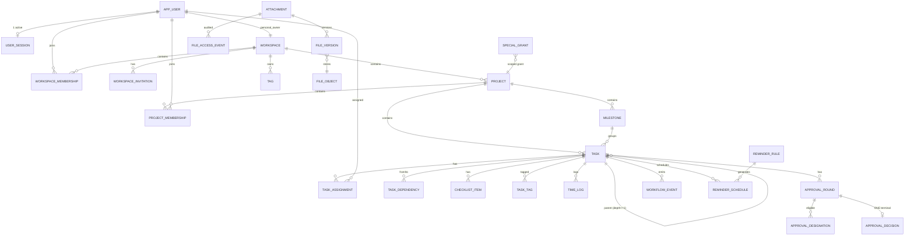

# 02A — ERD VẬT LÝ: QUY ƯỚC + MIỀN NGHIỆP VỤ LÕI

**Trạng thái:** ĐỀ XUẤT — **CHƯA FROZEN**, chưa được phép tạo database (đúng đặc tả mục 15: "Không nên tạo database trước khi hoàn tất các quyết định này").
**Phạm vi file này:** quy ước schema + Identity, Workspace, Project, Task, Workflow, Files, Calendar.
**File kèm:** `02B-DATA-MODEL-PLATFORM.md` (Collaboration, Notifications, Reports, AI, Jobs/Outbox, Audit, Admin + partition + migration).
**Phụ thuộc quyết định mở:** DEC-05 (subtask approval), DEC-15 (history), DEC-23 (time log), DEC-27 (race), DEC-30/31 (personal ws + giữ email), DEC-43 (UUIDv7/Flyway).


**Chú giải ký hiệu dùng trong các bảng:** `Y` = có / được phép / cơ chế giữ đầy đủ bất biến; `N` = không / không được phép / không thể dùng cơ chế đó; `!` = một phần (phần còn lại phải xử lý ở service layer hoặc đang chờ quyết định); `—` = không áp dụng.

---

## 1. Quy ước schema bắt buộc

| Quy ước | Quyết định đề xuất | Lý do |
|---|---|---|
| PK | `id uuid PRIMARY KEY` — **UUIDv7** | Không lộ số lượng/thứ tự kinh doanh (chống enumeration, hỗ trợ Nhóm 10 IDOR); v7 time-ordered nên B-tree index không bị phân mảnh như UUIDv4 |
| Tên bảng | snake_case, **số ít** (`task`, không phải `tasks`) | Nhất quán, dễ map JPA |
| Tên cột | snake_case | — |
| FK | `<bảng>_id`, `ON DELETE RESTRICT` mặc định | Không bao giờ cascade xoá vật lý — soft-delete là chuẩn |
| Enum | `text` + `CHECK (col IN (…))`, **không** dùng PostgreSQL `ENUM TYPE` | Đổi/thêm giá trị không cần `ALTER TYPE`; migration an toàn hơn; NFR-18 |
| Thời gian | `timestamptz` cho **mọi** cột thời điểm | Nhóm 06: "Deadline lưu instant chuẩn hoá" |
| Audit cột | `created_at`, `created_by`, `updated_at`, `updated_by` trên **mọi** bảng nghiệp vụ | Truy vết tối thiểu |
| Soft delete | `deleted_at timestamptz NULL`, `deleted_by uuid NULL`, `delete_group_id uuid NULL` | AUD-29: restore không hồi sinh mục bị xoá độc lập |
| Optimistic lock | `version bigint NOT NULL DEFAULT 0` trên entity có tranh chấp (task, project, workspace, approval_round, attachment, app_user) | Nhóm 05 + mục 20 "Race condition" |
| Tiền/số giờ | `time_log.minutes integer` (không dùng float) | Tránh sai số làm tròn báo cáo |
| Text lớn | `text`, giới hạn độ dài ở **application validation**, không phải DB | Đơn giản; DB check chỉ cho trường ngắn (title ≤ 300) |
| Chuẩn hoá tên | Cột `*_name_normalized` (`lower(btrim(...))`) + unique index trên cột đã chuẩn hoá | AUD-31 |
| Schema | 1 schema `app` ở V1; ranh giới module cưỡng chế bằng **DB role** (ENF-01) chứ không bằng schema riêng | Giảm chi phí migration; vẫn tách được khi cần |

**Base columns (mọi bảng nghiệp vụ đều có):**

```sql
id             uuid        PRIMARY KEY,
created_at     timestamptz NOT NULL DEFAULT now(),
created_by     uuid        NULL,     -- NULL chỉ với SYSTEM_RULE
updated_at     timestamptz NOT NULL DEFAULT now(),
updated_by     uuid        NULL,
deleted_at     timestamptz NULL,
deleted_by     uuid        NULL,
delete_group_id uuid       NULL,
version        bigint      NOT NULL DEFAULT 0
```

Bảng append-only (`audit_event`, `security_event`, `workflow_event`, `activity_event`, `approval_decision`, `file_access_event`, `outbox_event`) **không có** `updated_*`, `deleted_*`, `version`.

---

## 2. MOD-01 Identity & Access

### 2.1 `app_user`

| Cột | Kiểu | Ràng buộc |
|---|---|---|
| `id` | uuid | PK (UUIDv7) |
| `username` | text | NOT NULL, CHECK `~ '^[a-z0-9._-]{3,32}$'` |
| `username_normalized` | text | NOT NULL, **UNIQUE (toàn phần, kể cả đã soft-delete)** — AUD-31 |
| `email` | citext | NOT NULL |
| `email_normalized` | text | NOT NULL, **UNIQUE (toàn phần)** — AUD-31 |
| `password_hash` | text | NOT NULL (Argon2id; **không** log) |
| `password_changed_at` | timestamptz | NOT NULL |
| `must_change_password` | boolean | NOT NULL DEFAULT false — AUD-17 |
| `status` | text | NOT NULL, CHECK IN (`PENDING_APPROVAL`,`ACTIVE`,`REJECTED`,`SUSPENDED`,`DISABLED`,`DELETED`) — Nhóm 01 |
| `status_changed_at` / `status_changed_by` / `status_reason` | — | NOT NULL / NULL / text — audit chuyển trạng thái |
| `failed_login_count` | integer | NOT NULL DEFAULT 0 — AUD-32 |
| `locked_until` | timestamptz | NULL — AUD-32: lockout **không** đổi `status` |
| `is_system_admin` | boolean | NOT NULL DEFAULT false |
| `display_name`, `phone`, `job_title`, `bio`, `avatar_attachment_id` | — | Nhóm 01 "Hồ sơ gồm tên, username, email, avatar, điện thoại, chức danh, bio, timezone" |
| `timezone` | text | NOT NULL DEFAULT `'Asia/Ho_Chi_Minh'`, CHECK độ dài ≤ 64 (IANA) |
| `locale` | text | NOT NULL DEFAULT `'vi-VN'` |
| `last_login_at`, `last_login_session_id` | — | NULL |
| `protected_flag` | boolean | NOT NULL DEFAULT false — bảo vệ System Admin cuối cùng |

**Constraints / indexes:**

```sql
-- AUD-31: email/username đã dùng phải giữ dành riêng → UNIQUE TOÀN PHẦN (không có WHERE deleted_at IS NULL)
CREATE UNIQUE INDEX uq_app_user_username_norm ON app_user (username_normalized);
CREATE UNIQUE INDEX uq_app_user_email_norm    ON app_user (email_normalized);

-- Bảo vệ System Admin cuối cùng (Nhóm 01) — trigger, không thể bằng CHECK
CREATE TRIGGER trg_app_user_guard_last_admin BEFORE UPDATE OR DELETE ON app_user
  FOR EACH ROW EXECUTE FUNCTION guard_last_system_admin();

-- Index phục vụ policy layer
CREATE INDEX ix_app_user_status ON app_user (status) WHERE deleted_at IS NULL;
```

> **Ghi chú AUD-31:** dùng unique index **toàn phần** nghĩa là tài khoản soft-delete vẫn "chiếm" email. Đây là hành vi **đúng** theo Nhóm 01 ("không cấp lại"). Hệ quả: không thể đăng ký lại bằng email cũ — phải khôi phục tài khoản (chỉ System Admin).

### 2.2 `user_session` (một phiên duy nhất — Nhóm 01)

| Cột | Kiểu | Ràng buộc |
|---|---|---|
| `id` | uuid | PK |
| `user_id` | uuid | NOT NULL, FK → app_user, ON DELETE RESTRICT |
| `session_token_hash` | text | NOT NULL, UNIQUE — **chỉ lưu hash**, không lưu token |
| `status` | text | CHECK IN (`ACTIVE`,`REVOKED_LOGIN_ELSEWHERE`,`REVOKED_LOGOUT`,`REVOKED_ADMIN`,`REVOKED_PASSWORD_CHANGE`,`EXPIRED`) |
| `client_type` | text | CHECK IN (`WEB`,`ANDROID`,`IOS`,`CLI`) — AUD-19 |
| `device_label`, `user_agent`, `ip_address` | text | NULL |
| `created_at`, `last_seen_at`, `expires_at`, `revoked_at`, `revoked_reason` | timestamptz | — |
| `revoked_by_user_id` | uuid | NULL |

```sql
-- BẤT BIẾN "mỗi tài khoản chỉ một phiên hoạt động" — ép bằng DB, không chỉ bằng code
CREATE UNIQUE INDEX uq_user_session_single_active ON user_session (user_id) WHERE status = 'ACTIVE';
CREATE INDEX ix_user_session_expires ON user_session (expires_at) WHERE status = 'ACTIVE';
```

> Đây là một trong số ít bất biến **ép được hoàn toàn bằng constraint**: nếu code cố tạo phiên thứ hai, INSERT sẽ fail. Test 19.1 "Một account chỉ có một active session" có bằng chứng ở tầng DB.

### 2.3 `user_refresh_token`

`id`, `session_id` FK→user_session ON DELETE CASCADE, `token_hash` UNIQUE, `rotated_from_id` NULL, `expires_at`, `revoked_at`, `created_at`. Index trên `session_id`. Refresh token **luôn** gắn session → khi session revoke thì refresh vô hiệu (Nhóm 01).

### 2.4 `account_recovery_code` (AUD-17)

`id`, `user_id` FK, `code_hash` NOT NULL, `code_index` smallint NOT NULL (1..8), `expires_at` NULL, `used_at` NULL, `used_by_session_id` NULL, `revoked_at` NULL, `created_at`, `created_by`.
`UNIQUE (user_id, code_index)`; CHECK `code_index BETWEEN 1 AND 8`.

### 2.5 `password_reset_ticket` (AUD-17: mật khẩu tạm 24h)

`id`, `user_id`, `temp_password_hash`, `ticket_type` CHECK IN (`ADMIN_ISSUED_TEMP_PASSWORD`,`SELF_SERVICE_RESET`), `expires_at` NOT NULL (**24h** với ADMIN_ISSUED), `consumed_at`, `consumed_by_session_id`, `created_by`, `created_at`.

### 2.6 `reauth_ticket` (AUD-34)

`id`, `user_id`, `session_id`, `action_code` text NOT NULL, `target_type` text NULL, `target_id` uuid NULL, `token_hash` NOT NULL UNIQUE, `expires_at` NOT NULL (5 phút), `consumed_at`, `created_at`, `ip_address`.
`UNIQUE` một phần để chống spam: `CREATE UNIQUE INDEX uq_reauth_open ON reauth_ticket (user_id, action_code, target_id) WHERE consumed_at IS NULL AND expires_at > now();`

### 2.7 `global_permission_grant` (AUD-33)

`id`, `user_id`, `permission_code` text NOT NULL CHECK IN (`ACCOUNT_APPROVE_GLOBAL`, `AUDIT_READ_SYSTEM`, `PROJECT_CONTENT_READ_GLOBAL`, `SYSTEM_CONFIG_MANAGE`, `OLLAMA_CONFIG_MANAGE`, `RETENTION_MANAGE`), `granted_by`, `granted_at`, `expires_at` NULL, `revoked_at` NULL, `revoked_by` NULL, `reason` text NOT NULL, `reauth_ticket_id` FK NULL.
`CREATE UNIQUE INDEX uq_grant_active ON global_permission_grant (user_id, permission_code) WHERE revoked_at IS NULL;`
CHECK `(revoked_at IS NULL) OR (revoked_by IS NOT NULL AND reason IS NOT NULL)`.

### 2.8 `user_email_history` (AUD-31)

`id`, `user_id`, `email_normalized` NOT NULL, `active_from`, `active_to`. `UNIQUE (email_normalized)` — email cũ **vẫn** bị giữ dành riêng.

### 2.9 `user_profile_preference`

Bảng này đã có trong danh mục 65 bảng (`02B §11`, dòng 9) và trong danh sách bảng MOD-01 sở hữu (`01 §6`), nhưng **chưa** có định nghĩa cột ở bản draft trước — đây là lỗ hổng được phát hiện khi rà soát chéo. Định nghĩa bổ sung như sau, bám Nhóm 01 (hồ sơ có `timezone`) và Nhóm 06 (reminder cấu hình theo user, quiet hours theo timezone user, mute theo loại).

| Cột | Kiểu | Ràng buộc |
|---|---|---|
| `user_id` | uuid | **PK**, FK → `app_user` ON DELETE CASCADE (1-1 với tài khoản) |
| `timezone` | text | NOT NULL, DEFAULT từ `system_setting`; CHECK độ dài 1..64, phải là IANA zone hợp lệ (validate ở service layer, DB không kiểm tra được danh sách zone) |
| `locale` | text | NOT NULL DEFAULT `'vi-VN'`; CHECK IN (`vi-VN`,`en-US`) — **chờ DEC-44** nếu chọn song ngữ |
| `first_day_of_week` | smallint | NOT NULL DEFAULT 1; CHECK IN (0..6), 0 = Chủ nhật |
| `default_reminder_offsets` | jsonb | NOT NULL DEFAULT `'[{"minutes":1440},{"minutes":60}]'` — Nhóm 06: mặc định trước deadline 1 ngày và 1 giờ; CHECK là mảng ≤5 phần tử, mỗi phần tử `minutes` 0..10080 |
| `quiet_hours_enabled` | boolean | NOT NULL DEFAULT false |
| `quiet_hours_start` | time | NULL — giờ **địa phương** theo `timezone` |
| `quiet_hours_end` | time | NULL |
| `overdue_reminder_interval_hours` | smallint | NOT NULL DEFAULT 24; CHECK 1..168 (Nhóm 06: "sau đó theo cấu hình") |
| `calendar_default_view` | text | NOT NULL DEFAULT `'WEEK'`; CHECK IN (`DAY`,`WEEK`,`MONTH`,`LIST`) |
| `digest_enabled` | boolean | NOT NULL DEFAULT true |
| `updated_at`, `updated_by` | — | NOT NULL |

```sql
-- Quiet hours chỉ có nghĩa khi cả hai đầu mút được đặt
ALTER TABLE user_profile_preference ADD CONSTRAINT ck_quiet_hours_pair
  CHECK ( quiet_hours_enabled = false
          OR (quiet_hours_start IS NOT NULL AND quiet_hours_end IS NOT NULL) );

-- CHECK jsonb shape mức tối thiểu (độ sâu/cấu trúc đầy đủ validate ở service layer)
ALTER TABLE user_profile_preference ADD CONSTRAINT ck_reminder_offsets_array
  CHECK ( jsonb_typeof(default_reminder_offsets) = 'array'
          AND jsonb_array_length(default_reminder_offsets) <= 5 );
```

**Quy tắc timezone (Nhóm 06 — FROZEN, không có AUD riêng):** `timezone` ở bảng này **chỉ** dùng để hiển thị và tính quiet hours. Đổi `timezone` **không** được tự đổi `instant` đã lưu của deadline (`task.due_at` là `timestamptz`, đi kèm `task.due_timezone` lưu múi giờ gốc, `task.due_date_only` và `task.due_is_date_only` — xem §5.1). Không có trigger nào tự viết lại deadline khi đổi timezone; xử lý DST theo đúng Nhóm 06.

**Ranh giới với `notification_preference` (02B §2.2):** bảng này giữ tuỳ chọn **cá nhân theo hồ sơ** (múi giờ, ngôn ngữ, quiet hours, offset mặc định, chế độ lịch). Mute **theo loại thông báo** và kênh (in-app/push/email) nằm ở `notification_preference`. Không được trùng lặp dữ liệu giữa hai bảng.

---

## 3. MOD-02 Workspace

### 3.1 `workspace`

| Cột | Kiểu | Ràng buộc |
|---|---|---|
| `id` | uuid | PK |
| `type` | text | NOT NULL, CHECK IN (`PERSONAL`,`TEAM`) — **không thể UPDATE** (AUD-30) |
| `personal_owner_user_id` | uuid | NULL, FK → app_user |
| `name` | text | NOT NULL, CHECK length 1..120 |
| `slug` | text | NOT NULL |
| `status` | text | NOT NULL, CHECK IN (`ACTIVE`,`ARCHIVED`,`DELETED`) |
| `archived_at`, `archived_by`, `archive_reason` | — | NULL |
| `owner_user_id` | uuid | NULL — **chỉ** cho TEAM (redundant có chủ đích để query nhanh, được bảo vệ bằng trigger đồng bộ với `workspace_membership`) |

```sql
-- AUD-30: đúng 1 Personal Workspace mỗi user; Personal ⇔ personal_owner_user_id NOT NULL
ALTER TABLE workspace ADD CONSTRAINT ck_workspace_personal_consistency
  CHECK ( (type = 'PERSONAL') = (personal_owner_user_id IS NOT NULL) );

CREATE UNIQUE INDEX uq_workspace_personal_owner
  ON workspace (personal_owner_user_id) WHERE type = 'PERSONAL' AND deleted_at IS NULL;

CREATE UNIQUE INDEX uq_workspace_slug ON workspace (lower(slug)) WHERE deleted_at IS NULL;

-- AUD-30: chống "Personal thành Team bằng đường vòng"
CREATE TRIGGER trg_workspace_type_immutable BEFORE UPDATE OF type ON workspace
  FOR EACH ROW WHEN (OLD.type IS DISTINCT FROM NEW.type)
  EXECUTE FUNCTION raise_immutable_column('workspace.type');

-- Personal Workspace không có slug trùng Team; status DELETED chỉ soft
CREATE INDEX ix_workspace_status ON workspace (status) WHERE deleted_at IS NULL;
```

### 3.2 `workspace_membership`

| Cột | Kiểu | Ràng buộc |
|---|---|---|
| `id` | uuid | PK |
| `workspace_id` | uuid | NOT NULL FK |
| `user_id` | uuid | NOT NULL FK |
| `role` | text | NOT NULL, CHECK IN (`OWNER`,`ADMIN`,`MEMBER`,`GUEST`) — Nhóm 02 |
| `status` | text | NOT NULL, CHECK IN (`PENDING_ACTIVATION`,`ACTIVE`,`REMOVED`,`LEFT`) |
| `joined_at`, `left_at`, `left_reason` | — | — |
| `left_via` | text | CHECK IN (`SELF_LEAVE`,`REMOVED_BY_OWNER`,`REMOVED_BY_ADMIN`,`ACCOUNT_DELETED`,`OWNER_TRANSFERRED`) |

```sql
-- BẤT BIẾN "Team Workspace đúng một Owner" (AUD-28) — ép bằng DB
CREATE UNIQUE INDEX uq_wsm_single_owner
  ON workspace_membership (workspace_id)
  WHERE role = 'OWNER' AND status = 'ACTIVE' AND deleted_at IS NULL;

-- Một user chỉ một membership đang hoạt động mỗi workspace
CREATE UNIQUE INDEX uq_wsm_active_member
  ON workspace_membership (workspace_id, user_id)
  WHERE status IN ('ACTIVE','PENDING_ACTIVATION') AND deleted_at IS NULL;

-- Personal Workspace KHÔNG có membership của người khác (bất biến Nhóm 02)
CREATE TRIGGER trg_wsm_personal_only_owner BEFORE INSERT OR UPDATE ON workspace_membership
  FOR EACH ROW EXECUTE FUNCTION guard_personal_workspace_membership();
```

### 3.3 `workspace_invitation` (AUD-11)

| Cột | Kiểu | Ràng buộc |
|---|---|---|
| `id` | uuid | PK |
| `workspace_id` | uuid | NOT NULL FK |
| `invitee_email_normalized` | text | NOT NULL — "gắn email cụ thể" |
| `target_role` | text | NOT NULL CHECK IN (`ADMIN`,`MEMBER`,`GUEST`) |
| `status` | text | NOT NULL CHECK IN (`PENDING_ACCEPT`,`REDEEMED`,`EXPIRED`,`REVOKED`,`PENDING_ACCOUNT_APPROVAL`) |
| `invited_by` | uuid | NOT NULL FK |
| `token_hash` | text | NOT NULL UNIQUE |
| `expires_at` | timestamptz | NOT NULL — "có hạn" |
| `redeemed_at`, `redeemed_by_user_id` | — | NULL — "dùng một lần" |
| `created_membership_id` | uuid | NULL FK → workspace_membership |

```sql
CREATE UNIQUE INDEX uq_winv_open_email
  ON workspace_invitation (workspace_id, invitee_email_normalized)
  WHERE status IN ('PENDING_ACCEPT','PENDING_ACCOUNT_APPROVAL');

-- Quy tắc mời (Nhóm 02): Owner/Admin mời ADMIN/MEMBER/GUEST; Member chỉ MEMBER/GUEST
ALTER TABLE workspace_invitation ADD CONSTRAINT ck_winv_role_matrix
  CHECK (target_role IN ('ADMIN','MEMBER','GUEST'));   -- matrix đầy đủ xét ở policy layer + test
```

### 3.4 `workspace_setting`

`workspace_id` PK FK, `allow_member_create_project boolean NOT NULL DEFAULT false`, `default_reminder_offsets_minutes int[] NOT NULL DEFAULT '{1440,60}'`, `reminder_paused boolean NOT NULL DEFAULT false`, `paused_reason text`, `paused_at timestamptz`. (Nhóm 02: "Member tạo khi cấu hình cho phép"; Nhóm 06: pause reminders.)

---

## 4. MOD-03 Project

### 4.1 `project`

| Cột | Kiểu | Ràng buộc |
|---|---|---|
| `id` | uuid | PK |
| `workspace_id` | uuid | NOT NULL FK |
| `name` | text | NOT NULL, CHECK length 1..160 |
| `description` | text | NULL |
| `status` | text | NOT NULL CHECK IN (`PLANNING`,`ACTIVE`,`ON_HOLD`,`COMPLETED`,`ARCHIVED`,`DELETED`) — Nhóm 03 |
| `previous_status` | text | NULL — phục vụ unarchive/restore "tuân trạng thái trước đó" (Nhóm 03) |
| `approval_enabled` | boolean | NOT NULL DEFAULT false — Nhóm 03 "Nghiệm thu bật/tắt theo Project" |
| `approval_enabled_changed_at/by/reason` | — | audit; tắt giữa chừng phải xử lý hết pending |
| `allow_member_create_task` | boolean | NOT NULL DEFAULT false — Nhóm 03 "Quyền tạo Task: … Member nếu cấu hình Project cho phép" |
| `completed_at`, `completed_by`, `completed_cascade_audit_id` | — | AUD-01: link tới audit event cascade |
| `archived_at`, `archived_by` | — | — |
| `created_by` | uuid | NOT NULL — "Người tạo mặc định là Manager" |

```sql
CREATE INDEX ix_project_workspace_status ON project (workspace_id, status) WHERE deleted_at IS NULL;
CREATE UNIQUE INDEX uq_project_name_in_ws ON project (workspace_id, lower(name)) WHERE deleted_at IS NULL;

-- BẤT BIẾN "≥1 Manager ACTIVE" KHÔNG THỂ ép bằng constraint (xem mục 9) → transaction + trigger kiểm tra DEFERRABLE
CREATE CONSTRAINT TRIGGER trg_project_has_manager AFTER UPDATE OF status ON project
  DEFERRABLE INITIALLY DEFERRED FOR EACH ROW EXECUTE FUNCTION guard_project_has_active_manager();
```

### 4.2 `project_membership`

| Cột | Kiểu | Ràng buộc |
|---|---|---|
| `id` | uuid | PK |
| `project_id` | uuid | NOT NULL FK |
| `user_id` | uuid | NOT NULL FK |
| `role` | text | NOT NULL CHECK IN (`MANAGER`,`MEMBER`,`GUEST`) |
| `status` | text | NOT NULL CHECK IN (`PENDING_ACTIVATION`,`ACTIVE`,`REMOVED`) |
| `added_by`, `added_at`, `removed_at`, `removed_by`, `removal_reason` | — | — |
| `is_creator` | boolean | NOT NULL DEFAULT false |

```sql
CREATE UNIQUE INDEX uq_psm_active ON project_membership (project_id, user_id)
  WHERE status IN ('ACTIVE','PENDING_ACTIVATION') AND deleted_at IS NULL;

-- AUD-04: Workspace Guest chỉ được làm Project Guest; AUD-50: Manager phải thuộc Workspace ACTIVE
CREATE TRIGGER trg_psm_role_consistency BEFORE INSERT OR UPDATE ON project_membership
  FOR EACH ROW EXECUTE FUNCTION guard_project_role_vs_workspace_role();
```

Hàm `guard_project_role_vs_workspace_role()` thực hiện: tra `workspace_membership` của `(project.workspace_id, NEW.user_id)`; nếu không tồn tại hoặc `status <> 'ACTIVE'` → RAISE; nếu `role = 'GUEST'` ở Workspace và `NEW.role <> 'GUEST'` → RAISE `guest_cannot_have_write_role`.

### 4.3 `milestone` (AUD-21)

`id`, `project_id` FK NOT NULL, `name` NOT NULL, `description`, `status` CHECK IN (`OPEN`,`COMPLETED`,`CANCELLED`) DEFAULT `OPEN`, `due_at timestamptz NULL`, `due_timezone text NULL`, `completed_at`, `completed_by`, `cancelled_at`, `cancelled_by`, `cancel_reason`, `sort_order int`.
Index: `(project_id, status) WHERE deleted_at IS NULL`.

### 4.4 `special_grant` (AUD-50 — "quyền đặc biệt được cấp rõ ràng")

`id`, `scope_type` CHECK IN (`PROJECT`,`WORKSPACE`), `scope_id` uuid, `grantee_user_id` FK, `permission_code` CHECK IN (`PROJECT_CONTENT_READ`,`WORKSPACE_CONTENT_READ`,`AUDIT_READ_SCOPE`), `granted_by` NOT NULL, `reauth_ticket_id` NOT NULL FK, `reason` NOT NULL, `granted_at`, `expires_at`, `revoked_at`, `revoked_by`.
`CREATE UNIQUE INDEX uq_special_grant_active ON special_grant (scope_type, scope_id, grantee_user_id, permission_code) WHERE revoked_at IS NULL;`
CHECK `(revoked_at IS NULL) OR (revoked_by IS NOT NULL)`.

### 4.5 `project_setting`

`project_id` PK FK, `approval_sla_hours int NULL` (AUD-08: **chỉ** dùng cho notify/escalation), `reminder_offsets_minutes int[] NULL`, `default_task_priority text NULL`, `timelog_edit_window_days int NOT NULL DEFAULT 7` (AUD-23).

---

## 5. MOD-04 Task

### 5.1 `task`

| Cột | Kiểu | Ràng buộc |
|---|---|---|
| `id` | uuid | PK |
| `project_id` | uuid | NOT NULL FK |
| `parent_task_id` | uuid | NULL, FK → task(id) ON DELETE RESTRICT |
| `depth` | smallint | NOT NULL DEFAULT 0, **CHECK `depth IN (0,1)`** — bất biến "Subtask tối đa một cấp" |
| `title` | text | NOT NULL, CHECK length 1..300 |
| `description` | text | NULL |
| `state` | text | NOT NULL CHECK IN (`TODO`,`IN_PROGRESS`,`PENDING_APPROVAL`,`COMPLETED`,`CANCELLED`) — Nhóm 04 |
| `blocked_flag` | boolean | NOT NULL DEFAULT false — Nhóm 04: "`BLOCKED` là cờ độc lập" |
| `blocked_reason` | text | NULL, CHECK `(blocked_flag) OR (blocked_reason IS NULL)` |
| `priority` | text | NOT NULL DEFAULT `'MEDIUM'` CHECK IN (`LOW`,`MEDIUM`,`HIGH`,`URGENT`) |
| `start_at` | timestamptz | NULL — Nhóm 06: "Start date … tùy chọn" |
| `start_date_only` | date | NULL |
| `due_at` | timestamptz | NULL — instant chuẩn hoá |
| `due_date_only` | date | NULL — Nhóm 06: "Task không có cả hai nằm trong danh sách chưa xếp lịch" |
| `due_timezone` | text | NULL — Nhóm 06: "lưu cả instant và timezone gốc" |
| `due_is_date_only` | boolean | NOT NULL DEFAULT false — Nhóm 06: 23:59:59 tz người đặt |
| `milestone_id` | uuid | NULL FK → milestone ON DELETE SET NULL — Nhóm 03: "xóa Milestone chỉ bỏ liên kết Task" |
| `created_by` | uuid | NOT NULL |
| `completed_at`, `completed_by`, `cancelled_at`, `cancelled_by`, `cancel_reason` | — | — |
| `search_text` | text | generated/normalized cho tìm kiếm (AUD-26) |
| `search_tsv` | tsvector | generated `to_tsvector('simple', search_text)` |

```sql
-- Bất biến Subtask một cấp (2 lớp bảo vệ)
ALTER TABLE task ADD CONSTRAINT ck_task_depth CHECK (depth IN (0,1));
CREATE TRIGGER trg_task_depth_consistency BEFORE INSERT OR UPDATE OF parent_task_id, depth ON task
  FOR EACH ROW EXECUTE FUNCTION guard_subtask_single_level();

-- Không cho subtask có milestone riêng / dependency (AUD-09, DEC-09)
ALTER TABLE task ADD CONSTRAINT ck_task_subtask_no_milestone
  CHECK (NOT (depth = 1 AND milestone_id IS NOT NULL));

-- Một task trong một project duy nhất; subtask phải cùng project với parent
CREATE TRIGGER trg_task_same_project_as_parent BEFORE INSERT OR UPDATE OF parent_task_id ON task
  FOR EACH ROW EXECUTE FUNCTION guard_subtask_same_project();

CREATE INDEX ix_task_project_state ON task (project_id, state) WHERE deleted_at IS NULL;
CREATE INDEX ix_task_project_depth_state ON task (project_id, depth, state) WHERE deleted_at IS NULL;  -- progress chỉ đếm top-level
CREATE INDEX ix_task_parent ON task (parent_task_id) WHERE parent_task_id IS NOT NULL AND deleted_at IS NULL;
CREATE INDEX ix_task_due ON task (due_at) WHERE due_at IS NOT NULL AND deleted_at IS NULL
        AND state NOT IN ('COMPLETED','CANCELLED');   -- overdue scan
CREATE INDEX ix_task_search_tsv ON task USING gin (search_tsv);
CREATE INDEX ix_task_search_trgm ON task USING gin (title gin_trgm_ops);   -- AUD-26
CREATE INDEX ix_task_restore_group ON task (delete_group_id) WHERE delete_group_id IS NOT NULL;  -- AUD-29
```

### 5.2 `task_assignment`

`id`, `task_id` NOT NULL FK ON DELETE RESTRICT, `user_id` NOT NULL FK, `status` CHECK IN (`ACTIVE`,`REMOVED`,`COMPLETED_CONFIRMED`) DEFAULT `ACTIVE`, `assigned_by`, `assigned_at`, `removed_at`, `removed_by`, `removal_reason`, `confirmed_at`.

```sql
CREATE UNIQUE INDEX uq_assignment_active ON task_assignment (task_id, user_id)
  WHERE status = 'ACTIVE' AND deleted_at IS NULL;

-- Nhóm 02: "gỡ assignment của Task chưa hoàn tất" khi thành viên rời → status REMOVED, giữ lịch sử
CREATE INDEX ix_assignment_user ON task_assignment (user_id, status) WHERE deleted_at IS NULL;
```

> **Task 0..n assignee** (Nhóm 04): không có unique constraint nào buộc ≥1. Task không assignee là hợp lệ.

### 5.3 `task_dependency` (AUD-09)

`id`, `task_id` NOT NULL FK, `depends_on_task_id` NOT NULL FK, `dependency_type` CHECK IN (`RELATED_BLOCKS`) DEFAULT `RELATED_BLOCKS`, `created_by`, `created_at`,
CHECK `task_id <> depends_on_task_id`,
`UNIQUE (task_id, depends_on_task_id)`.
Trigger `guard_dependency_same_project()` — chỉ trong cùng Project (DEC-09).
Trigger `guard_dependency_acyclic()` — dùng `WITH RECURSIVE` dò chu trình **trong transaction**, RAISE `dependency_cycle_detected` (hard-block).

### 5.4 `checklist_item`

`id`, `task_id` NOT NULL FK, `title` NOT NULL CHECK length 1..200, `position int NOT NULL`, `checked boolean NOT NULL DEFAULT false`, `checked_at`, `checked_by`, `assignee_user_id` NULL FK.
`UNIQUE (task_id, position) WHERE deleted_at IS NULL`.

### 5.5 `tag` / `task_tag` (AUD-22)

`tag`: `id`, `workspace_id` NOT NULL FK, `name` NOT NULL, `name_normalized` NOT NULL, `color char(7)`, `created_by`.
`UNIQUE (workspace_id, name_normalized) WHERE deleted_at IS NULL`.
`task_tag`: `task_id`, `tag_id`, `created_by`, `created_at`; PK `(task_id, tag_id)`.

### 5.6 `time_log` (AUD-23)

| Cột | Ràng buộc |
|---|---|
| `id`, `task_id` NOT NULL FK | — |
| `user_id` NOT NULL FK | **luôn = actor**, không nhận từ request body |
| `minutes` integer NOT NULL | CHECK `minutes > 0 AND minutes <= 1440` |
| `work_date` date NOT NULL | CHECK `work_date <= CURRENT_DATE` (không log tương lai) |
| `note` text NULL | — |
| `locked_at` timestamptz NULL | khoá sổ khi snapshot đã đóng |
| `created_by`, `created_at`, `updated_at`, `updated_by`, soft-delete | — |

```sql
CREATE INDEX ix_timelog_task_user ON time_log (task_id, user_id) WHERE deleted_at IS NULL;
CREATE INDEX ix_timelog_workdate ON time_log (work_date) WHERE deleted_at IS NULL;
-- Trigger chặn sửa/xoá ngoài cửa sổ cho phép (project_setting.timelog_edit_window_days)
CREATE TRIGGER trg_timelog_edit_window BEFORE UPDATE OR DELETE ON time_log
  FOR EACH ROW EXECUTE FUNCTION guard_timelog_edit_window();
```

---

## 6. MOD-05 Workflow

### 6.1 `approval_round`

| Cột | Kiểu | Ràng buộc |
|---|---|---|
| `id` | uuid | PK |
| `task_id` | uuid | NOT NULL FK |
| `round_no` | smallint | NOT NULL, ≥1 — "nhiều vòng nghiệm thu", "nhiều vòng tính riêng" (Nhóm 08) |
| `status` | text | NOT NULL CHECK IN (`OPEN`,`APPROVED`,`REJECTED`,`CANCELLED`) |
| `round_outcome` | text | NULL CHECK IN (`APPROVED`,`REJECTED`,`CANCELLED`) — AUD-01 |
| `submitted_at` | timestamptz | NOT NULL |
| `submitted_by` | uuid | NOT NULL — **người submit**, dùng cho cấm tự duyệt (Nhóm 05) |
| `decided_at`, `decided_by` | — | NULL |
| `sla_breached` | boolean | NOT NULL DEFAULT false — AUD-08: **cờ tính toán**, không phải quyết định |
| `sla_due_at` | timestamptz | NULL |
| `cancelled_reason_code` | text | NULL CHECK IN (`PROJECT_COMPLETED_CASCADE`,`TASK_CANCELLED`,`APPROVAL_DISABLED`) |
| `closed_by_audit_event_id` | uuid | NULL — AUD-01 traceability |

```sql
-- Chỉ một round OPEN mỗi task
CREATE UNIQUE INDEX uq_round_open ON approval_round (task_id) WHERE status = 'OPEN';
-- round_no tăng đơn điệu, round cũ bất biến
CREATE UNIQUE INDEX uq_round_no ON approval_round (task_id, round_no);
-- Round đã đóng KHÔNG được sửa (trừ cột sla_breached) — trigger
CREATE TRIGGER trg_round_immutable_when_closed BEFORE UPDATE ON approval_round
  FOR EACH ROW WHEN (OLD.status <> 'OPEN')
  EXECUTE FUNCTION guard_closed_round_immutable();
```

### 6.2 `approval_designation` (AUD-07)

`id`, `round_id` NOT NULL FK, `user_id` NOT NULL FK, `designation_type` CHECK IN (`DEFAULT_MANAGER`,`DESIGNATED`), `designated_by` NULL, `designated_at`, `revoked_at`, `revoked_reason` CHECK IN (`LOST_MEMBERSHIP`,`LOST_PROJECT_ROLE`,`ACCOUNT_NOT_ACTIVE`,`MANAGER_REASSIGNED`,`ROUND_CLOSED`), `revoked_by`.
`CREATE UNIQUE INDEX uq_designation_active ON approval_designation (round_id, user_id) WHERE revoked_at IS NULL;`

> Nhóm 05: "Approver mất quyền bị thu hồi tức thời" → `revoked_at` được set **trong cùng transaction** với việc thu hồi membership/role (qua outbox event hoặc direct contract call). Nếu không còn designation ACTIVE → round vẫn OPEN, phát cảnh báo Manager, **không auto-approve**.

### 6.3 `approval_decision` — **append-only**

| Cột | Ràng buộc |
|---|---|
| `id`, `round_id` NOT NULL FK, `task_id` NOT NULL | — |
| `decided_by` uuid NOT NULL | — |
| `decision_outcome` text NOT NULL CHECK IN (`APPROVED`,`REJECTED`,`CANCELLED`) | **AUD-01:** `CANCELLED` là *kết quả huỷ vòng*, không phải approve/reject giả mạo |
| `reason` text NULL | CHECK bắt buộc có reason khi `REJECTED` (Nhóm 05) |
| `decided_at` timestamptz NOT NULL | — |
| `actor_type` text NOT NULL CHECK IN (`USER`,`SYSTEM_RULE`) | AUD-01 |
| `correlation_id`, `audit_event_id` | — |

```sql
-- AUD-27: BẤT BIẾN "chỉ một kết quả terminal mỗi round" — ÉP BẰNG DB
CREATE UNIQUE INDEX uq_decision_single_terminal ON approval_decision (round_id);

ALTER TABLE approval_decision ADD CONSTRAINT ck_decision_reject_reason
  CHECK (decision_outcome <> 'REJECTED' OR (reason IS NOT NULL AND length(btrim(reason)) >= 3));

-- Cấm tự duyệt (Nhóm 05): assignee hoặc submitter — trigger đọc 2 bảng
CREATE TRIGGER trg_decision_no_self_approval BEFORE INSERT ON approval_decision
  FOR EACH ROW EXECUTE FUNCTION guard_no_self_approval();
```

`guard_no_self_approval()`:
1. Lấy `approval_round.submitted_by` → nếu `= NEW.decided_by` → RAISE `self_approval_forbidden_submitter`.
2. Tồn tại `task_assignment(task_id=NEW.task_id, user_id=NEW.decided_by, status='ACTIVE', deleted_at IS NULL)` → RAISE `self_approval_forbidden_assignee`.
3. Không tồn tại `approval_designation(round_id, user_id, revoked_at IS NULL)` → RAISE `not_eligible_approver`.
4. `approval_round.status <> 'OPEN'` → RAISE `round_not_open`.
5. **Không** kiểm tra `created_by` của Task — đúng Nhóm 05: "riêng creator không bị cấm chỉ vì là creator".

### 6.4 `workflow_event` — **append-only** (AUD-15: nguồn chân lý lịch sử)

| Cột | Ghi chú |
|---|---|
| `id` uuid PK | — |
| `task_id`, `project_id`, `workspace_id` | denormalize để query lịch sử theo scope không cần join |
| `event_type` | CHECK IN (`TASK_CREATED`,`TASK_STARTED`,`TASK_SUBMITTED`,`TASK_APPROVED`,`TASK_REJECTED`,`TASK_CANCELLED`,`TASK_REOPENED`,`TASK_STATE_CHANGED`,`ASSIGNMENT_ADDED`,`ASSIGNMENT_REMOVED`,`DEADLINE_CHANGED`,`PRIORITY_CHANGED`,`BLOCKED_SET`,`BLOCKED_CLEARED`,`ROUND_OPENED`,`ROUND_CLOSED`,`APPROVER_DESIGNATED`,`APPROVER_REVOKED`,`SLA_BREACHED`,`PROJECT_COMPLETED_CASCADE`) |
| `from_state`, `to_state` | text NULL |
| `round_id`, `round_no` | NULL |
| `actor_type` | CHECK IN (`USER`,`SYSTEM_RULE`) |
| `actor_user_id` | NULL khi SYSTEM_RULE |
| `occurred_at` | timestamptz NOT NULL — **thời điểm nghiệp vụ**, không phải thời điểm ghi |
| `reason` | NULL |
| `payload` | jsonb — before/after tối thiểu |
| `correlation_id`, `audit_event_id` | — |

```sql
CREATE INDEX ix_wf_event_task_time ON workflow_event (task_id, occurred_at DESC);
CREATE INDEX ix_wf_event_project_time ON workflow_event (project_id, occurred_at DESC);
CREATE INDEX ix_wf_event_type_time ON workflow_event (event_type, occurred_at DESC);
-- Không có UPDATE/DELETE grant cho role application (AUD-14)
```

---

## 7. MOD-07 Files

### 7.1 `attachment` (đa đối tượng — AUD/mục 22.1 "cách mô hình hóa attachment đa loại đối tượng")

| Cột | Ràng buộc |
|---|---|
| `id` uuid PK | — |
| `target_type` text NOT NULL | CHECK IN (`TASK`,`SUBTASK`,`PROJECT`,`COMMENT`,`MILESTONE`,`AVATAR`,`REPORT_EXPORT`) |
| `target_id` uuid NOT NULL | — |
| `workspace_id` uuid NOT NULL, `project_id` uuid NULL | **denormalize bắt buộc** để policy layer lọc scope trong 1 query và để redact khi mất quyền |
| `display_name` text NOT NULL | — |
| `content_type` text NOT NULL | CHECK theo allowlist cấu hình (Nhóm 09) |
| `current_version_id` uuid NULL | FK → file_version |
| `status` text NOT NULL | CHECK IN (`STAGING`,`SCANNING`,`AVAILABLE`,`QUARANTINED`,`BLOCKED`,`DELETED`) — Nhóm 09 "loại nguy hiểm chặn hoặc cách ly" |
| `uploaded_by`, `uploaded_at` | NOT NULL |
| `size_bytes` bigint NOT NULL | CHECK > 0 |

```sql
-- Chọn phương án "polymorphic + denormalized scope" thay vì FK riêng cho từng loại:
--   ưu: 1 bảng, policy layer đồng nhất, index scope nhanh
--   nhược: không có FK thật tới target → phải bù bằng trigger kiểm tra tồn tại + job reconciliation
CREATE INDEX ix_attachment_target ON attachment (target_type, target_id) WHERE deleted_at IS NULL;
CREATE INDEX ix_attachment_project ON attachment (project_id) WHERE deleted_at IS NULL;
CREATE INDEX ix_attachment_ws ON attachment (workspace_id) WHERE deleted_at IS NULL;
CREATE TRIGGER trg_attachment_target_exists BEFORE INSERT ON attachment
  FOR EACH ROW EXECUTE FUNCTION guard_attachment_target_exists();
```

### 7.2 `file_version` / `file_object`

`file_version`: `id`, `attachment_id` NOT NULL FK, `version_no int NOT NULL` ≥1, `file_object_id` NOT NULL FK, `change_note text`, `created_by`, `created_at`.
`UNIQUE (attachment_id, version_no)`; trigger `guard_version_no_monotonic()` → **không ghi đè** (Nhóm 09: "khôi phục phiên bản cũ bằng cách tạo phiên bản mới").

`file_object`: `id`, `bucket text NOT NULL`, `object_key text NOT NULL UNIQUE` (**immutable**), `size_bytes bigint NOT NULL`, `sha256 char(64) NOT NULL`, `content_type text`, `storage_class text`, `status text CHECK IN ('STAGING','COMMITTED','ORPHANED','PURGED')`, `scan_status text CHECK IN ('PENDING','CLEAN','INFECTED','UNSUPPORTED','ERROR')`, `scan_detail jsonb`, `uploaded_at`, `committed_at`, `purged_at`.
`CREATE INDEX ix_file_object_orphan ON file_object (status) WHERE status IN ('STAGING','ORPHANED');` → phục vụ reconciliation DB↔Object Storage (mục 20 "DB và Object Storage lệch nhau — Cao").

### 7.3 `file_access_event` — **append-only**

`id`, `attachment_id`, `file_version_id`, `user_id`, `session_id`, `access_type` CHECK IN (`PREVIEW`,`DOWNLOAD`,`AI_READ`,`RESTORE`), `decision` CHECK IN (`ALLOWED`,`DENIED_NOT_FOUND`,`DENIED_FORBIDDEN`,`DENIED_STATE_LOCKED`,`DENIED_REVOKED`), `reason_code`, `ip_address`, `user_agent`, `occurred_at`, `correlation_id`.
Index: `(attachment_id, occurred_at DESC)`, `(user_id, occurred_at DESC)`.
→ Bằng chứng kiểm thử cho Nhóm 09 "mỗi lượt preview/download kiểm tra quyền tại request" và test 19.2.

### 7.4 `upload_session`

`id`, `attachment_id`, `staging_object_key`, `status` CHECK IN (`INITIATED`,`UPLOADING`,`SCAN_PENDING`,`COMMITTED`,`FAILED`,`CLEANED_UP`), `client_filename`, `declared_size`, `declared_content_type`, `detected_content_type`, `expires_at`, `error_detail`, `created_by`, `created_at`, `completed_at`.
→ Nhóm 14.4: "lỗi phải có cleanup và trạng thái phục hồi".

---

## 8. MOD-08 Calendar

### 8.1 `reminder_rule`

`id`, `scope_type` CHECK IN (`USER_DEFAULT`,`WORKSPACE`,`PROJECT`,`TASK`,`MILESTONE`), `scope_id`, `owner_user_id` NULL, `event_type` CHECK IN (`DEADLINE`,`START_DATE`,`APPROVAL_PENDING`,`OVERDUE`), `offset_minutes int NOT NULL`, `channels text[] NOT NULL DEFAULT '{IN_APP}'`, `enabled boolean NOT NULL DEFAULT true`, `created_by`, `created_at`.
`UNIQUE (scope_type, scope_id, owner_user_id, event_type, offset_minutes) WHERE enabled AND deleted_at IS NULL`.
→ Nhóm 06: "mặc định trước deadline 1 ngày và 1 giờ" = 2 rule `offset_minutes` 1440 và 60; "có thể cấu hình theo user"; "Manager có thể đặt reminder dùng chung" (AUD-24).

### 8.2 `reminder_schedule`

| Cột | Ràng buộc |
|---|---|
| `id`, `rule_id` FK, `task_id` NULL FK, `milestone_id` NULL FK | — |
| `recipient_user_id` NOT NULL FK | — |
| `fire_at` timestamptz NOT NULL | instant đã chuẩn hoá |
| `status` CHECK IN (`SCHEDULED`,`FIRED`,`CANCELLED`,`PAUSED`,`SKIPPED_QUIET_HOURS`,`DEFERRED_QUIET_HOURS`) | — |
| `deferred_to` timestamptz NULL | quiet hours (Nhóm 06) |
| `fired_at`, `notification_id` | — |
| `dedup_key` text NOT NULL | **UNIQUE** — chống gửi lặp khi job retry (AUD-24, AUD-49) |
| `paused_reason` | CHECK IN (`PROJECT_ON_HOLD`,`PROJECT_ARCHIVED`,`PROJECT_COMPLETED`,`WORKSPACE_ARCHIVED`,`TASK_PENDING_APPROVAL`,`TASK_COMPLETED`,`TASK_CANCELLED`) |

```sql
CREATE UNIQUE INDEX uq_reminder_dedup ON reminder_schedule (dedup_key);
CREATE INDEX ix_reminder_due ON reminder_schedule (fire_at) WHERE status IN ('SCHEDULED','DEFERRED_QUIET_HOURS');
CREATE INDEX ix_reminder_paused ON reminder_schedule (paused_reason) WHERE status = 'PAUSED';
```

> **Nhóm 06:** "Pending approval ngừng reminder thực thi cho assignee, nhắc approver hợp lệ" → khi Task vào PENDING_APPROVAL: pause các schedule `event_type='DEADLINE'` của assignee, tạo schedule mới cho approver với `event_type='APPROVAL_PENDING'`. "Resume không gửi bù hàng loạt" → khi unpause, **delete/deferral** các schedule có `fire_at < now()` và tạo **một** `RESUME_DIGEST` (AUD-25).

### 8.3 `task_deadline_change` — append-only

`id`, `task_id`, `old_due_at`, `new_due_at`, `old_timezone`, `new_timezone`, `changed_by`, `changed_at`, `notify_assignment_ids uuid[]`, `audit_event_id`.
→ Nhóm 06: "Thay đổi deadline cập nhật calendar/reminder và thông báo assignee"; Nhóm 08: "tiến độ lịch sử theo event".

### 8.4 `calendar_export_record` — append-only

`id`, `user_id`, `scope_type` CHECK IN (`PERSONAL`,`PROJECT`,`WORKSPACE`), `scope_id`, `date_from`, `date_to`, `redaction_level` CHECK IN (`MINIMAL`,`STANDARD`) DEFAULT `MINIMAL`, `ics_hash char(64)`, `exported_at`, `ip_address`, `audit_event_id`.
→ Nhóm 06: "ICS export V1; file đã tải về không thể thu hồi, nên **tối thiểu hóa thông tin riêng tư**". `MINIMAL` = chỉ title + thời gian + reference opaque, **không** description/comment.

---

## 9. Ánh xạ bất biến (đặc tả 15.2) → cơ chế thi hành

**Chú giải ký hiệu:** `Y` = cơ chế đó giữ được bất biến một cách đầy đủ; `!` = chỉ giữ được một phần, phần còn lại phải do service layer; `N` = không thể dùng cơ chế đó; `—` = không cần cơ chế đó.

| # | Bất biến | DB constraint | Trigger | Transaction/Service | Test |
|---|---|---|---|---|---|
| I-01 | Mỗi ACTIVE account đúng một Personal Workspace | Y `uq_workspace_personal_owner` + `ck_workspace_personal_consistency` | Y `trg_wsm_personal_only_owner` | Tạo WS trong cùng tx tạo user | TC-I01 |
| I-02 | Personal không thành Team bằng đường vòng | Y `trg_workspace_type_immutable` | Y | — | TC-I02 |
| I-03 | Team Workspace đúng một Owner | Y `uq_wsm_single_owner` | Y `guard_owner_transfer` | `SELECT … FOR UPDATE` workspace (AUD-28) | TC-I03 |
| I-04 | Project chưa DELETED có ≥1 Manager ACTIVE | N không thể | ! constraint trigger DEFERRED `trg_project_has_manager` | Lock project + đếm trước commit; **chặn** leave/remove (AUD-03) | TC-I04 |
| I-05 | Membership Project gắn người thuộc Workspace ACTIVE | ! FK chỉ tới user | Y `guard_project_role_vs_workspace_role` | Kiểm tra lại trong tx | TC-I05 |
| I-06 | Workspace Guest không thành Project Manager/Member | N | Y như trên | AUD-04 | TC-I06 |
| I-07 | Subtask tối đa một cấp | Y `ck_task_depth` | Y `guard_subtask_single_level` | — | TC-I07 |
| I-08 | Parent completion đòi mọi child COMPLETED/CANCELLED | N | ! constraint trigger DEFERRED trên `task.state` | Đếm child trong tx submit | TC-I08 |
| I-09 | Dependency không chu trình | N | Y `guard_dependency_acyclic` (WITH RECURSIVE) | Cùng tx tạo dependency | TC-I09 |
| I-10 | Dependency chỉ trong cùng Project | N | Y `guard_dependency_same_project` | DEC-09 | TC-I10 |
| I-11 | Assignee không tự approve | N | Y `guard_no_self_approval` | Trong tx approve (mục 14.3 đặc tả) | TC-I11 |
| I-12 | Submitter không tự approve | N | Y như trên | — | TC-I12 |
| I-13 | Mỗi ApprovalRound ≤1 quyết định terminal | Y `uq_decision_single_terminal` | — | `SELECT … FOR UPDATE` round (AUD-27) | TC-I13 |
| I-14 | Round cũ bất biến khi reopen | N | Y `trg_round_immutable_when_closed` | Round mới = `round_no + 1` | TC-I14 |
| I-15 | Một phiên hoạt động mỗi tài khoản | Y `uq_user_session_single_active` | — | — | TC-I15 |
| I-16 | Email/username không cấp lại | Y unique toàn phần | — | — | TC-I16 |
| I-17 | Soft-delete/restore không hồi sinh quyền | ! `delete_group_id` | Y `guard_restore_validity` | AUD-29 | TC-I17 |
| I-18 | File version không ghi đè | Y `UNIQUE(attachment_id, version_no)` | Y `guard_version_no_monotonic` | Object key immutable | TC-I18 |
| I-19 | Audit không bị sửa | Y không grant UPDATE/DELETE | — | AUD-14 | TC-I19 |
| I-20 | Không tự approve khi thiếu approver | N | Y `guard_no_auto_approve` (chặn update state → COMPLETED khi round OPEN) | AUD-07 | TC-I20 |
| I-21 | System Admin cuối cùng được bảo vệ | N | Y `guard_last_system_admin` | Nhóm 01 | TC-I21 |
| I-22 | Tắt nghiệm thu chỉ khi hết pending | N | Y `guard_approval_disable_no_pending` | Nhóm 03 | TC-I22 |
| I-23 | Progress chỉ đếm top-level | ! index `depth` | — | Query `WHERE depth = 0` (AUD-20) | TC-I23 |

**Kết luận (đếm trực tiếp từ bảng trên):** trong 23 bất biến, **9** ép được hoàn toàn bằng constraint/index (`Y` ở cột DB), **3** chỉ ép được một phần (`!`), **11** không thể ép bằng constraint thuần (`N`). Cột trigger bù lại: **16** bất biến có trigger giữ đầy đủ, **2** dùng constraint trigger `DEFERRED`, **5** không cần trigger. Điểm quan trọng nhất: **18/23 bất biến vẫn cần transaction/service logic**, vì điều kiện của chúng phụ thuộc trạng thái runtime (`ACTIVE`, trạng thái hiệu lực Workspace/Project, tính hợp lệ của actor) chứ không chỉ phụ thuộc giá trị cột. Không có bất biến nào được phép phó mặc hoàn toàn cho DB. Đây là cơ sở để ưu tiên test âm ở `07-TEST-PLAN.md`.

---

## 10. Chiến lược concurrency & isolation

| Ngữ cảnh | Isolation | Lock | Lý do |
|---|---|---|---|
| Approve/Reject round | `READ COMMITTED` (mặc định) | `SELECT … FOR UPDATE` trên `approval_round` + unique index terminal | AUD-27; unique index là chốt chặn cuối, không phụ thuộc isolation |
| Owner transfer | `READ COMMITTED` | `FOR UPDATE` trên `workspace` | AUD-28 |
| Project → COMPLETED cascade | `READ COMMITTED` | `FOR UPDATE` trên `project`, sau đó batch update task theo `project_id` | AUD-01; cascade đồng bộ trong 1 tx |
| Thêm/bớt Project Manager | `READ COMMITTED` | `FOR UPDATE` trên `project` | I-04 |
| Task update nội dung | `READ COMMITTED` | optimistic `version` | Trả `409 VERSION_CONFLICT` |
| Tạo dependency | `READ COMMITTED` | `FOR UPDATE` cả 2 task | I-09 chống chu trình khi 2 tx ngược chiều đồng thời |
| Upload commit | `READ COMMITTED` | optimistic trên `attachment` | staging → committed |
| Job lease | `READ COMMITTED` | `FOR UPDATE SKIP LOCKED` | MOD-14 |
| Snapshot daily | `REPEATABLE READ` | — | Số liệu nhất quán trong 1 lần chụp |

**Quy tắc chung:** không dùng `SERIALIZABLE` mặc định (chi phí retry cao ở 50–100 user); thay vào đó dùng lock tường minh + unique index. Mọi transaction nghiệp vụ **phải ngắn** — không gọi HTTP/S3/Ollama bên trong transaction (đặc biệt cấm gọi Ollama trong tx).

---

## 11. Những điểm ERD này CHƯA chốt (phụ thuộc quyết định mở)

| Vùng | Phụ thuộc | Nếu quyết định khác đi thì ERD đổi thế nào |
|---|---|---|
| `approval_round`/`approval_decision` có cho Subtask không | **DEC-05** | Nếu Subtask có approval → thêm `task.depth` vào điều kiện tạo round, số round tăng mạnh, cần thêm index |
| `workflow_event` + `metric_daily_snapshot` | **DEC-15** | Nếu chỉ dùng snapshot → bỏ nhiều event_type; nếu chỉ event → bỏ `metric_daily_snapshot`, dashboard lịch sử chậm |
| `time_log.locked_at` + trigger edit window | **DEC-23** | Nếu Manager được sửa giờ → thêm cột `corrected_by`, `correction_reason` |
| `attachment.target_type` có `REPORT_EXPORT` | **DEC-16** | Nếu export lưu bảng riêng → tách `report_export_object` |
| `special_grant` | **DEC-50** | Nếu không có "quyền đặc biệt" → bỏ bảng, Workspace Owner hoàn toàn không đọc được Project chưa tham gia |
| `reminder_schedule.dedup_key` nội dung | **DEC-24, DEC-25** | Digest resume cần thêm bảng `notification_digest` (ở 02B) |
| `app_user.timezone` mặc định | **DEC-44** | Nếu hệ thống đa quốc gia → cần thêm bảng `timezone_alias` |
| `task.search_text` chiến lược tiếng Việt | **DEC-26** | Nếu cần chất lượng cao → thêm bảng `task_embedding` (AI) |

---

## 12. ERD khái niệm vật lý (rút gọn — miền lõi)


