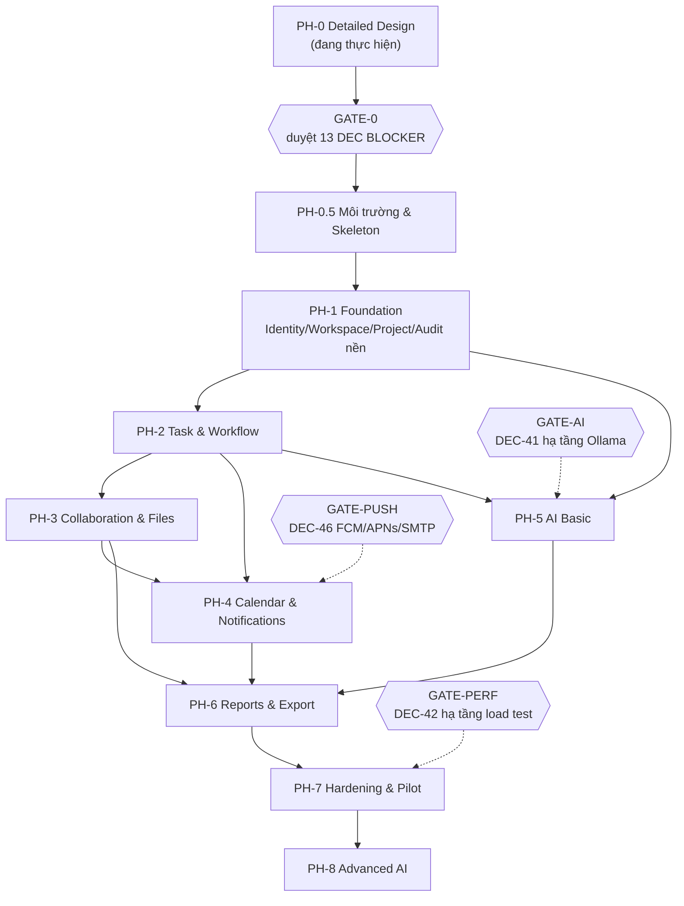

# 06 — KẾ HOẠCH TRIỂN KHAI THEO PHASE

**Trạng thái:** ĐỀ XUẤT — đặc tả mục 21 ghi rõ lộ trình là **CHƯA FROZEN**. Tài liệu này chi tiết hoá lộ trình đó, **không** thay đổi phạm vi V1 đã FROZEN.
**Quy ước:** `PH-n` (phase), `GATE-n` (cổng phê duyệt), `EST-n` (ước lượng — **là giả định ASM, chưa đo**).
**Nguyên tắc thực thi (theo yêu cầu người dùng):** chưa viết code khi chưa được duyệt phase; không tự thay đổi database/dữ liệu thật; không tự commit/push/deploy; không tự đổi công nghệ đã chốt; không tự tuyên bố PASS.


**Chú giải ký hiệu dùng trong các bảng:** `Y` = có / được phép / cơ chế giữ đầy đủ bất biến; `N` = không / không được phép / không thể dùng cơ chế đó; `!` = một phần (phần còn lại phải xử lý ở service layer hoặc đang chờ quyết định); `—` = không áp dụng.

---

## 1. Hiện trạng xuất phát điểm (FACT, đo ngày 11/10/2026)

| Hạng mục | Trạng thái | Hệ quả cho kế hoạch |
|---|---|---|
| Repository `D:\task` | Rỗng, chưa `git init` | Phải khởi tạo repo + cấu trúc monorepo ở PH-0.5 |
| Java | 21.0.9 LTS Y | Đạt cho Spring Boot 3.x |
| Maven / Gradle | N chưa có | PH-0.5: cài Maven **hoặc** commit Maven Wrapper |
| Node / pnpm | Y v26.10.0 / 9.15.4 | Đạt |
| Flutter / Dart | ! Dart 3.11.1 Y, `flutter --version` không trả output | PH-0.5: chạy `flutter doctor` xác nhận |
| Docker | Y CLI 29.8.1 nhưng **daemon TẮT** | PH-0.5: bật Docker Desktop; nếu không bật được → phải cài PostgreSQL + MinIO native |
| PostgreSQL client | N chưa có | PH-0.5 |
| Ollama | N chưa cài | **Chặn PH-5** cho tới khi chốt DEC-41 |
| RAM / CPU / GPU | 15.7 GB / 8 CPU / Iris Xe ~1 GB VRAM | **Chặn nghiệm thu NFR-09/10** (AUD-42); AI chỉ chạy CPU-only rất chậm (AUD-41) |
| Ổ D: trống | 28 GB | Không đủ cho PostgreSQL data + MinIO data + Docker images + dataset load test → PH-0.5 phải chọn ổ khác hoặc đặt quota |

→ **PH-0.5 (Chuẩn bị môi trường) là phase bắt buộc, không có trong lộ trình gốc của đặc tả.** Đây là điểm khác biệt duy nhất về *trình tự* so với mục 21, và không làm thay đổi phạm vi V1.

---

## 2. Sơ đồ phase và dependency



**Đường găng (critical path):** `PH-0 → GATE-0 → PH-0.5 → PH-1 → PH-2 → PH-3 → PH-6 → PH-7`.
PH-4 và PH-5 có thể chạy **song song** với PH-3 nếu có đủ người, nhưng cả hai đều có gate prerequisite bên ngoài (FCM/APNs/SMTP và Ollama).

---

## 3. Chi tiết từng phase

### PH-0 — Detailed Design (đang thực hiện)

| Mục | Nội dung |
|---|---|
| **Mục tiêu** | Biến baseline FROZEN thành thiết kế chi tiết có thể thi công, và tách bạch rõ cái gì đã chốt / cái gì là giả định / cái gì cần người dùng quyết |
| **Phạm vi** | 9 tài liệu: `00-AUDIT-SPEC`, `01-MODULES-BOUNDARIES`, `02A/02B-DATA-MODEL`, `03-API-CONTRACT`, `04-RBAC-MATRIX`, `05-WORKFLOW-STATE-MACHINES`, `06-IMPLEMENTATION-PLAN`, `07-TEST-PLAN`, `08-DECISION-REGISTER` |
| **Không làm** | Không viết code, không tạo database, không `git init` (chờ duyệt), không cài công cụ |
| **Điều kiện ra** | (1) 50 phát hiện audit được lập; (2) 65 bảng + 23 bất biến + 15 race case được thiết kế; (3) 51 DEC được phân loại; (4) **GATE-0 được người dùng trả lời** |
| **Deliverable còn thiếu so với đặc tả mục 22** | Mục 22.6 Deployment design, 22.8 DR runbook, 22.9 UX/UI sitemap → đề xuất làm trong **PH-0.5** (deployment skeleton) và **PH-1** (UX sitemap trước khi code Web/Mobile). Đây là bổ sung có chủ đích, cần xác nhận |
| **Rủi ro** | Nếu GATE-0 kéo dài, mọi phase sau bị treo. 13 DEC BLOCKER phải được trả lời trước |

### GATE-0 — Cổng phê duyệt bắt buộc (13 DEC mức BLOCKER)

| DEC | Câu hỏi | Chặn phase |
|---|---|---|
| DEC-01 | Actor + transaction của cascade huỷ khi Project COMPLETED | PH-2 |
| DEC-02 | "readonly" của ON_HOLD/ARCHIVED có chặn workflow | PH-2 |
| DEC-03 | Chặn cứng việc rời Workspace của Manager cuối | PH-1 |
| DEC-05 | Subtask có vòng nghiệm thu riêng | PH-2 |
| DEC-06 | Danh sách nội dung bị khoá ở PENDING_APPROVAL | PH-2, PH-3 |
| DEC-12 | Allowlist offline cache Mobile | PH-1 (mobile) |
| DEC-15 | Cơ chế số liệu lịch sử (event / snapshot / cả hai) | PH-1 (ERD), PH-6 |
| DEC-27 | Cơ chế chống race approval | PH-2 |
| DEC-41 | Hạ tầng Ollama | PH-5 |
| DEC-42 | Hạ tầng load test | PH-7 |
| DEC-43 | Bộ công nghệ (Maven/Flyway/queue/MinIO/WebSocket/opaque token/UUIDv7) | PH-0.5, PH-1 |
| DEC-46 | FCM / Apple Developer / SMTP | PH-4 |
| DEC-48 | Mô hình uỷ quyền background job | PH-1 |

**Ngoài ra cần chốt trước PH-0.5:** tên package Java (`vn.smarttask` hay khác), tên repo, chiến lược nhánh git, có dùng monorepo 1 repo cho cả 3 codebase hay 3 repo.

### PH-0.5 — Môi trường, Skeleton và Hạ tầng dev

| Mục | Nội dung |
|---|---|
| **Mục tiêu** | Có môi trường dev tái lập được bằng lệnh, skeleton 3 codebase build/chạy được, migration chạy được trên DB rỗng |
| **Điều kiện vào** | GATE-0 đã duyệt (ít nhất DEC-43) |
| **Phạm vi Backend** | `git init`; parent POM + 21 module con (theo `01-MODULES-BOUNDARIES.md` §5); Maven Wrapper; `platform-common` (error model, pagination, correlation id, UUIDv7 generator); `platform-persistence` (Flyway, base entity, soft-delete, optimistic lock); `platform-security` (AuthorizationPolicy skeleton + pipeline P1..P9); `platform-jobs` (outbox + job queue + lease + idempotency); `app-api`, `app-worker`, `app-cli`, `app-bootstrap`; health endpoint; ArchUnit tests (ENF-02); Testcontainers |
| **Phạm vi Infra** | `docker-compose.dev.yml`: PostgreSQL 16, MinIO, MailHog, (Ollama nếu DEC-41 = P-B); `docker-compose.test.yml`; script tạo DB role `stm_app`/`stm_migrate` (ENF-01); thư mục `infra/` cho reverse proxy config mẫu |
| **Phạm vi Web** | Vite + React + TypeScript + ESLint + Prettier; API client generation; auth context; router; design system cơ bản; error boundary hiển thị error envelope |
| **Phạm vi Mobile** | Flutter project (android + ios); dio client; secure storage; router; offline-cache skeleton **theo DEC-12**; FCM stub |
| **Migration** | `V1.0.001..V1.0.0xx` tạo **toàn bộ** 65 bảng theo 02A/02B, kèm trigger/index/constraint + rollback script viết tay (MIG-08) |
| **Điều kiện ra** | (1) `mvnw verify` pass với ArchUnit + Testcontainers migration test; (2) `flyway migrate` + `rollback` chạy được trên DB rỗng; (3) Web và Mobile build được, gọi được `/actuator/health` qua reverse proxy; (4) `docker compose up` dựng đủ stack; (5) `app-cli bootstrap-admin` chạy được và **từ chối** chạy lần 2 (AUD-18); (6) tài liệu `docs/09-ENV-SETUP.md` + `docs/10-UX-SITEMAP.md` hoàn tất |
| **Test bắt buộc** | TC-O-001 (migration up/down), TC-O-002 (DB role không có UPDATE/DELETE trên audit), TC-I19, TC-I21 (bootstrap một lần), smoke test 3 codebase |
| **Rủi ro** | Docker daemon không bật được trên Windows 11 Home → fallback cài PostgreSQL/MinIO native (thêm 0.5–1 ngày). Ổ D: thiếu chỗ → phải chuyển data dir sang ổ khác |
| **EST-0.5** | **10–15 ngày công** (1 kỹ sư full-stack senior) — *giả định, chưa đo* |

### PH-1 — Foundation: Identity, Workspace, Project, Audit nền

| Mục | Nội dung |
|---|---|
| **Mục tiêu** | Đóng toàn bộ Nhóm 01, 02, 03 (phần Project/Milestone/membership) + nền audit/security + policy layer |
| **Điều kiện vào** | PH-0.5 xong; DEC-03, DEC-11, DEC-12, DEC-15, DEC-30/31, DEC-34, DEC-35, DEC-48, DEC-50 đã chốt |
| **Backend scope** | MOD-01 (đăng ký/duyệt/login một phiên/refresh/revoke/lockout/recovery codes/temp password/reauth/grant rời/bootstrap), MOD-02 (personal+team workspace, membership, invitation, owner transfer nguyên tử, archive, setting), MOD-03 (project CRUD + lifecycle chưa gồm COMPLETED cascade, membership, manager invariant, milestone, special_grant, approval setting toggle), MOD-13 (audit append-only + hash chain + scoped read), MOD-14 (outbox + job queue hoạt động thật), MOD-12 (system_setting + config change log + emergency action log) |
| **Web scope** | Màn hình: đăng nhập, đăng ký (nếu bật), quên mật khẩu, reauth modal, danh sách/chi tiết Workspace, quản lý thành viên + mời, chuyển Owner, danh sách/chi tiết Project, quản lý participant + Manager, Milestone, trang Admin (account approval, system settings, security events) |
| **Mobile scope** | Đăng nhập/phiên duy nhất, offline cache theo DEC-12 (chỉ allowlist), danh sách Workspace/Project, push registration gắn session |
| **Điều kiện ra** | (1) **Toàn bộ** test TC-I01..I07, I15, I16, I17, I21 pass **thật** (có evidence theo mẫu ở `07-TEST-PLAN.md`); (2) negative test RBAC cho A-01..A-20, W-01..W-16, P-01..P-23; (3) test 404-vs-403 cho P-03; (4) RACE-04, RACE-05, RACE-06 pass; (5) audit ghi đủ actor/action/target/before-after/reason/outcome/scope; (6) `docker compose` + backup script + restore drill **lần đầu** chạy được ở Dev |
| **Test bắt buộc** | TC-I01..I07, TC-I15..I17, TC-I21, TC-R04..R06, TC-S-001..(IDOR horizontal trên workspace/project), TC-S-(404 vs 403), TC-S-(self-escalation), TC-F-(session duy nhất, lockout, recovery code), TC-O-(restore drill lần 1) |
| **Rủi ro** | (a) Policy layer thiết kế sai ở PH-1 sẽ lan sang mọi phase sau → **bắt buộc** code review + ArchUnit; (b) owner transfer + manager invariant là chỗ dễ sai nhất (RACE-04/05); (c) UX sitemap chưa có sẽ làm Web/Mobile phải sửa lại |
| **EST-1** | **25–35 ngày công** Backend + **15–20** Web + **12–18** Mobile — *giả định* |

### PH-2 — Task & Workflow

| Mục | Nội dung |
|---|---|
| **Mục tiêu** | Đóng Nhóm 04 + Nhóm 05 — phần lõi giá trị và cũng là phần rủi ro cao nhất |
| **Điều kiện vào** | PH-1 xong; DEC-01, DEC-02, DEC-05, DEC-06, DEC-07, DEC-08, DEC-09, DEC-20, DEC-21, DEC-23, DEC-26, DEC-27 đã chốt |
| **Backend scope** | MOD-04 (task/subtask 1 cấp, 0..n assignee, dependency không chu trình, checklist, tag, time log, soft-delete/restore theo `delete_group_id`, search), MOD-05 (state machine T-01..T-12, approval round, designation, decision, no-self-approval, one-terminal-decision, reopen, cancel-đóng-round), PJ-05 cascade COMPLETED, PJ-06 không tự reopen, approval toggle (P-15/P-16), MOD-06 (comment + activity timeline) |
| **Web scope** | Danh sách Task theo Project (filter/sort/search), board theo state, Task detail (subtask, checklist, assignee, dependency, tag, time log, comment, timeline), workflow action buttons theo RBAC (ẩn/hiện — nhưng **backend vẫn kiểm tra**), approval panel (approve/reject + reason), reopen dialog bắt buộc reason, Milestone view |
| **Mobile scope** | Danh sách Task, Task detail read + action workflow, submit/approve/reject, comment, offline theo DEC-12 |
| **Điều kiện ra** | (1) TC-I08..I14, TC-I20, TC-I22, TC-I23 pass thật; (2) **RACE-01, 02, 03, 07, 11, 12** pass thật; (3) toàn bộ transition bị cấm ở `05-WORKFLOW §1.2` có test âm; (4) test 19.1 của đặc tả phủ đủ; (5) cascade PJ-05 giữ audit đúng `reason_code`; (6) progress Project tính đúng công thức (AUD-20) |
| **Test bắt buộc** | TC-I08..I14, TC-I20, TC-I22, TC-I23, TC-R01..R03, TC-R07, TC-R11, TC-R12, TC-W-* (toàn bộ state machine), TC-NEG-* (self-approval 2 dạng, thiếu approver, subtask chưa xong, chu trình, depth >1) |
| **Rủi ro** | Cao nhất dự án. Ba điểm dễ sai: (a) self-approval khi actor vừa là ASG vừa là SUB; (b) cascade đồng bộ trong 1 transaction mà không deadlock; (c) lock ở PENDING_APPROVAL (DEC-06) bị vòng qua bằng endpoint khác |
| **EST-2** | **30–40 ngày công** Backend + **20–28** Web + **15–20** Mobile — *giả định* |

### PH-3 — Collaboration & Files

| Mục | Nội dung |
|---|---|
| **Mục tiêu** | Đóng Nhóm 09 (file private, versioning, gateway, activity log) |
| **Điều kiện vào** | PH-2 xong; DEC-06, DEC-16, DEC-29, DEC-45 đã chốt; MinIO chạy được |
| **Backend scope** | MOD-07 (upload_session → staging → scan → commit, versioning không ghi đè, restore-as-new-version, soft-delete, preview/download gateway per-request authz, `file_access_event` kể cả DENIED), `STORAGE_RECONCILE` job, allowlist content-type + max size từ `system_setting`, activity timeline hoàn chỉnh, attachment cho TASK/SUBTASK/PROJECT/COMMENT/MILESTONE/AVATAR |
| **Web scope** | Upload (drag-drop, tiến trình, chunk), preview PDF/ảnh qua gateway, danh sách version + restore, thông báo lỗi loại file/dung lượng, timeline UI |
| **Mobile scope** | Upload từ camera/thư viện, download có kiểm tra quyền, **không** cache file offline ngoài allowlist DEC-12 |
| **Điều kiện ra** | (1) TC-I18 pass; (2) test 19.2 "revoke trước download → request mới bị chặn, stale URL không dùng được" pass; (3) test "file PENDING_APPROVAL không sửa được qua API/comment khác" pass; (4) reconciliation phát hiện được lệch DB↔object trong test giả lập; (5) `file_access_event` ghi đủ cả ALLOWED và DENIED |
| **Test bắt buộc** | TC-I17, TC-I18, TC-S-(IDOR file theo UUID), TC-S-(path traversal filename), TC-S-(content-type giả mạo: khai `image/png` nhưng bytes là `application/x-msdownload`), TC-F-(upload/preview/download/version/restore), TC-O-(orphan cleanup) |
| **Rủi ro** | (a) **Chưa có engine anti-malware** → `scan_status = 'UNSUPPORTED'`; phải ghi rõ trong tài liệu nghiệm thu là **chưa có** bảo vệ malware (Nhóm 09 nói "khi có công cụ"); (b) streaming qua Backend tốn tài nguyên ở tải cao → phải benchmark riêng; (c) 28 GB ổ D: không đủ cho MinIO data khi test upload lớn |
| **EST-3** | **18–25 ngày công** Backend + **12–16** Web + **10–14** Mobile — *giả định* |

### PH-4 — Calendar & Notifications  ⟵ GATE-PUSH (DEC-46)

| Mục | Nội dung |
|---|---|
| **Mục tiêu** | Đóng Nhóm 06 |
| **Điều kiện vào** | PH-2 xong (PH-3 song song được); DEC-13, DEC-24, DEC-25, DEC-46 đã chốt; **có FCM project** (Android) và SMTP; APNs chỉ khi có Apple Developer account |
| **Backend scope** | MOD-08 (resolve deadline instant+tz+date-only 23:59:59, DST handling, calendar views ngày/tuần/tháng/danh sách, reminder rule/schedule, pause/resume recompute, `task_deadline_change`, ICS export MINIMAL), MOD-09 (notification + seq, preference, mute, quiet hours theo timezone, read-state đồng bộ cấp tài khoản, mark-all-read, redaction theo scope, push/email delivery + `delivery_attempt` dedup), WebSocket realtime + resync cursor |
| **Web scope** | Calendar 4 view, unscheduled list, reminder preferences, quiet hours, notification center + unread badge + mark all read, realtime update, ICS download |
| **Mobile scope** | Push (FCM/APNs), notification center, deep link **có server revalidate quyền**, quiet hours, offline theo DEC-12 |
| **Điều kiện ra** | (1) test timezone/DST pass (đổi timezone hồ sơ **không** đổi instant); (2) reconnect/resync không phát dữ liệu ngoài quyền (test 19.2); (3) quiet hours trì hoãn thông báo thường nhưng **SECURITY_CRITICAL gửi ngay**; (4) resume chỉ phát **một** digest/người, không bulk catch-up; (5) phiên cũ không nhận push sau login mới; (6) ICS export ở mức MINIMAL, có `calendar_export_record` |
| **Test bắt buộc** | TC-N-* (deadline 23:59:59 theo tz người đặt; date-only; DST; unscheduled), TC-R14, TC-S-(reconnect resync), TC-S-(deep link sau revoke), TC-F-(mute/quiet hours/mark all read), TC-M-(push register/unregister gắn session) |
| **Rủi ro** | (a) **APNs cần Apple Developer trả phí** → nếu chưa có, iOS push phải dời, chỉ cam kết Android + in-app (AUD-46); (b) SMTP thật cần hạ tầng → Dev/Test dùng MailHog, **không** tuyên bố email production hoạt động; (c) quiet hours + timezone là nguồn bug kinh niên, cần test biên kỹ |
| **EST-4** | **20–28 ngày công** Backend + **15–20** Web + **14–18** Mobile — *giả định* |

### PH-5 — AI Basic  ⟵ GATE-AI (DEC-41)

| Mục | Nội dung |
|---|---|
| **Mục tiêu** | Đóng Nhóm 07 giai đoạn 1: AI chỉ **đề xuất** |
| **Điều kiện vào** | PH-1 + PH-2 xong; **DEC-39, DEC-40, DEC-41, DEC-47 đã chốt và có hạ tầng Ollama thật** (hoặc chấp nhận phương án P-B CPU-only với chỉ tiêu công bố trước) |
| **Backend scope** | MOD-11 (`ai_context_manifest` + builder lọc quyền, sanitize, prompt template, adapter Ollama qua Backend, structured output + JSON schema validation, `ai_job` qua MOD-14, reauthorize 2 lần, `ai_suggestion` DRAFT, `ai_interaction` lưu ở Object Storage private + retention, model config + reauth), mock Ollama cho Dev/Test |
| **Web scope** | AI assistant panel: tạo Task draft từ ngôn ngữ tự nhiên, gợi ý subtask/priority (kèm giải thích)/deadline/assignee, natural search, Daily Planner (on-demand + opt-in), Weekly Review; **mọi suggestion đều có nút xác nhận** trước khi gọi use case chuẩn |
| **Mobile scope** | AI request + job status + suggestion confirm (không chạy inference trên thiết bị) |
| **Điều kiện ra** | (1) **ArchUnit test DEP-04 pass**: module AI không depend Workflow/mutation command; (2) revoke giữa job → `CANCELLED_REVOKED`, không trả kết quả, không retry (test 19.2); (3) Ollama timeout/down → core nghiệp vụ **không** ảnh hưởng, lỗi rõ, retry hợp lệ (NFR-12); (4) prompt injection qua comment/file → output validate, suggestion ngoài scope bị loại; (5) context không chứa trường cấm trong manifest; (6) **không** có đường nào để AI tạo `approval_decision` hoặc đổi `task.state`; (7) chỉ tiêu AI đo được và **công bố kèm phần cứng** (NFR-21) |
| **Test bắt buộc** | TC-AI-* (privacy, timeout, reauth, injection, manifest, concurrency limit), TC-R13, TC-S-(AI job của user khác → 404), TC-P-(AI benchmark riêng) |
| **Rủi ro** | **Cao về hạ tầng.** Trên máy hiện tại (Iris Xe 1 GB VRAM, 15.7 GB RAM) Ollama chỉ chạy CPU, model ≤3B, concurrency 1, latency có thể **vài chục giây đến vài phút**. Đây là lý do GATE-AI phải được quyết định **trước** khi vào PH-5, không phải trong lúc làm |
| **EST-5** | **18–25 ngày công** Backend + **12–16** Web + **8–10** Mobile — *giả định, chưa tính thời gian chờ hạ tầng* |

### PH-6 — Reports & Export

| Mục | Nội dung |
|---|---|
| **Mục tiêu** | Đóng Nhóm 08 |
| **Điều kiện vào** | PH-2 xong; PH-3/PH-4/PH-5 xong (vì cần dữ liệu file/notification/AI); DEC-15, DEC-16, DEC-20, DEC-37, DEC-38 đã chốt |
| **Backend scope** | MOD-10 (metric dictionary đúng 02B §3.4, dashboard Personal/Project/Workspace/System, `MetricEnvelope` phân biệt 0/N-A/NO_PERMISSION/INSUFFICIENT_DATA/PARTIAL, historical từ `workflow_event` + `metric_daily_snapshot`, `SNAPSHOT_DAILY` job, export PDF/XLSX/CSV qua durable job + TTL 24h + chỉ requester tải được), giải thích số liệu bằng AI (không sửa số liệu) |
| **Web scope** | 4 dashboard, bộ lọc khoảng thời gian (ngày/tuần/tháng/quý/năm/tùy chọn), historical view "as-of date", export wizard + job status + download, nhãn phân biệt unique task vs assignment count |
| **Mobile scope** | Dashboard rút gọn (Personal + Project), export request + download |
| **Điều kiện ra** | (1) progress đúng công thức, `N/A` khi denominator = 0; (2) reopen **không** đổi snapshot quá khứ (TC-I tương ứng); (3) không có metric xếp hạng năng suất cá nhân (R-07 không tồn tại); (4) dashboard chỉ tổng hợp đối tượng người xem có quyền, `PARTIAL` khi thiếu; (5) export kiểm tra quyền **2 lần** (lúc tạo + lúc giao); (6) phân biệt đúng unique task vs assignment count |
| **Test bắt buộc** | TC-F-(mọi metric trong dictionary), TC-S-(dashboard cross-tenant), TC-S-(export của user khác → 404), TC-P-(export benchmark riêng), TC-R15 |
| **Rủi ro** | (a) `PARTIAL` semantics dễ bị client hiểu sai → cần contract rõ và test cả Web lẫn Mobile; (b) PDF/XLSX generation nặng → phải chạy ở worker, không trong request thread; (c) snapshot job cần idempotent theo ngày |
| **EST-6** | **18–24 ngày công** Backend + **16–22** Web + **8–12** Mobile — *giả định* |

### PH-7 — Hardening & Pilot  ⟵ GATE-PERF (DEC-42)

| Mục | Nội dung |
|---|---|
| **Mục tiêu** | Có **bằng chứng** cho NFR, không phải tuyên bố |
| **Điều kiện vào** | PH-1..PH-6 xong; DEC-42 (hạ tầng load test), DEC-45 (retention), DEC-14 (audit disposal) đã chốt |
| **Phạm vi** | Load test bậc 1 (10–20 user trên máy dev, ghi rõ là baseline tham chiếu) **và** bậc 2 (50–100 user trên hạ tầng riêng — chỉ khi DEC-42 cấp hạ tầng); benchmark riêng cho AI/upload lớn/report export; security review toàn bộ ma trận RBAC + negative test; penetration test tối thiểu (IDOR, injection, CSRF, CORS, rate limit); observability (health/liveness/readiness, metrics P50/P95/P99, DB pool, queue depth, DLQ, Ollama availability, storage capacity, backup age); backup độc lập + restore drill có đối chiếu metadata↔object; DR runbook; migration/rollback drill; isolation Dev/Test/Production |
| **Điều kiện ra** | Báo cáo nghiệm thu NFR **có evidence**: công bố phần cứng, dataset, tần suất request, tỷ lệ endpoint, thời lượng, cách tính P95 (đúng đặc tả mục 12). RPO/RTO chỉ tuyên bố đạt khi có backup độc lập **và** restore drill thật. Phần nào không đạt → ghi rõ **không đạt** và lý do |
| **Test bắt buộc** | TC-P-* toàn bộ, TC-O-* toàn bộ, TC-S-* regression đầy đủ |
| **Rủi ro** | Không có hạ tầng riêng → **không thể** đóng PH-7. Đây là gate cứng, không được "ước lượng cho qua" |
| **EST-7** | **20–30 ngày công** Backend + **5–8** Web + **5–8** Mobile = **30–46** (khớp bảng mục 4) + thời gian thuê/cấu hình hạ tầng — *giả định* |

### PH-8 — Advanced AI (sau V1 core ổn định)

Phân tích rủi ro nâng cao, rule-based overdue risk giải thích được (Nhóm 07). Chỉ bắt đầu sau khi PH-7 có evidence. **EST-8:** chưa ước lượng — phụ thuộc kết quả PH-5.

---

## 4. Tổng hợp ước lượng (giả định, chưa đo — ASM)

| Phase | Backend | Web | Mobile | Tổng ngày công | Ghi chú |
|---|---|---|---|---|---|
| PH-0 | — | — | — | ~6–8 (đã thực hiện phần lớn) | Tài liệu thiết kế |
| PH-0.5 | 10–15 | — | — | 10–15 | Gồm cả Web/Mobile skeleton |
| PH-1 | 25–35 | 15–20 | 12–18 | 52–73 | |
| PH-2 | 30–40 | 20–28 | 15–20 | 65–88 | Rủi ro cao nhất |
| PH-3 | 18–25 | 12–16 | 10–14 | 40–55 | |
| PH-4 | 20–28 | 15–20 | 14–18 | 49–66 | Chờ DEC-46 |
| PH-5 | 18–25 | 12–16 | 8–10 | 38–51 | Chờ DEC-41 |
| PH-6 | 18–24 | 16–22 | 8–12 | 42–58 | |
| PH-7 | 20–30 | 5–8 | 5–8 | 30–46 | Chờ DEC-42 |
| **Tổng V1 (không gồm PH-0 và PH-8)** | **159–222** | **95–130** | **72–100** | **326–452 ngày công** | ~15–22 tháng cho 1 kỹ sư; ~5–7 tháng cho team 3 người |

> **Cách tính dòng tổng (để người đọc kiểm lại được):** Backend = 10+25+30+18+20+18+18+20 = **159** (thấp) và 15+35+40+25+28+25+24+30 = **222** (cao). Web = 15+20+12+15+12+16+5 = **95** / 20+28+16+20+16+22+8 = **130**. Mobile = 12+15+10+14+8+8+5 = **72** / 18+20+14+18+10+12+8 = **100**. Tổng = 159+95+72 = **326** / 222+130+100 = **452**. PH-0 (~6–8 ngày công tài liệu) **không** cộng vào vì là phase đang thực hiện; nếu cộng thì thành 332–460.

> Các con số trên là **ước lượng thô**, không phải cam kết. Chưa tính: UX/UI design, QA độc lập, thời gian chờ phê duyệt GATE, thời gian chuẩn bị hạ tầng ngoài (FCM/APNs/SMTP/GPU/VM load test).

---

## 5. Chiến lược lát cắt dọc (theo gợi ý đặc tả mục 21)

Thay vì làm xong toàn bộ Backend mới tới Web/Mobile, mỗi phase **bàn giao một lát cắt dọc** xuyên suốt:

```
Mỗi PH-n:  DB migration → Backend use case → REST endpoint → Web screen → Mobile screen → test E2E của đúng lát đó
```

**Lợi ích:** phát hiện sớm sai lệch contract giữa Backend và 2 client; có bản demo chạy được sau mỗi phase; giảm rủi ro tích hợp cuối kỳ (đúng mục 21: "Có thể triển khai Web/Mobile theo từng luồng dọc xuyên suốt để giảm rủi ro tích hợp").

**Luồng dọc E2E tối thiểu phải demo được ở mỗi phase:**

| Phase | Luồng demo |
|---|---|
| PH-0.5 | Bootstrap admin → login → health check trên cả Web và Mobile |
| PH-1 | Đăng ký → duyệt → tạo Team Workspace → mời → tạo Project → thêm Manager |
| PH-2 | Tạo Task → giao 2 assignee → start → submit → approver độc lập approve; và nhánh reject; và nhánh Project COMPLETED cascade |
| PH-3 | Upload file vào Task → version mới → preview/download → revoke quyền → download bị chặn |
| PH-4 | Đặt deadline → reminder nổ → push lên Mobile → quiet hours defer → reconnect resync |
| PH-5 | Gõ ngôn ngữ tự nhiên → AI draft Task → user xác nhận → Task thật được tạo |
| PH-6 | Dashboard Project → xem historical as-of → export PDF → tải về |
| PH-7 | Báo cáo load test + restore drill có evidence |

---

## 6. Definition of Done chung cho mọi phase

Một phase chỉ được coi là xong khi **đủ cả 8** điều kiện:

1. Toàn bộ scope Backend/Web/Mobile của phase đã implement, không còn `TODO` chặn luồng chính.
2. Migration chạy được trên DB rỗng **và** có rollback script đã thử (MIG-08).
3. Test bắt buộc của phase đã **chạy thật** và có evidence theo mẫu ở `07-TEST-PLAN.md` §5. Không có evidence → coi như chưa đạt.
4. ArchUnit + negative test RBAC pass (ENF-02, ENF-04).
5. Không có bất biến nào trong `02A §9` bị vi phạm.
6. Audit event ghi đủ cho mọi action trong phase (đối chiếu `04-RBAC-MATRIX.md`).
7. Tài liệu cập nhật: API contract, ERD (nếu đổi), decision register (nếu có DEC mới phát sinh).
8. Báo cáo phase theo mẫu ở mục 7 bên dưới, **gửi người dùng và chờ xác nhận** trước khi sang phase kế.

---

## 7. Mẫu báo cáo bắt buộc sau mỗi phase (theo yêu cầu người dùng)

```
BÁO CÁO PHASE <n> — <tên phase>
1. Phạm vi đã thực hiện         : (đối chiếu scope trong tài liệu này)
2. File đã tạo / sửa            : (đường dẫn, số dòng, loại thay đổi)
3. Quyết định thiết kế đã áp dụng: (DEC-nn đã dùng, ASM-nn đã giả định)
4. API thay đổi                 : (EP-nnn thêm/sửa/xoá, breaking hay không)
5. Database thay đổi            : (migration V*, bảng/cột/index/constraint, rollback script)
6. Test đã chạy và KẾT QUẢ THẬT : (ID test, pass/fail/skip, evidence đính kèm; KHÔNG ghi pass nếu chưa chạy)
7. Rủi ro / vấn đề còn tồn tại  : (kèm mức độ và hướng xử lý)
8. Điều kiện cần xác nhận trước phase tiếp theo : (danh sách DEC còn treo)
```

---

## 8. Quy tắc dừng (stop rule)

Dừng phần triển khai bị ảnh hưởng và báo cáo ngay khi gặp một trong các tình huống sau — **không tự quyết định thay người dùng**:

| Tình huống | Hành động |
|---|---|
| Phát hiện yêu cầu mâu thuẫn trong baseline FROZEN | Dừng phần bị ảnh hưởng, ghi `AUD-nn` mới, đề xuất phương án, chờ xác nhận |
| Thiết kế chi tiết phát hiện DEC đã chốt là không khả thi | Dừng, nêu lý do kỹ thuật cụ thể, đề xuất phương án thay thế, **không** âm thầm đổi |
| Cần đổi công nghệ đã chốt (Nhóm 11 / ARCH) | Dừng, không tự đổi |
| Cần đổi phạm vi V1 (ví dụ hoãn PH-5) | Dừng, nêu rõ đây là thay đổi phạm vi đã FROZEN, cần phê duyệt |
| Bất biến không thể bảo đảm bằng thiết kế hiện tại | Dừng, báo cáo, đề xuất change request |
| Thiếu hạ tầng ngoài (FCM/APNs/SMTP/GPU/VM) | Ghi nhận là prerequisite bị chặn, chuyển sang phần khác của phase, **không** mock rồi tuyên bố đạt |
| Test fail mà không sửa được trong scope | Giữ phase ở trạng thái chưa hoàn thành, báo cáo trung thực |

---

## 9. Điểm CHƯA chốt của kế hoạch

| Vấn đề | Cần xác nhận |
|---|---|
| Thêm PH-0.5 vào lộ trình gốc (đặc tả mục 21 không có) | Có đồng ý không |
| Thêm deliverable `09-ENV-SETUP.md` và `10-UX-SITEMAP.md` (đặc tả mục 22.6, 22.9 để ngỏ) | Có làm trong PH-0.5/PH-1 không |
| Monorepo 1 repo cho Backend+Web+Mobile hay 3 repo | Quyết định trước PH-0.5 |
| Tên package Java, tên repo, chiến lược nhánh git | Quyết định trước PH-0.5 |
| Số lượng kỹ sư thực tế (ước lượng ở mục 4 giả định 1 senior full-stack + 1 backend + 1 frontend/mobile) | Ảnh hưởng trực tiếp timeline |
| Có làm DB role tách theo module ngay từ PH-0.5 hay hoãn tới PH-7 | DEC-43 |
| Có chạy PH-4 song song PH-3 hay tuần tự | Phụ thuộc nhân lực |
| Thời điểm bắt đầu và deadline (người dùng chưa nêu) | Không tự đặt |
