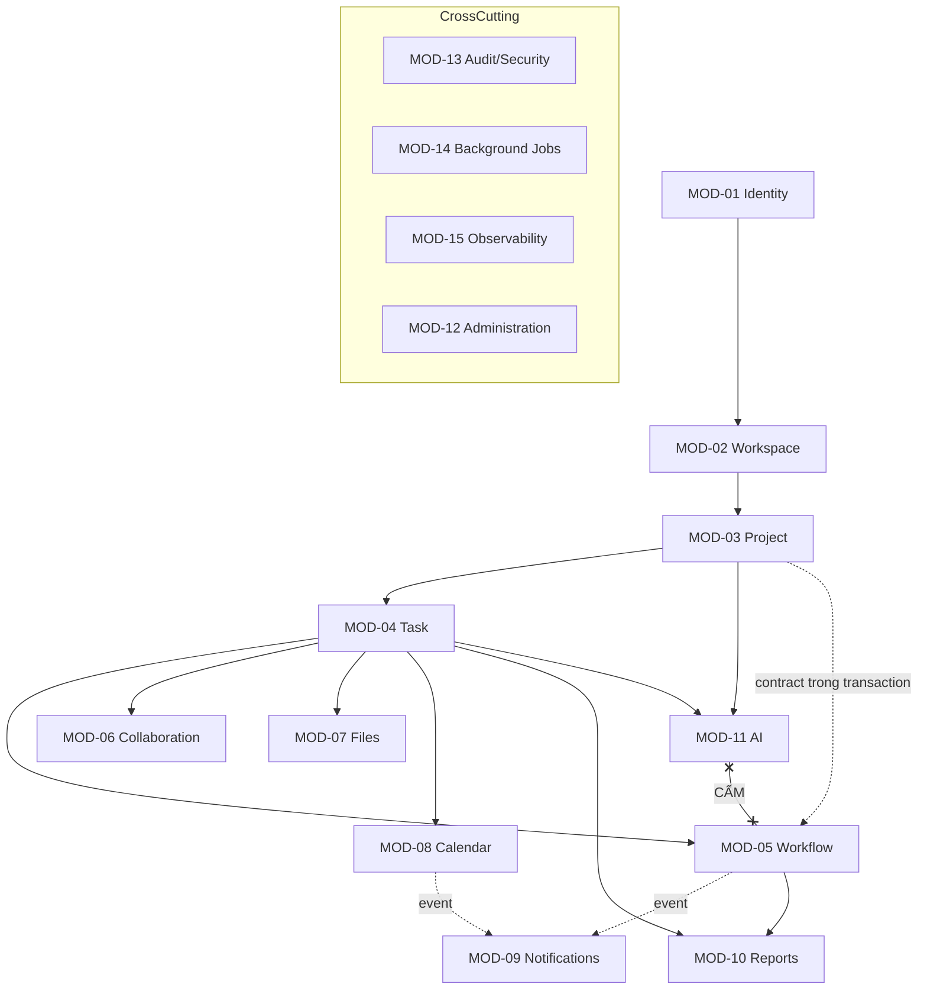

# 01 — MODULE, DEPENDENCY VÀ RANH GIỚI DỮ LIỆU

**Trạng thái:** ĐỀ XUẤT thiết kế chi tiết — chưa được duyệt. Bám baseline ARCH-01..ARCH-10 (FROZEN) và 13.2 (bảng module).
**Quy ước ID:** `MOD-nn` (module), `DEP-nn` (quy tắc dependency), `ENF-nn` (cơ chế cưỡng chế ranh giới).
**Nguyên tắc nguồn chân lý:** Đặc tả mục 13.2 liệt kê 15 module. Tài liệu này **không thêm, không bớt, không đổi tên** module; chỉ bổ sung chi tiết ranh giới dữ liệu và contract để thi hành ARCH-01/ARCH-10.


**Chú giải ký hiệu dùng trong các bảng:** `Y` = có / được phép / cơ chế giữ đầy đủ bất biến; `N` = không / không được phép / không thể dùng cơ chế đó; `!` = một phần (phần còn lại phải xử lý ở service layer hoặc đang chờ quyết định); `—` = không áp dụng.

---

## 1. Kiến trúc phân lớp bắt buộc (ARCH-01, mục 13.3)

```
HTTP/WS Controller (adapter-in)
        ↓  chỉ nhận DTO, không chứa nghiệp vụ
Application Use Case (command / query)
        ↓  điều phối transaction, gọi policy
Domain Model + Domain Rules
        ↓  bất biến, state machine
Authorization Policy Layer (ARCH-06)  ← cắt ngang mọi use case
        ↓
Repository (port) → Adapter (PostgreSQL / S3 / Ollama / Push / Email)
        ↓
Outbox (cùng transaction) → Durable Job Worker (ARCH-04, ARCH-05)
```

**Quy tắc lớp:**

| Quy tắc | Nội dung | Cưỡng chế bằng |
|---|---|---|
| L-01 | Controller không chứa logic nghiệp vụ, không mở transaction | ArchUnit + code review |
| L-02 | Domain không import Spring/JPA/S3/Ollama | ArchUnit (`noClasses().that().resideInAPackage("..domain..").should().dependOnClassesThat().resideInAnyPackage("..infrastructure..", "org.springframework..")`) |
| L-03 | Mọi use case mutating đều gọi Policy Layer **trước** khi đọc/ghi dữ liệu | ArchUnit + integration test âm |
| L-04 | Mọi use case mutating đều ghi `audit_event` + `outbox_event` trong **cùng** transaction | Integration test kiểm tra rollback |
| L-05 | Query (đọc) tách khỏi Command (ghi) — dùng CQRS nhẹ: `*QueryService` không ghi | ArchUnit |
| L-06 | Không module nào truy cập bảng của module khác bằng SQL/JPA của mình | ENF-01 bên dưới |

---

## 2. Danh sách module, ranh giới dữ liệu và contract

### MOD-01 — Identity & Access

| Mục | Nội dung |
|---|---|
| **Trách nhiệm** | Account lifecycle, đăng nhập/đăng xuất, một-phiên-duy-nhất, refresh, recovery, mật khẩu, lockout, reauthentication, grant quyền rời, bootstrap System Admin |
| **Bảng sở hữu** | `app_user`, `user_email_history`, `user_session`, `user_refresh_token`, `account_recovery_code`, `password_reset_ticket`, `global_permission_grant`, `reauth_ticket`, `user_profile_preference` |
| **Không sở hữu** | Membership (MOD-02/03), audit (MOD-13) |
| **Public contract (module khác gọi được)** | `IdentityApi.getUser(id) → UserPrincipal`; `IdentityApi.assertSessionValid(sessionId)`; `IdentityApi.isValidActiveUser(userId)`; `IdentityApi.hasGlobalPermission(userId, code)`; `IdentityApi.requireReauth(sessionId, action, target) → ReauthTicket`; `IdentityApi.onSessionRevoked(cb)`; `IdentityApi.getDeliveryPreferences(userId) → {timezone, quietHoursEnabled, quietHoursStart, quietHoursEnd, overdueReminderPolicy, digestEnabled}` (**chỉ** MOD-08/MOD-09 được gọi; xem AUD-51) |
| **Bất biến canh giữ** | (1) Mỗi tài khoản **đúng 1** session ACTIVE (AUD-19); (2) login mới vô hiệu access + refresh + push registration của phiên cũ; (3) email/username đã dùng **không cấp lại** (AUD-31); (4) System Admin cuối cùng không thể bị xoá/vô hiệu; (5) lockout không đổi `status` (AUD-32) |
| **Ranh giới cần bảo vệ (đặc tả 13.2)** | "Không cấp quyền nội dung chỉ dựa trên role global" → `IdentityApi` **không** có method nào trả về "được đọc Project X" |
| **Phụ thuộc** | MOD-13 (ghi audit), MOD-14 (outbox event `SESSION_REVOKED`, `ACCOUNT_STATUS_CHANGED`), MOD-09 (huỷ push registration qua event, **không** gọi trực tiếp) |

### MOD-02 — Workspace

| Mục | Nội dung |
|---|---|
| **Trách nhiệm** | Personal/Team Workspace, membership, invitation, owner transfer, archive/restore, workspace setting |
| **Bảng sở hữu** | `workspace`, `workspace_membership`, `workspace_invitation`, `workspace_setting` |
| **Public contract** | `WorkspaceApi.getWorkspace(id)`; `WorkspaceApi.getMembership(wsId, userId) → WorkspaceRole?`; `WorkspaceApi.isPersonal(wsId)`; `WorkspaceApi.assertEffectiveWritable(wsId)` (trả về trạng thái hiệu lực: ACTIVE/READONLY/ARCHIVED); `WorkspaceApi.canInvite(inviterRole, targetRole)`; `WorkspaceApi.listMemberUserIds(wsId, filter)` |
| **Bất biến** | (1) Mỗi ACTIVE account **đúng 1** Personal Workspace (AUD-30); (2) Team Workspace **đúng 1** Owner (AUD-28); (3) Personal không thể thành Team bằng đường vòng; (4) thu hồi quyền có hiệu lực ngay; (5) Owner muốn rời phải chuyển quyền trước |
| **Ranh giới** | "One Owner, revocation" — MOD-02 **không** biết gì về nội dung Project/Task |
| **Phụ thuộc** | MOD-01 (UserPrincipal, session), MOD-13, MOD-14 |

### MOD-03 — Project

| Mục | Nội dung |
|---|---|
| **Trách nhiệm** | Project lifecycle, participants, managers, milestones, project setting (approval on/off, ai cho phép Member tạo Task) |
| **Bảng sở hữu** | `project`, `project_membership`, `project_setting`, `milestone`, `special_grant` |
| **Public contract** | `ProjectApi.getProject(id)`; `ProjectApi.getMembership(projectId, userId)`; `ProjectApi.listManagerUserIds(projectId)`; `ProjectApi.isApprovalEnabled(projectId)`; `ProjectApi.assertEffectiveState(projectId) → {PLANNING, ACTIVE, ON_HOLD_READONLY, COMPLETED_READONLY, ARCHIVED_READONLY, DELETED}`; `ProjectApi.isApprovalSettingMutable(projectId)`; `ProjectApi.hasParticipation(projectId, userId)` (AUD-50) |
| **Bất biến** | (1) Project chưa DELETED có **≥1 Manager ACTIVE hợp lệ** (AUD-03); (2) Manager không phải Workspace Guest; (3) creator mặc định Manager; (4) tắt nghiệm thu chỉ được khi **không còn** approval pending (Nhóm 03); (5) Project COMPLETED → cascade CANCELLED (AUD-01); (6) COMPLETED→ACTIVE **không** tự reopen Task |
| **Ranh giới** | "Multiple Managers, ít nhất một Manager hợp lệ" |
| **Phụ thuộc** | MOD-01, MOD-02 (assertEffectiveWritable), MOD-13, MOD-14. **Không** phụ thuộc MOD-04/05 khi đọc; khi cascade COMPLETED thì gọi `WorkflowApi.cancelOpenRounds(...)` qua contract trong **cùng transaction** |

### MOD-04 — Task

| Mục | Nội dung |
|---|---|
| **Trách nhiệm** | Task/Subtask CRUD, assignment, dependency, checklist, tag, time log, soft-delete/restore theo `delete_group_id` |
| **Bảng sở hữu** | `task`, `task_assignment`, `task_dependency`, `checklist_item`, `tag`, `task_tag`, `time_log` |
| **Public contract** | `TaskApi.getTask(id)`; `TaskApi.getEffectiveState(taskId) → {state, blockedFlag, editable, executionLocked}`; `TaskApi.listAssigneeIds(taskId)`; `TaskApi.isExecutionLocked(taskId)` (AUD-06); `TaskApi.listChildIds(taskId)`; `TaskApi.countByState(scope)` (cho MOD-10) |
| **Bất biến** | (1) Subtask **tối đa 1 cấp**; (2) Task **0..n** assignee; (3) parent chỉ COMPLETED khi mọi child ∈ {COMPLETED, CANCELLED}; (4) dependency **không chu trình** (hard-block, AUD-09); (5) `BLOCKED` là cờ độc lập; (6) restore không hồi sinh mục bị xoá độc lập (AUD-29); (7) progress chỉ đếm top-level |
| **Ranh giới** | "Parent one-level, nhiều assignee" |
| **Phụ thuộc** | MOD-03 (state, approval setting, membership), MOD-02, MOD-01, MOD-13, MOD-14. **Không** tự chuyển trạng thái workflow — phải qua MOD-05 |

### MOD-05 — Workflow

| Mục | Nội dung |
|---|---|
| **Trách nhiệm** | State machine Task, approval round, submit/approve/reject/cancel/reopen/start, designation approver, SLA flag |
| **Bảng sở hữu** | `approval_round`, `approval_designation`, `approval_decision`, `workflow_event` |
| **Public contract** | `WorkflowApi.canPerform(taskId, actor, action) → Decision`; `WorkflowApi.start/submit/approve/reject/cancel/reopen(...)`; `WorkflowApi.getOpenRound(taskId)`; `WorkflowApi.cancelOpenRoundsForProjectCompletion(projectId, actorRef)` (AUD-01); `WorkflowApi.listEligibleApprovers(taskId)` (AUD-07) |
| **Bất biến** | (1) **Không self-approval** (assignee ∪ submitter); (2) **một terminal decision** mỗi round (AUD-27); (3) reject bắt buộc reason; (4) reopen COMPLETED bắt buộc reason + **không sửa lịch sử**; (5) cancel khi pending → đóng round bằng `CANCELLED`, **không giả mạo** approve/reject; (6) thiếu approver độc lập → **giữ PENDING_APPROVAL** + cảnh báo Manager, không auto-approve; (7) approver mất quyền → thu hồi designation tức thời |
| **Ranh giới** | "No self-approval, one terminal result" |
| **Phụ thuộc** | MOD-04 (đọc Task, ghi state qua contract), MOD-03, MOD-02, MOD-01, MOD-13, MOD-14. Đây là module **duy nhất** được đổi `task.state` |

### MOD-06 — Collaboration

| Mục | Nội dung |
|---|---|
| **Trách nhiệm** | Comment, Activity Timeline |
| **Bảng sở hữu** | `comment`, `activity_event` |
| **Public contract** | `CollabApi.appendActivity(target, type, payload)` (module khác gọi để timeline đầy đủ); `CollabApi.assertCommentAllowed(target, actor)` — bắt buộc ánh xạ sang mã action `CM-01..CM-05` của `04 §7.1` (AUD-53), **không** được chỉ kiểm tra quyền đọc |
| **Bất biến** | (1) Chỉ người có quyền xem đối tượng mới đọc được timeline (`FL-08 ACTIVITY_TIMELINE_READ`); (2) `activity_event` **append-only**; (3) comment trên Task PENDING_APPROVAL vẫn được phép nhưng **audit** (AUD-06, chờ DEC-06); (4) **không** có đường nào sửa comment của người khác — chỉ xoá có lý do (`CM-05`, chờ DEC-54); (5) Guest không ghi được comment (ASM/DEC-54) |
| **Ranh giới** | "Scope và trạng thái đối tượng" |
| **Phụ thuộc** | MOD-04, MOD-03, MOD-02, MOD-01, MOD-13, MOD-14 |

### MOD-07 — Files

| Mục | Nội dung |
|---|---|
| **Trách nhiệm** | Attachment đa đối tượng, versioning, upload staging, safety check, preview/download gateway, soft-delete/restore, FileAccessEvent |
| **Bảng sở hữu** | `attachment`, `file_version`, `file_object`, `file_access_event`, `upload_session` |
| **Public contract** | `FilesApi.authorizeDownload(attachmentId, versionId, actor) → StreamTicket` (single-use, TTL ngắn); `FilesApi.assertUploadAllowed(target, actor)`; `FilesApi.listAttachments(target)` |
| **Bất biến** | (1) **Mỗi** preview/download kiểm tra quyền **tại request** (ARCH-07); (2) không URL công khai/không thể thu hồi; (3) version không ghi đè; (4) metadata ↔ object nhất quán qua staging + reconciliation; (5) Task PENDING_APPROVAL → khoá add/replace/delete/restore attachment (AUD-06); (6) parent soft-delete → ẩn file, không xoá vật lý ngay |
| **Ranh giới** | "Private object, per-request auth" |
| **Phụ thuộc** | MOD-04 (executionLocked), MOD-03, MOD-02, MOD-01, MOD-13, MOD-14, S3 adapter |

### MOD-08 — Calendar

| Mục | Nội dung |
|---|---|
| **Trách nhiệm** | Start date/deadline (instant + timezone gốc), calendar views, reminder rule/schedule, pause/resume recomputation, ICS export |
| **Bảng sở hữu** | `reminder_rule`, `reminder_schedule`, `calendar_export_record`, `task_deadline_change` (lịch sử đổi deadline) |
| **Public contract** | `CalendarApi.resolveDeadline(input, actorTz) → {instant, originalTz, originalLocalDate}`; `CalendarApi.recomputeSchedules(scopeId)`; `CalendarApi.isReminderPaused(scope)` |
| **Bất biến** | (1) Deadline ngày-only = **23:59:59** timezone người đặt, lưu **cả** instant và tz gốc; (2) đổi timezone hồ sơ **không** đổi instant; (3) xử lý DST tường minh; (4) pause không xoá lịch sử, resume **không** gửi bù hàng loạt; (5) ICS export tối thiểu hoá dữ liệu riêng tư và được audit |
| **Ranh giới** | "Timezone, access scope" |
| **Phụ thuộc** | MOD-04, MOD-03, MOD-02, MOD-01 (gồm `IdentityApi.getDeliveryPreferences()` để lấy `overdueReminderPolicy` + offset reminder mặc định khi sinh `reminder_schedule`, AUD-51), MOD-09 (gửi qua event, không gọi trực tiếp), MOD-13, MOD-14 |

### MOD-09 — Notifications

| Mục | Nội dung |
|---|---|
| **Trách nhiệm** | In-app notification, realtime signal (WebSocket), push, email, read-state đồng bộ cấp tài khoản, mute loại, quiet hours, redaction |
| **Bảng sở hữu** | `notification`, `notification_preference`, `device_push_registration`, `delivery_attempt`, `realtime_cursor` |
| **Public contract** | `NotifyApi.emit(event)` (chỉ nhận từ outbox consumer); `NotifyApi.resync(userId, lastCursor) → events`; `NotifyApi.redactForScope(scopeId)` |
| **Bất biến** | (1) Phiên cũ **không** nhận push nhạy cảm sau đăng nhập mới (AUD-19); (2) mất quyền → redact nội dung + chặn deep link, **audit giữ lại** (AUD-13); (3) quiet hours trì hoãn thông báo thường, **không** trì hoãn thông báo bảo mật quan trọng — cấu hình quiet hours **không** nằm trong bảng của MOD-09 mà đọc qua `IdentityApi.getDeliveryPreferences()` (AUD-51, DEC-52); (4) mute theo loại không chặn được loại bảo mật; (5) dedup theo `dedup_token` (AUD-49) |
| **Ranh giới** | "Redaction, quiet hours, revoked session" |
| **Phụ thuộc** | MOD-01 (session/push binding **và** delivery preferences: `timezone` + quiet hours, qua contract — **không** query `user_profile_preference`/`app_user` trực tiếp, ENF-02d), MOD-02/03/04 (scope để redact), MOD-13, MOD-14, push/email adapter |

### MOD-10 — Reports

| Mục | Nội dung |
|---|---|
| **Trách nhiệm** | Dashboard (Personal/Project/Workspace/System), metric dictionary, historical metrics, snapshot, export PDF/XLSX/CSV |
| **Bảng sở hữu** | `metric_daily_snapshot`, `report_export_job`, `report_definition` |
| **Public contract** | `ReportsApi.getDashboard(scope, actor)`; `ReportsApi.getMetric(scope, metricCode, period) → MetricEnvelope` (AUD-38); `ReportsApi.getHistorical(scope, asOfDate)` |
| **Bất biến** | (1) Chỉ tổng hợp đối tượng người xem **hiện** có quyền; (2) phân biệt unique task vs assignment count (AUD-37); (3) `0` / `N/A` / `NO_PERMISSION` / `INSUFFICIENT_DATA` / `PARTIAL` tách bạch (AUD-38); (4) reopen **không** viết lại snapshot quá khứ (AUD-15); (5) export kiểm tra quyền lúc tạo **và** lúc giao (AUD-16); (6) **không** xếp hạng/điểm năng suất cá nhân |
| **Ranh giới** | "Current access scope, as-of history" |
| **Phụ thuộc** | MOD-04 (đếm), MOD-05 (approval stats), MOD-03, MOD-02, MOD-01, MOD-13, MOD-14 |

### MOD-11 — AI

| Mục | Nội dung |
|---|---|
| **Trách nhiệm** | Context Manifest, thu thập context **có lọc quyền**, sanitize, prompt, gọi Ollama qua Backend, validate output, lưu AiJob/AiInteraction/AiSuggestion, model config |
| **Bảng sở hữu** | `ai_model_configuration`, `ai_job`, `ai_interaction`, `ai_suggestion`, `ai_context_manifest` |
| **Public contract** | `AiApi.requestSuggestion(feature, scope, actor) → aiJobId`; `AiApi.getJobStatus(aiJobId, actor)`; `AiApi.getSuggestion(id, actor) → immutable DTO` |
| **Bất biến** | (1) **Không** mutation nghiệp vụ — chỉ tạo `AiSuggestion` DRAFT (AUD-47); (2) không client nào gọi Ollama trực tiếp (ARCH-02/08); (3) context tối thiểu + đã lọc quyền; (4) output validate theo schema, từ chối nếu không hợp lệ; (5) **reauthorize** trước khi trả kết quả (AUD-48); (6) mất quyền → huỷ/ẩn job, không retry trái phép; (7) Ollama lỗi → core nghiệp vụ **không** ảnh hưởng (NFR-12); (8) không bịa dữ liệu thiếu |
| **Ranh giới** | "No autonomous mutation" |
| **Phụ thuộc (read-only)** | MOD-02, MOD-03, MOD-04, MOD-06, MOD-07 (chỉ đọc metadata/content theo quyền), MOD-01, MOD-13, MOD-14, Ollama adapter. **CẤM** phụ thuộc MOD-05 (Workflow) — xem ENF-04 |

### MOD-12 — Administration

| Mục | Nội dung |
|---|---|
| **Trách nhiệm** | System config toàn cục, self-registration toggle, dung lượng file, allowlist loại file, retention policy, emergency actions metadata, quản trị Ollama config |
| **Bảng sở hữu** | `system_setting`, `configuration_change_log`, `emergency_action_log` |
| **Public contract** | `AdminApi.getSetting(key)` (mọi module đọc); `AdminApi.requireReauthAndAudit(action, actor, before, after)` |
| **Bất biến** | (1) **Không** cấu hình nào được vượt invariant bảo mật (Nhóm 10); (2) mọi thay đổi có reauth + audit before/after; (3) quản trị Ollama **không** đồng nghĩa quyền đọc Project; (4) System Admin **không** mặc nhiên đọc nội dung riêng tư; (5) emergency action chỉ trong phạm vi Nhóm 01–03 |
| **Ranh giới** | "No implicit private read" |
| **Phụ thuộc** | MOD-01, MOD-13, MOD-14 |

### MOD-13 — Audit / Security

| Mục | Nội dung |
|---|---|
| **Trách nhiệm** | AuditEvent bất biến, SecurityEvent, scoped audit read, retention/disposal, hash-chain |
| **Bảng sở hữu** | `audit_event`, `security_event`, `audit_maintenance_log`, `retention_policy` |
| **Public contract** | `AuditApi.record(entry)` (append-only, mọi module gọi); `AuditApi.query(scope, filter, actor)` (kiểm tra quyền động, AUD-36) |
| **Bất biến** | (1) **Append-only**: DB role application không có UPDATE/DELETE (AUD-14); (2) không sửa khi reopen; (3) quyền đọc theo scope, **không** suy từ role; (4) disposal cũng được audit; (5) không log token/mật khẩu/nội dung riêng tư/prompt nhạy cảm (mục 18.4) |
| **Ranh giới** | "Scoped audit access" |
| **Phụ thuộc** | MOD-01 (định danh actor). **Không** phụ thuộc module nghiệp vụ nào khác |

### MOD-14 — Background Jobs

| Mục | Nội dung |
|---|---|
| **Trách nhiệm** | Outbox (ghi + poll + dispatch), durable job queue, lease, retry, dead-letter, cancellation, idempotency store |
| **Bảng sở hữu** | `outbox_event`, `outbox_delivery`, `background_job`, `job_attempt`, `idempotency_record` (**5 bảng**). Lease **không** là bảng riêng: nó là các cột `lease_holder`, `lease_expires_at` trên `background_job` + index `ix_job_lease` (`02B §5.3`) |
| **Public contract** | `OutboxPort.append(event)` (gọi trong transaction nghiệp vụ); `JobsApi.enqueue(jobType, payload, principalUserId, scope, dedupKey, idempotencyKey)`; `JobsApi.getStatus(jobId, actor)`; `JobPrincipal.of(job) → AuthorizationContext` (AUD-48) |
| **Bất biến** | (1) Domain change + outbox **cùng một DB transaction** (ARCH-04); (2) consumer idempotent theo `(outbox_event_id, handler_key)` (AUD-49); (3) job **không** lưu permission snapshot, chỉ lưu `principal_user_id` + scope, reauthorize tại bước nhạy cảm và trước khi giao kết quả (AUD-48, NFR-24); (4) lease chống xử lý trùng; (5) worker restart **không** mất job đã commit; (6) mất quyền → `CANCELLED_REVOKED`, không retry |
| **Ranh giới** | "Idempotency and reauthorization" |
| **Phụ thuộc** | MOD-01 (đánh giá lại principal), MOD-13. Được **mọi** module phụ thuộc (chiều ngược lại) |

### MOD-15 — Observability

| Mục | Nội dung |
|---|---|
| **Trách nhiệm** | Health/liveness/readiness, structured logs + correlation ID, metrics (P50/P95/P99, DB pool, queue depth, retry/DLQ, Ollama availability, storage capacity, backup age), alert rules |
| **Bảng sở hữu** | **Không sở hữu bảng nào** trong V1 (metrics đẩy ra endpoint kiểu Prometheus; structured log ra stdout/file; health probe tính tại chỗ, không lưu). Một bảng `health_probe_state` **chỉ** được thêm nếu có yêu cầu lưu lịch sử probe, và khi đó phải qua change request cập nhật `02B §11` + migration mới — không được tự suy diễn |
| **Public contract** | `CorrelationContext.current()`; `Metrics.counter/timer(...)` |
| **Bất biến** | (1) **Không** leak secret/token/nội dung riêng tư/prompt vào log hoặc metric label (mục 18.4); (2) metric label **không** chứa giá trị cardinality cao (task id, user id) để tránh lộ thông tin qua metrics; (3) correlation ID xuyên suốt HTTP → job → outbox → notification |
| **Ranh giới** | "No secret/private-content leakage" |
| **Phụ thuộc** | Không phụ thuộc module nghiệp vụ (chỉ là cross-cutting) |

---

## 3. Đồ thị dependency cho phép



**Chiều phụ thuộc:** mũi tên `A --> B` nghĩa là **B phụ thuộc A** (B gọi contract của A). Identity là gốc, không phụ thuộc nghiệp vụ.

| ID | Quy tắc dependency | Mức |
|---|---|---|
| DEP-01 | Phụ thuộc **một chiều**: Identity → Workspace → Project → Task → Workflow. Không có chu trình module | Bắt buộc |
| DEP-02 | MOD-05 (Workflow) là **duy nhất** được ghi `task.state` | Bắt buộc |
| DEP-03 | MOD-03 gọi MOD-05 qua contract `cancelOpenRoundsForProjectCompletion` trong **cùng transaction** khi Project → COMPLETED (AUD-01) | Bắt buộc |
| DEP-04 | **CẤM** MOD-11 (AI) phụ thuộc MOD-05 (Workflow) hoặc bất kỳ `*Command*` mutation nào của MOD-03/04 (AUD-47) | Bắt buộc |
| DEP-05 | MOD-09 (Notifications) **không** được gọi ngược từ nghiệp vụ một cách đồng bộ; chỉ nhận từ outbox consumer | Bắt buộc |
| DEP-06 | MOD-10 (Reports) chỉ **đọc** qua contract đếm/thống kê, không query trực tiếp bảng MOD-04/05 | Bắt buộc |
| DEP-07 | MOD-13 (Audit) không phụ thuộc module nghiệp vụ nào | Bắt buộc |
| DEP-08 | MOD-12 (Administration) chỉ cung cấp setting; không chứa logic nghiệp vụ | Bắt buộc |
| DEP-09 | MOD-14 được mọi module dùng để ghi outbox/enqueue; MOD-14 chỉ phụ thuộc MOD-01 + MOD-13 | Bắt buộc |
| DEP-10 | Adapter (S3, Ollama, FCM/APNs, SMTP) nằm trong `infrastructure`, chỉ được gọi từ module sở hữu tương ứng | Bắt buộc |

---

## 4. Cơ chế cưỡng chế ranh giới (bắt buộc, không chỉ là quy ước)

| ID | Cơ chế | Chi tiết thực thi |
|---|---|---|
| ENF-01 | **Schema separation theo module** | Mỗi bảng có prefix schema hoặc cột quy ước + **DB role riêng cho mỗi module** ở Production: `role_task` chỉ có DML trên `task*`. Dev có thể dùng 1 role nhưng migration phải khai báo quyền để Production áp dụng được. Đây là cách duy nhất chặn đứng "truy cập chéo entity/bảng để vượt policy" (ARCH-10) ở tầng dữ liệu |
| ENF-02 | **ArchUnit tests** trong CI | (a) cấm `..domain..` → Spring/infra; (b) cấm module A import `internal` của module B (chỉ được import `contract`); (c) DEP-04 (AI ≠ Workflow); (d) cấm Repository của module này xuất hiện trong module khác; (e) mọi `*CommandHandler` phải depend trên `AuthorizationPolicy` |
| ENF-03 | **Package convention** | `vn.smarttask.<module>.{api, application, domain, infrastructure, internal}`. Chỉ package `api` (contract) + `application.dto` được module khác nhìn thấy |
| ENF-04 | **Policy Layer là điểm cắt duy nhất** | `AuthorizationPolicy.assert(ctx, action, resource)` — không có đường tắt. Integration test âm cho từng action trong ma trận RBAC (xem `04-RBAC-MATRIX.md`) |
| ENF-05 | **Transaction boundary = use case** | `@Transactional` chỉ ở Application Use Case. Contract giữa module gọi trong cùng transaction khi bất biến yêu cầu (owner transfer, approval, cascade cancel) |
| ENF-06 | **Không có shared database transaction xuyên module cho việc có thể làm sau commit** | Đúng mục 13.3: "sự kiện async chỉ phục vụ việc có thể làm sau commit" |
| ENF-07 | **Contract versioning nội bộ** | Mỗi `*Api` interface có `@InternalContract(version=…)`, thay đổi breaking phải qua review |

---

## 5. Bố cục Maven multi-module đề xuất (phục vụ ARCH-01/ARCH-10, NFR-19)

```
smart-task-backend/                     (parent POM, Java 21, Spring Boot 3.x)
├── bom/                                (quản lý version tập trung)
├── platform-common/                    (error model, pagination, id, correlation, util)  → MOD-15 hỗ trợ
├── platform-security/                  (AuthorizationPolicy, AuthorizationContext, ReauthPort) → ARCH-06
├── platform-persistence/               (Flyway config, base entity, soft-delete, optimistic lock)
├── platform-jobs/                      (Outbox + Job queue + lease + idempotency)         → MOD-14
├── module-identity/                    → MOD-01
├── module-workspace/                   → MOD-02
├── module-project/                     → MOD-03
├── module-task/                        → MOD-04
├── module-workflow/                    → MOD-05
├── module-collaboration/               → MOD-06
├── module-files/                       → MOD-07
├── module-calendar/                    → MOD-08
├── module-notifications/               → MOD-09
├── module-reports/                     → MOD-10
├── module-ai/                          → MOD-11
├── module-administration/              → MOD-12
├── module-audit/                       → MOD-13
├── adapter-postgres/                   (implementation repository của tất cả module)
├── adapter-objectstorage/              (S3/MinIO)                                        → ARCH-07
├── adapter-ollama/                                                                        → ARCH-08
├── adapter-push-email/                 (FCM/APNs/SMTP)
├── app-api/                            (controller REST + WebSocket, assembly chạy được)  → ARCH-02
├── app-worker/                         (assembly worker; V1 chạy cùng JVM, tách được sau) → NFR-19
├── app-cli/                            (bootstrap-admin, maintenance, purge, restore-check) → AUD-18
└── app-bootstrap/                      (composition root, profile dev/test/prod)
```

**Vì sao tách `app-api` / `app-worker` / `app-cli` thành 3 assembly nhưng V1 chạy chung JVM:** thoả NFR-19 ("Modular Monolith V1, tách worker/AI khi cần") mà không phải viết lại. `app-worker` chỉ cần main class riêng + profile `worker`; khi tách dịch vụ thì deploy 2 tiến trình, code không đổi.

**Lưu ý thực thi:** máy hiện tại **chưa có Maven** (AUD/B.2) → trước Phase 1 phải (a) cài Maven, hoặc (b) bootstrap Maven Wrapper từ một máy khác rồi commit `mvnw` + `.mvn/wrapper/`. Đây là prerequisite, không phải rủi ro kỹ thuật.

---

## 6. Ranh giới dữ liệu — ma trận "ai sở hữu bảng nào"

| Bảng | Module sở hữu | Module được **đọc qua contract** | Module bị **cấm** truy cập trực tiếp |
|---|---|---|---|
| `app_user`, `user_session`, `global_permission_grant` | MOD-01 | Tất cả (qua `UserPrincipal`) | Tất cả (SQL trực tiếp) |
| `user_profile_preference` | MOD-01 | **Chỉ** MOD-08 và MOD-09, qua `IdentityApi.getDeliveryPreferences()` — đọc `timezone`/quiet hours/chính sách nhắc quá hạn (AUD-51) | MOD-02..07, MOD-10..15 (cả SQL trực tiếp lẫn contract) |
| `user_email_history`, `user_refresh_token`, `account_recovery_code`, `password_reset_ticket`, `reauth_ticket` | MOD-01 | — (nội bộ MOD-01; `reauth_ticket` chỉ được kiểm qua `IdentityApi.requireReauth()`) | Tất cả module khác |
| `workspace`, `workspace_membership`, `workspace_invitation`, `workspace_setting` | MOD-02 | MOD-03..12 | MOD-01, MOD-13 |
| `project`, `project_membership`, `project_setting`, `milestone`, `special_grant` | MOD-03 | MOD-04..11 | MOD-01, MOD-02, MOD-13 |
| `task`, `task_assignment`, `task_dependency`, `checklist_item`, `tag`, `task_tag`, `time_log` | MOD-04 | MOD-05..11 | MOD-01..03, MOD-13 |
| `approval_round`, `approval_designation`, `approval_decision`, `workflow_event` | MOD-05 | MOD-03, MOD-10 | MOD-11 (AI) — DEP-04 |
| `comment`, `activity_event` | MOD-06 | MOD-04, MOD-07, MOD-10, MOD-11 (read-only theo quyền) | MOD-01..03 |
| `attachment`, `file_version`, `file_object`, `file_access_event`, `upload_session` | MOD-07 | MOD-04, MOD-06, MOD-10, MOD-11 | MOD-01..03 |
| `reminder_rule`, `reminder_schedule`, `calendar_export_record`, `task_deadline_change` | MOD-08 | MOD-04, MOD-10 | MOD-01..03 |
| `notification`, `notification_preference`, `device_push_registration`, `delivery_attempt`, `realtime_cursor` | MOD-09 | MOD-01 (chỉ để huỷ registration theo session, qua event) | MOD-02..08, MOD-10, MOD-11 |
| `metric_daily_snapshot`, `report_export_job`, `report_definition` | MOD-10 | — | MOD-01..09, MOD-11 |
| `ai_*` | MOD-11 | MOD-10 (chỉ metadata, không nội dung) | MOD-01..09 |
| `system_setting`, `configuration_change_log`, `emergency_action_log` | MOD-12 | Tất cả (read setting) | Tất cả (write) |
| `audit_event`, `security_event`, `audit_maintenance_log`, `retention_policy` | MOD-13 | Tất cả **ghi**; chỉ System Admin/scoped grant **đọc** | Mọi thao tác UPDATE/DELETE |
| `outbox_event`, `outbox_delivery`, `background_job`, `job_attempt`, `idempotency_record` | MOD-14 | Tất cả (ghi/enqueue) | — |

**Ghi chú quan trọng:** `audit_event` là bảng duy nhất **mọi module đều ghi**. Điều này không vi phạm ranh giới vì MOD-13 chỉ expose `record()` append-only và không module nào được đọc bảng này ngoài `AuditApi.query()` có kiểm tra scope (AUD-36).

---

## 7. Điểm có thể tách thành dịch vụ riêng sau này (ARCH-10, NFR-19)

| Ứng viên tách | Điều kiện tách | Chi phí tách |
|---|---|---|
| **AI worker** (MOD-11 + adapter-ollama) | Khi Ollama cần GPU server riêng hoặc số job AI đồng thời > khả năng JVM chính | Thấp — đã là async job qua MOD-14, chỉ cần chạy `app-worker` với profile `ai` trên máy khác |
| **Notification/Delivery worker** (MOD-09 + adapter-push-email) | Khi lượng push/email lớn hoặc cần SLA riêng | Thấp — đã nhận từ outbox |
| **Report/Export worker** (MOD-10 export) | Khi export PDF/XLSX nặng làm ảnh hưởng P95 API | Thấp — đã là durable job |
| **File gateway** (MOD-07 download/preview) | Khi băng thông file lớn chiếm tài nguyên API | Trung bình — cần chia sẻ session store (MOD-01) giữa 2 tiến trình |
| **Read-model cho Reports** (MOD-10) | Khi dashboard query làm chậm OLTP | Trung bình — cần CDC từ outbox sang read model |

**Yêu cầu thiết kế để giữ khả năng tách:** (1) không dùng in-memory state chia sẻ giữa api/worker (mọi trạng thái ở DB); (2) session store ở DB, không ở local cache; (3) mọi giao tiếp async qua outbox, không qua direct call; (4) correlation ID xuyên tiến trình.

---

## 8. Những điểm trong tài liệu này CHƯA phải quyết định đã duyệt

1. Tên module Maven, tên package `vn.smarttask` — cần xác nhận (ảnh hưởng toàn bộ source).
2. Cơ chế ENF-01 (DB role riêng cho mỗi module) chỉ khả thi ở Production có quản trị DB; Dev dùng 1 role. Cần xác nhận có làm ở V1 hay chỉ chuẩn bị migration.
3. Danh sách bảng ở mục 6 là **ứng viên**, sẽ được chốt trong `02A-DATA-MODEL-CORE.md` và `02B-DATA-MODEL-PLATFORM.md` và phụ thuộc vào DEC-05, DEC-15, DEC-23, DEC-30/31, DEC-36.
4. Việc MOD-06 cho phép comment trên Task PENDING_APPROVAL phụ thuộc DEC-06.
5. `special_grant` (AUD-50) thuộc MOD-03 hay MOD-01 cần chốt — đề xuất MOD-03 vì scope là Project.
