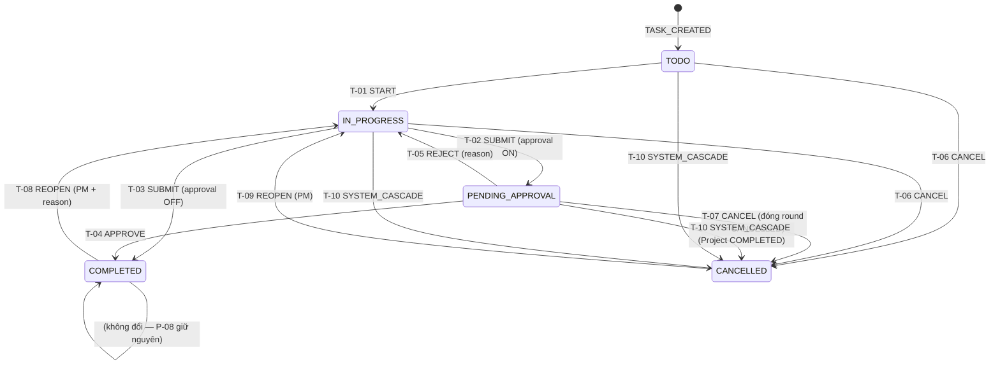
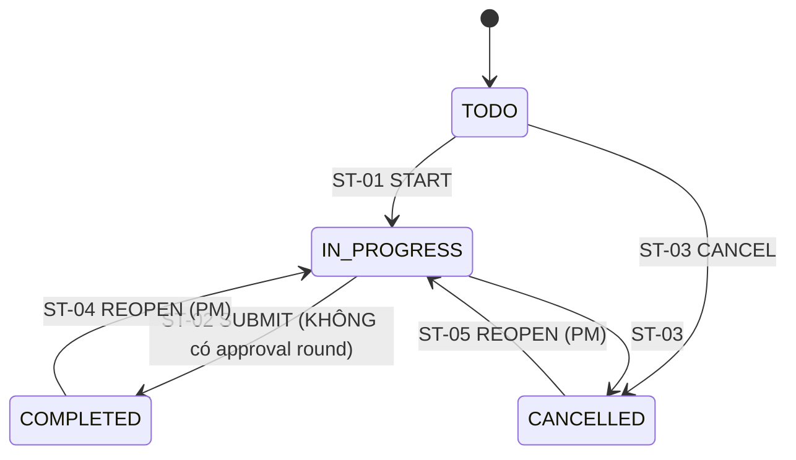
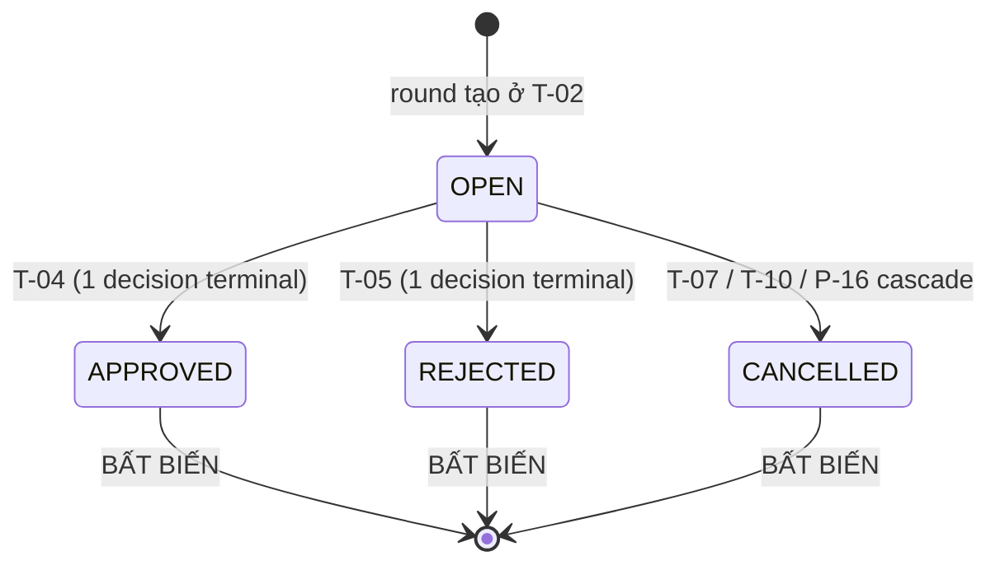
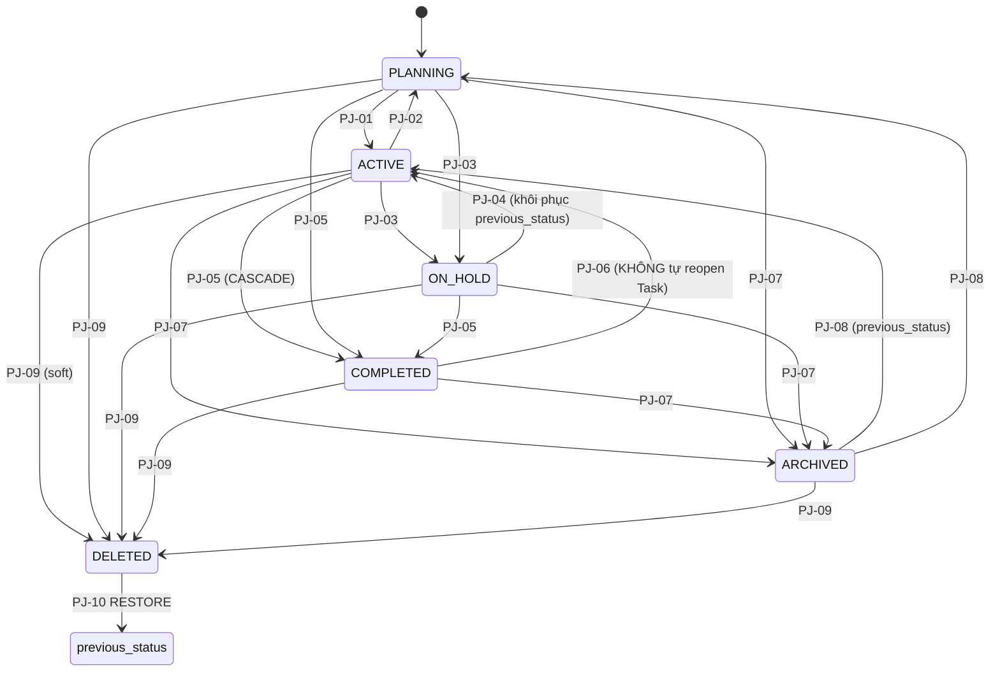
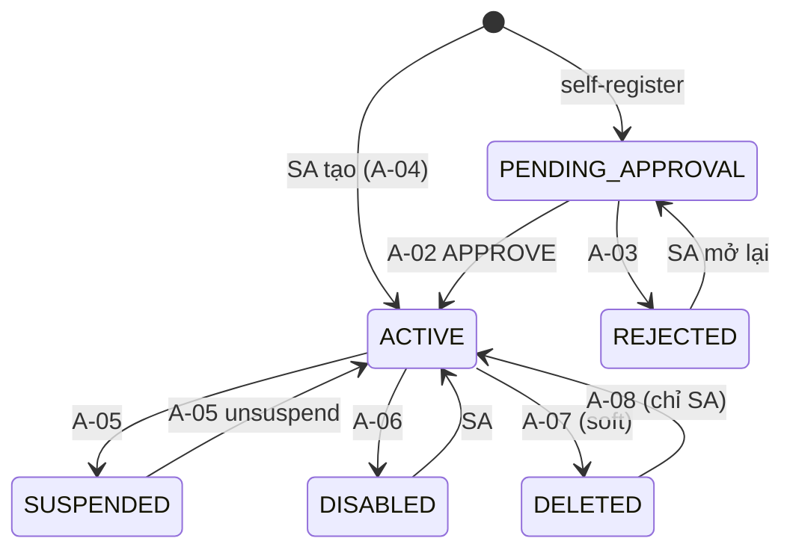
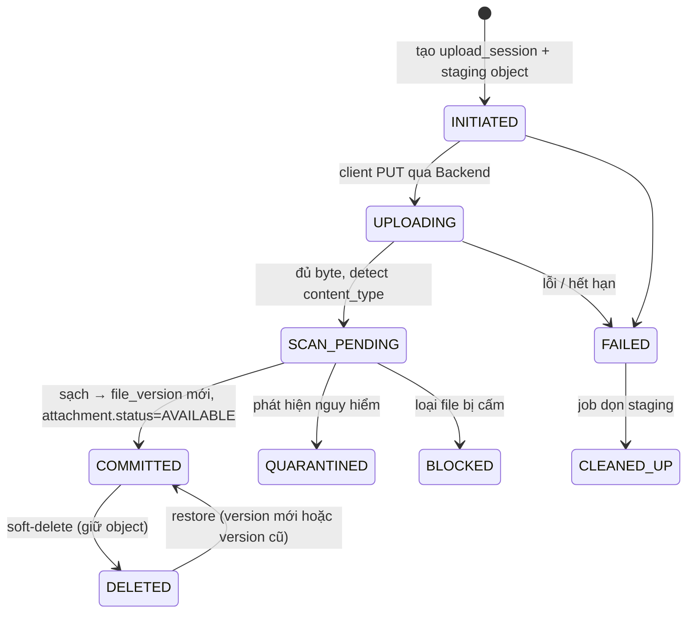
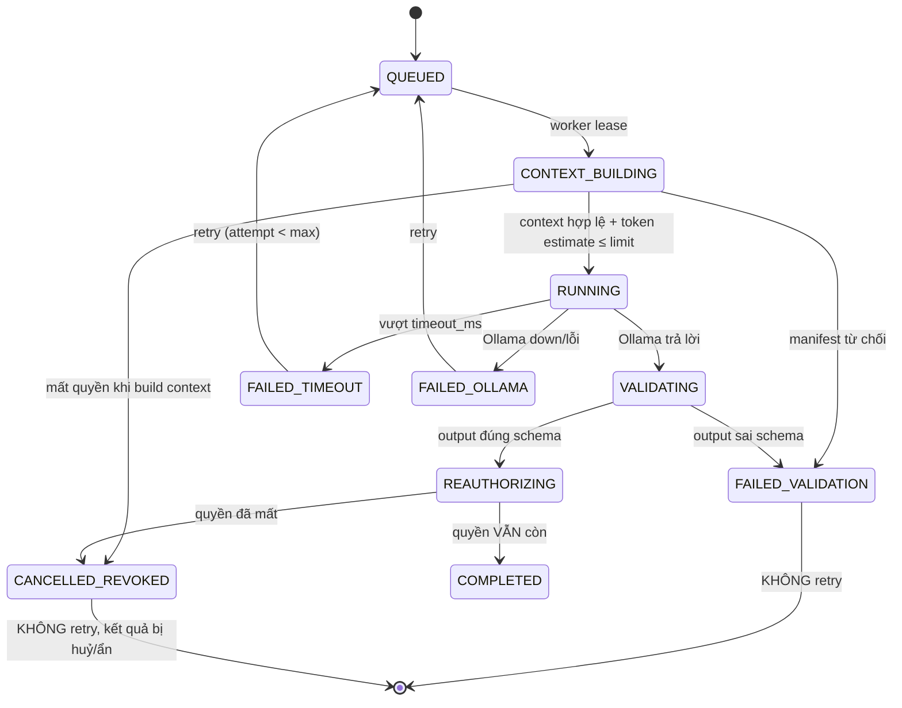
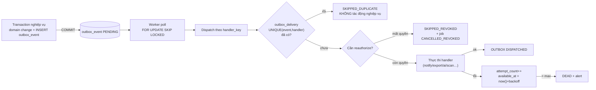

# 05 — ĐẶC TẢ WORKFLOW & STATE MACHINE

**Trạng thái:** ĐỀ XUẤT — **CHƯA FROZEN**. Bám baseline Nhóm 03, 04, 05, 06 (FROZEN) và sơ đồ đặc tả mục 14.2.
**Quy ước:** mỗi transition có `T-nn`; mỗi race case có `RACE-nn`; mỗi recovery scenario có `REC-nn`.
**Nguyên tắc:** state machine **đóng** — transition nào không có trong bảng thì **không tồn tại**. Không có đường tắt, không có trạng thái ẩn.


**Chú giải ký hiệu dùng trong các bảng:** `Y` = có / được phép / cơ chế giữ đầy đủ bất biến; `N` = không / không được phép / không thể dùng cơ chế đó; `!` = một phần (phần còn lại phải xử lý ở service layer hoặc đang chờ quyết định); `—` = không áp dụng.

---

## 1. Task (top-level) — state machine chính



### 1.1. Bảng transition đầy đủ

> **Quy ước đặt tên (AUD-52):** `T-01..T-12` ở bảng này là **transition của state machine Task**, không phải mã action RBAC. Họ action RBAC trên Task nằm ở `04-RBAC-MATRIX.md §7` và đã được đổi tên thành **`TK-01..TK-16`** để hết trùng prefix (bản draft trước cả hai đều là `T-nn`). Trích dẫn chéo phải ghi rõ nguồn: `RBAC TK-13`, `05 T-08`.

| ID | From → To | Actor được phép | Pre-condition (P7 invariant) | Hành động trong **cùng transaction** | Post-condition / side effect sau commit |
|---|---|---|---|---|---|
| **T-01** | `TODO → IN_PROGRESS` | PM, ASG, CRT (RBAC F-01) | `isValidActiveActor`; Project effective state = ACTIVE (**PLANNING chặn**); Task chưa soft-delete; WS ACTIVE | ghi `workflow_event(TASK_STARTED)`; `audit_event`; `outbox_event` | notify CRT + PM (nếu actor ≠ họ); reminder `DEADLINE` giữ nguyên; bỏ pause `TASK_PENDING_APPROVAL` nếu có |
| **T-02** | `IN_PROGRESS → PENDING_APPROVAL` | ASG; nếu Task không có ASG: PM hoặc CRT | Mọi subtask `state ∈ {COMPLETED, CANCELLED}` (I-08); `project.approval_enabled = true`; Project ACTIVE | tạo `approval_round(round_no = max+1, status='OPEN', submitted_by = actor)`; tạo `approval_designation` mặc định cho mọi PM đủ điều kiện (không phải ASG, không phải SUB); ghi event/audit/outbox | Nếu **không** có designation hợp lệ → **giữ PENDING_APPROVAL**, notify PM `APPROVAL_NO_APPROVER`, **không auto-approve**; pause reminder `DEADLINE` của ASG, tạo reminder `APPROVAL_PENDING` cho APR (Nhóm 06) |
| **T-03** | `IN_PROGRESS → COMPLETED` | như T-02 | Mọi subtask ∈ {COMPLETED, CANCELLED}; `project.approval_enabled = false` | `task.state='COMPLETED'`, `completed_at/by`; event/audit/outbox | notify PM + CRT; pause mọi reminder; cập nhật progress Project (AUD-20) |
| **T-04** | `PENDING_APPROVAL → COMPLETED` | APR hợp lệ (8.1 RBAC) | `isEligibleApprover` = TRUE; round OPEN; **chưa có** decision terminal (I-13); `FOR UPDATE` round; Task chưa soft-delete; Project effective state cho phép (AUD-02) | INSERT `approval_decision(APPROVED)`; round `status='APPROVED'`, `round_outcome='APPROVED'`; `task.state='COMPLETED'`; event/audit/outbox | notify SUB + ASG; pause reminder; progress +1 |
| **T-05** | `PENDING_APPROVAL → IN_PROGRESS` | APR hợp lệ | như T-04 + `reason` NOT NULL ≥3 ký tự | INSERT `approval_decision(REJECTED, reason)`; round `status='REJECTED'`; `task.state='IN_PROGRESS'`; event/audit/outbox | notify SUB + ASG (kèm reason); resume reminder `DEADLINE` cho ASG; **round cũ bất biến** |
| **T-06** | `TODO/IN_PROGRESS → CANCELLED` | PM, CRT | `isValidActiveActor`; Project effective state cho phép | `task.state='CANCELLED'`, `cancelled_at/by/reason`; cascade subtask chưa xong → CANCELLED (cùng `delete_group_id`? **không** — dùng `cancel_reason='PARENT_CANCELLED'`); event/audit/outbox | notify ASG; pause reminder; progress denominator −1 |
| **T-07** | `PENDING_APPROVAL → CANCELLED` | PM, CRT | như T-06 | như T-06 **+** đóng round: `round.status='CANCELLED'`, `round_outcome='CANCELLED'`, `cancelled_reason_code='TASK_CANCELLED'`; INSERT `approval_decision(CANCELLED, actor_type)` — **không** phải APPROVED/REJECTED giả mạo (Nhóm 05) | notify APR + SUB "vòng duyệt đã đóng do huỷ"; **không** ghi là đã duyệt |
| **T-08** | `COMPLETED → IN_PROGRESS` | **chỉ PM** | `reason` NOT NULL; Project ACTIVE; Task chưa soft-delete | `task.state='IN_PROGRESS'`, `completed_at=NULL`? → **KHÔNG**: giữ `completed_at` lịch sử, thêm `reopened_at/by/reason`; event `TASK_REOPENED`; audit | **Lịch sử approval giữ nguyên**; round cũ bất biến; **progress giảm** ở số liệu hiện tại nhưng **snapshot quá khứ không đổi** (AUD-15); vòng mới chỉ tạo ở lần submit kế |
| **T-09** | `CANCELLED → IN_PROGRESS` | **chỉ PM** | Project ACTIVE (nếu bị cascade bởi P-08 thì Project phải đã về ACTIVE); Task chưa soft-delete | `task.state='IN_PROGRESS'`, `cancelled_*=NULL`? → giữ lịch sử + `reopened_at/by`; event/audit | **Không tự reopen Subtask** (Nhóm 05) → subtask vẫn CANCELLED; PM phải reopen từng subtask nếu cần |
| **T-10** | `TODO/IN_PROGRESS/PENDING_APPROVAL → CANCELLED` | `SYSTEM_RULE` (actor_user_id = PM bấm P-08) | Chỉ chạy trong transaction của `PROJECT_STATUS_TO_COMPLETED` | như T-06/T-07 + `reason_code='PROJECT_COMPLETED_CASCADE'` + `closed_by_audit_event_id` (AUD-01) | **Một** digest notify cho mỗi người liên quan, không spam theo từng Task |
| **T-11** | `* → *` (soft-delete) | PM, CRT (RBAC TK-13) | State và quyền cho phép | `deleted_at/by/delete_group_id`; cascade subtask cùng `delete_group_id` | Ẩn khỏi mọi query, timeline, calendar, dashboard; **không** xoá vật lý |
| **T-12** | `deleted → khôi phục` | PM, CRT (RBAC TK-14) | Chỉ các dòng cùng `delete_group_id` **và** cha còn sống **và** Project/WS còn hợp lệ | clear `deleted_at/by/delete_group_id` | **Không** tự reopen, **không** hồi sinh assignment đã bị gỡ (AUD-29) |

### 1.2. Transition **bị cấm** (phải có test âm)

| From → To | Vì sao cấm |
|---|---|
| `TODO → COMPLETED` | Phải qua IN_PROGRESS (đặc tả 14.2). Ngoại lệ duy nhất: không có |
| `TODO → PENDING_APPROVAL` | Chưa start thì không có gì để submit |
| `COMPLETED → PENDING_APPROVAL` | "Task COMPLETED/CANCELLED không bị đổi ngược" (Nhóm 03) |
| `COMPLETED → TODO` | Reopen luôn về IN_PROGRESS (Nhóm 05) |
| `CANCELLED → COMPLETED` | Phải reopen → IN_PROGRESS → submit lại |
| `PENDING_APPROVAL → TODO` | Reject về IN_PROGRESS, "không có trạng thái REQUEST_CHANGES riêng" |
| `* → BLOCKED` | `BLOCKED` là **cờ độc lập**, không phải trạng thái (Nhóm 04) |
| Tự động `PENDING_APPROVAL → COMPLETED` khi hết approver | Cấm tuyệt đối (Nhóm 05) |
| Tự động `PENDING_APPROVAL → IN_PROGRESS` khi quá hạn SLA | "không tự reject" (Nhóm 05, AUD-08) |
| AI khởi tạo bất kỳ transition nào | Nhóm 07 + AUD-47 (DEP-04 cấm module AI depend Workflow) |

### 1.3. `BLOCKED` flag (orthogonal)

| Hành động | Ai | Ràng buộc |
|---|---|---|
| Set `blocked_flag = true` + `blocked_reason` | PM, PR, ASG, CRT | `CHECK (blocked_flag) OR (blocked_reason IS NULL)` |
| Clear | như trên | ghi `workflow_event(BLOCKED_CLEARED)` |
| Ảnh hưởng | — | **Không** chặn transition nào; chỉ hiển thị + đếm trong `TASK_BLOCKED_COUNT` (AUD-37) |

---

## 2. Subtask — state machine rút gọn (AUD-05, chờ DEC-05)



| ID | Transition | Ghi chú |
|---|---|---|
| ST-01 | `TODO → IN_PROGRESS` | Như T-01 |
| ST-02 | `IN_PROGRESS → COMPLETED` | **Đề xuất V1: subtask KHÔNG có approval round** (AUD-05). Subtask hoàn tất là điều kiện cho parent |
| ST-03 | `→ CANCELLED` | PM/CRT của subtask; cascade khi parent bị cancel (T-06/T-07/T-10) |
| ST-04/05 | reopen | Chỉ PM; **không** tự reopen khi parent reopen (T-09) |
| — | `SUBTASK_CREATE` | Chặn nếu parent `depth = 1` → 422 `SUBTASK_MAX_DEPTH_EXCEEDED` (I-07) |

**Ràng buộc parent:** `TASK_SUBMIT` (T-02/T-03) trên parent **fail** với `409 SUBTASKS_INCOMPLETE` nếu `EXISTS subtask WHERE state NOT IN ('COMPLETED','CANCELLED') AND deleted_at IS NULL`.

---

## 3. ApprovalRound — state machine



| Trạng thái | Ý nghĩa | Được phép ghi thêm? |
|---|---|---|
| `OPEN` | Đang chờ quyết định | Y INSERT `approval_decision` (tối đa 1), UPDATE `sla_breached`, INSERT/UPDATE `approval_designation` |
| `APPROVED` / `REJECTED` / `CANCELLED` | Đã có kết quả terminal | N **bất biến** (`trg_round_immutable_when_closed`, I-14). Chỉ được đọc |

**Vòng duyệt nhiều round:** mỗi lần submit tạo `round_no` mới. Round cũ **không bao giờ** bị sửa → "nhiều vòng nghiệm thu" (Nhóm 01.1) và "nhiều vòng tính riêng, không nhân theo số approver" (Nhóm 08).

**Designation lifecycle:**

| Sự kiện | Hành động |
|---|---|
| Round mở | Auto-designate mọi PM thoả `isEligibleApprover` (loại trừ ASG & SUB) |
| PM chỉ định thêm (P-21) | INSERT designation `type = DESIGNATED` |
| Approver mất membership / role / account không ACTIVE | UPDATE `revoked_at = now()`, `revoked_reason = 'LOST_MEMBERSHIP' \| 'LOST_PROJECT_ROLE' \| 'ACCOUNT_NOT_ACTIVE'` — **trong cùng transaction** với việc thu hồi (Nhóm 05: "bị thu hồi tức thời") |
| Không còn designation ACTIVE nào | Round **vẫn OPEN**; `outbox_event(APPROVAL_NO_APPROVER)` → notify PM; **không auto-approve** |
| Round đóng | Mọi designation `revoked_reason = 'ROUND_CLOSED'` |

---

## 4. Project — state machine + cascade



| ID | Transition | Pre | Trong transaction | Post |
|---|---|---|---|---|
| PJ-01 | `PLANNING → ACTIVE` | PM | ghi `previous_status`, audit, outbox | resume reminders (AUD-25: **một** digest, không bulk catch-up) |
| PJ-02 | `ACTIVE → PLANNING` | PM; **chặn** nếu còn Task `IN_PROGRESS`/`PENDING_APPROVAL`? → **cần xác nhận** (đặc tả không nói) | audit | Đề xuất: **cho phép**, Task đang chạy giữ nguyên state nhưng không start mới được |
| PJ-03 | `* → ON_HOLD` | PM | `previous_status = OLD.status`; pause `reminder_schedule` (`paused_reason='PROJECT_ON_HOLD'`) | readonly toàn phần (AUD-02) |
| PJ-04 | `ON_HOLD → ACTIVE` | PM | unpause + **recompute** schedule | **Không gửi bù**; schedule có `fire_at < now()` → huỷ + phát **một** `RESUME_DIGEST`/người (AUD-25) |
| PJ-05 | `* → COMPLETED` | PM; **không bắt buộc lý do** (Nhóm 03) | **CASCADE đồng bộ:** mọi top-level Task `state ∉ {COMPLETED}` → CANCELLED (T-10); mọi Subtask chưa xong → CANCELLED; mọi round OPEN → CANCELLED; mọi Milestone `status='OPEN'` → CANCELLED; `completed_cascade_audit_id` | Một digest cho mỗi người liên quan; progress = 100% hoặc `N/A` |
| PJ-06 | `COMPLETED → ACTIVE` | PM | **Không** tự reopen Task CANCELLED (Nhóm 03) | PM phải `TASK_REOPEN_FROM_CANCELLED` từng Task |
| PJ-07 | `* → ARCHIVED` | PM | `previous_status`; pause reminders | readonly |
| PJ-08 | `ARCHIVED → previous_status` | PM | unpause + recompute | digest |
| PJ-09 | `* → DELETED` (soft) | PM + reauth | `delete_group_id`; cascade soft-delete Task? → **đề xuất KHÔNG cascade soft-delete**, chỉ đánh dấu Project DELETED và chặn mọi truy cập | Ẩn hoàn toàn (P3 → 404) |
| PJ-10 | `DELETED → previous_status` | PM + reauth | theo `delete_group_id` | **Không** hồi sinh membership |

**Tương tác `approval_enabled` (Nhóm 03):**

| Tình huống | Hành vi |
|---|---|
| Bật giữa chừng (P-15) | Áp dụng cho Task **đang thực hiện**: Task `IN_PROGRESS` lần submit kế sẽ vào `PENDING_APPROVAL`. Task `TODO` cũng áp dụng. **Không** hồi tố Task đã COMPLETED |
| Tắt giữa chừng (P-16) | **Chặn** nếu `EXISTS approval_round(status='OPEN')` trong Project → `409 PENDING_APPROVALS_EXIST`. PM phải xử lý (approve/reject/cancel) hết trước |
| Task COMPLETED/CANCELLED | **Không bị đổi ngược** khi toggle setting |

---

## 5. Workspace — state machine

```mermaid
stateDiagram-v2
  [*] --> ACTIVE
  ACTIVE --> ARCHIVED : WS-01 (WO + reauth)
  ARCHIVED --> ACTIVE : WS-02 (WO)
  ACTIVE --> DELETED : WS-03 (WO, chỉ TEAM; soft)
  ARCHIVED --> DELETED : WS-03
  DELETED --> ACTIVE : WS-04 (restore)
```



| ID | Transition | Ràng buộc đặc biệt |
|---|---|---|
| WS-01 | `ACTIVE → ARCHIVED` | WO + reauth. **Được phép dù còn Task dở dang** (Nhóm 02) → readonly + pause reminders. **Personal Workspace: không archive độc lập** |
| WS-02 | `ARCHIVED → ACTIVE` | WO; unpause + recompute + **một** digest |
| WS-03 | `→ DELETED` | **Personal Workspace KHÔNG thể xoá độc lập** (bất biến Nhóm 02) → `409 PERSONAL_WORKSPACE_IMMUTABLE`. Team: chỉ WO + reauth. **Không** cho phép nếu còn Project chưa DELETED? → đề xuất: yêu cầu archive/soft-delete Project trước, trả `409 WORKSPACE_HAS_ACTIVE_PROJECTS` (**cần xác nhận**) |
| WS-04 | restore | WO; không hồi sinh membership (AUD-29) |

**Owner transfer (WS-OWNER-TRANSFER, AUD-28):**
```
BEGIN;
  SELECT * FROM workspace WHERE id = $ws FOR UPDATE;
  -- validate: target là membership ACTIVE, role ≠ GUEST, user.status = ACTIVE
  UPDATE workspace_membership SET role='MEMBER', updated_at=now() WHERE workspace_id=$ws AND role='OWNER';
  UPDATE workspace_membership SET role='OWNER',  updated_at=now() WHERE id=$targetMembershipId;
  UPDATE workspace SET owner_user_id=$targetUserId, version=version+1 WHERE id=$ws;
  INSERT audit_event(...); INSERT outbox_event('WORKSPACE_OWNER_TRANSFERRED');
COMMIT;
```
`uq_wsm_single_owner` bảo đảm **không bao giờ** có 0 hoặc 2 Owner ở cuối transaction (partial unique index chỉ chặn ≥2; trường hợp 0 Owner bị chặn bởi trigger `guard_owner_transfer`).
**Vai trò Project của 2 người KHÔNG tự thay đổi** (Nhóm 02).

---

## 6. Account & Session lifecycle



| Bất biến | Cơ chế |
|---|---|
| Personal Workspace tạo **khi account chuyển ACTIVE** | Cùng transaction với A-02/A-04/A-08 → thoả "mỗi ACTIVE account đúng một Personal Workspace" |
| Account rời ACTIVE → **mọi** session revoke + push unregister + job `CANCELLED_REVOKED` + redact notification | outbox event `ACCOUNT_STATUS_CHANGED` → consumer MOD-09, MOD-14 |
| SA cuối cùng | `protected_flag` + trigger `guard_last_system_admin` (I-21) |
| Không cấp lại email/username | unique index toàn phần (AUD-31, I-16) |

**Session (AUD-19):**
```
LOGIN:
  BEGIN;
    SELECT id FROM user_session WHERE user_id=$u AND status='ACTIVE' FOR UPDATE;   -- tối đa 1 dòng
    UPDATE user_session SET status='REVOKED_LOGIN_ELSEWHERE', revoked_at=now(), revoked_by_user_id=$u WHERE user_id=$u AND status='ACTIVE';
    -- device_push_registration cascade theo session_id (ON DELETE không dùng; dùng UPDATE status='UNREGISTERED' trong cùng tx)
    INSERT user_session(...) VALUES (...) ;   -- uq_user_session_single_active bảo đảm 1 dòng
    INSERT user_refresh_token(...);
    INSERT security_event('LOGIN_SUCCESS'); INSERT outbox_event('SESSION_REVOKED' cho phiên cũ);
  COMMIT;
```

---

## 7. File lifecycle (Nhóm 09, đặc tả 14.4)



| Bước | Kiểm tra quyền | Ghi chú |
|---|---|---|
| `INITIATED` | `FILE_UPLOAD` (FL-01) + state cho phép | Chặn khi Task PENDING_APPROVAL |
| `UPLOADING` | re-check `FILE_UPLOAD` ở **mỗi** chunk/PUT | Không dùng token dài hạn |
| `SCAN_PENDING` | — | `file.scan_enabled = false` → `scan_status = 'UNSUPPORTED'`; **phải ghi rõ là chưa có bảo vệ malware**, không tuyên bố đã quét |
| `COMMITTED` | — | `file_version.version_no` tăng, **không ghi đè** object (I-18) |
| `PREVIEW`/`DOWNLOAD` | `FILE_PREVIEW`/`FILE_DOWNLOAD` **tại mỗi request** (ARCH-07) | `StreamTicket` single-use TTL ≤30s; ghi `file_access_event` kể cả khi **DENIED** |
| `AI_READ` | quyền hiện tại của **người yêu cầu** AI | Ghi `file_access_event(access_type='AI_READ')` |

**Reconciliation DB ↔ Object Storage (mục 20 rủi ro "DB và Object Storage lệch nhau — Cao"):** job `STORAGE_RECONCILE` chạy định kỳ, so sánh `file_object(status='COMMITTED')` với object thật trong bucket; lệch → đánh dấu `ORPHANED`/`MISSING` + `security_event` + cảnh báo vận hành. **Không** tự xoá.

---

## 8. AI job lifecycle (AUD-41, AUD-48, Nhóm 07, đặc tả 14.5)



| Điểm kiểm soát | Bắt buộc |
|---|---|
| Trước khi build context | `isValidActiveActor(principal_user_id, scope)` — quyền **tại thời điểm chạy**, không phải lúc enqueue |
| Context | Chỉ theo `ai_context_manifest` (AUD-39); bọc delimiter; cấm trường nhạy cảm (AUD-40) |
| Output | Validate JSON schema; loại trường ngoài scope; **không** cho output thành mutation |
| **Trước khi giao kết quả** | **Reauthorize lần 2** (`REAUTHORIZING`) — NFR-24; nếu mất quyền → `CANCELLED_REVOKED`, xoá `ai_suggestion`, `ai_suggestion.status = 'REDACTED'`, ghi audit |
| Ollama lỗi | `FAILED_OLLAMA`/`FAILED_TIMEOUT` + retry có giới hạn; **core nghiệp vụ không ảnh hưởng** (NFR-12) |
| Concurrency | `ai.max_concurrency` (đề xuất 1 trên máy dev — AUD-41) |
| Idempotency | `idempotency_key` UNIQUE trên `ai_job` |

---

## 9. Background job & outbox lifecycle (ARCH-04, ARCH-05, NFR-24)



| ID | Tình huống | Hành vi bắt buộc |
|---|---|---|
| REC-01 | Worker chết giữa lúc xử lý | `lease_expires_at` hết hạn → worker khác nhận lại; `outbox_delivery` UNIQUE ngăn tác động nghiệp vụ bị lặp (test 19.2) |
| REC-02 | Outbox delivery lặp (at-least-once) | `INSERT … ON CONFLICT DO NOTHING` trên `uq_delivery_handler`; nếu conflict → `SKIPPED_DUPLICATE` |
| REC-03 | Transaction nghiệp vụ rollback | `outbox_event` **cũng** rollback (cùng tx) → không có thông báo ma |
| REC-04 | Notification gửi fail sau commit | Retry **notification**, **không** lặp approve (đặc tả 14.3 bước 4) |
| REC-05 | Job đang chạy thì quyền bị thu hồi | Bước nhạy cảm kế tiếp reauthorize → fail → `CANCELLED_REVOKED`; kết quả đã sinh bị huỷ/ẩn; **không retry** |
| REC-06 | Job enqueue trùng (client retry) | `uq_job_dedup_alive` + `idempotency_key` → trả lại job cũ |
| REC-07 | DB restore về điểm cũ hơn Object Storage | `STORAGE_RECONCILE` phát hiện lệch; **không** tự sửa; báo vận hành |
| REC-08 | App restart khi đang migrate | Flyway lock (`flyway_schema_history`) ngăn chạy song song |

---

## 10. Catalogue race condition và cách giải quyết

| ID | Race | Kịch bản | Cơ chế chặn | Kết quả trả về | Test |
|---|---|---|---|---|---|
| **RACE-01** | 2 approver approve đồng thời | APR-A và APR-B cùng POST `/tasks/{id}/workflow/approve` | (1) `FOR UPDATE` trên round; (2) `uq_decision_single_terminal`; (3) `task.version` | Người thắng: 200. Người thua: **409 `APPROVAL_ALREADY_DECIDED`** + body chứa quyết định đã thắng | TC-R01 |
| **RACE-02** | Approve đồng thời với Cancel | APR approve trong khi PM cancel | `FOR UPDATE` trên round **và** task; transaction nào lock trước thắng | Thua: 409 `TASK_STATE_CHANGED` | TC-R02 |
| **RACE-03** | Submit đồng thời với Project COMPLETED | ASG submit trong khi PM bấm COMPLETED | Lock `project` trước trong cascade (PJ-05); submit lock task → thấy project state đã đổi → fail | 409 `PROJECT_READONLY` | TC-R03 |
| **RACE-04** | Owner transfer đồng thời 2 hướng | WO transfer cho A trong khi (khẩn cấp) SA transfer cho B | `FOR UPDATE` trên `workspace`; `uq_wsm_single_owner` | Thua: 409 `OWNER_ALREADY_TRANSFERRED` | TC-R04 |
| **RACE-05** | Remove Manager cuối đồng thời với add Manager mới | 2 PM cùng thao tác | `FOR UPDATE` trên `project` cho cả P-12 và P-13; constraint trigger DEFERRED `trg_project_has_manager` kiểm ở cuối tx | 409 `LAST_PROJECT_MANAGER` | TC-R05 |
| **RACE-06** | Login đồng thời trên 2 thiết bị | Web và Mobile login cùng lúc | `FOR UPDATE` trên dòng session ACTIVE + `uq_user_session_single_active` | Một phiên thắng, phiên kia bị revoke ngay khi tạo | TC-R06 |
| **RACE-07** | Thêm dependency tạo chu trình đồng thời (A→B và B→A) | 2 user khác nhau | `FOR UPDATE` trên **cả hai** task theo thứ tự `id` tăng dần (chống deadlock) rồi mới dò chu trình | 422 `DEPENDENCY_CYCLE_DETECTED` | TC-R07 |
| **RACE-08** | 2 request upload cùng attachment → version_no trùng | Client retry | `UNIQUE (attachment_id, version_no)` + `idempotency_key` | Một bản thắng, bản kia 409 hoặc trả lại kết quả cũ | TC-R08 |
| **RACE-09** | Download song song với revoke quyền | User A tải file trong khi WO gỡ A khỏi Project | Mỗi request kiểm tra quyền **tại thời điểm request** (ARCH-07); stream đang chạy có thể hoàn tất (**residual risk có chủ đích**) | Request mới: 404. Stream đang chạy: hoàn tất hoặc bị cắt ở chunk kế (cần chốt DEC) | TC-R09 |
| **RACE-10** | Outbox consumer xử lý lặp | 2 worker cùng poll | `FOR UPDATE SKIP LOCKED` + `uq_delivery_handler` | Một worker xử lý, worker kia `SKIPPED_DUPLICATE` | TC-R10 |
| **RACE-11** | Reopen đồng thời với submit mới | PM reopen trong khi ASG submit | `FOR UPDATE` task; `task.state` phải khớp precondition | 409 `TASK_STATE_CHANGED` | TC-R11 |
| **RACE-12** | Tắt approval đồng thời với submit | PM tắt `approval_enabled` trong khi ASG submit | `FOR UPDATE` trên **dòng `project`** khi đổi `project.approval_enabled` (cột nằm ở `02A §4.1`, **không** phải `project_setting`); submit đọc `approval_enabled` **trong cùng tx sau khi lock task** | Hoặc submit vào PENDING_APPROVAL (setting cũ), hoặc thẳng COMPLETED (setting mới) — **không** có trạng thái nửa vời | TC-R12 |
| **RACE-13** | 2 job AI cùng principal, revoke giữa chừng | Revoke membership khi 2 job AI đang RUNNING | Cả 2 reauthorize ở bước `REAUTHORIZING` → cả 2 `CANCELLED_REVOKED` | Không trả kết quả nhạy cảm (test 19.2) | TC-R13 |
| **RACE-14** | Mark-all-read đồng thời với redaction | User mark all read trong khi hệ thống redact scope | `redacted` là cờ riêng, UPDATE theo scope có `WHERE redacted = false` | Không lộ payload đã redact | TC-R14 |
| **RACE-15** | Snapshot daily chạy đồng thời với mutation | Job snapshot lúc 23:59 trong khi user approve | `REPEATABLE READ` cho transaction snapshot; `uq_snapshot_point` ngăn ghi lại | Snapshot nhất quán tại một thời điểm | TC-R15 |

**Quy tắc chống deadlock chung:** mọi transaction chạm nhiều dòng của **cùng một bảng** phải lock theo thứ tự `id` tăng dần (áp dụng cho RACE-07, cascade PJ-05, remove nhiều membership).

---

## 11. Ma trận tương tác reminder / notification theo trạng thái

| Trạng thái | Reminder `DEADLINE` cho ASG | Reminder `APPROVAL_PENDING` cho APR | Overdue reminder | Realtime |
|---|---|---|---|---|
| Task TODO/IN_PROGRESS | Y chạy | — | Y khi `due_at < now()` | Y |
| Task PENDING_APPROVAL | **pause** (Nhóm 06: "ngừng reminder thực thi cho assignee") | Y chạy | ! phân biệt "đang chờ duyệt" trong báo cáo | Y |
| PENDING_APPROVAL không có APR | | — | → notify **PM** `APPROVAL_NO_APPROVER` | Y |
| Task COMPLETED/CANCELLED | huỷ | huỷ | huỷ | Y (event cuối) |
| Project ON_HOLD/ARCHIVED | pause (`paused_reason`) | pause | pause | Y metadata only |
| Project COMPLETED | huỷ (Task đã CANCELLED) | huỷ (round đã CANCELLED) | huỷ | Y digest |
| Workspace ARCHIVED | pause | pause | pause | Y |
| Resume (Project/WS) | **recompute**, huỷ schedule quá hạn, phát **một** `RESUME_DIGEST`/người | như vậy | **không** gửi bù hàng loạt (Nhóm 06, AUD-25) | Y |
| Mất quyền (revoke) | huỷ schedule của người bị gỡ | huỷ designation + schedule | — | redact notification + chặn deep link (AUD-13) |
| Quiet hours | defer (`deferred_to`) | defer | defer | **SECURITY_CRITICAL gửi ngay** (Nhóm 06) |
| Mute theo loại | skip | skip | skip | **SECURITY_CRITICAL vẫn gửi** |
| Session revoke / login nơi khác | — | — | — | đóng WebSocket, huỷ push registration (AUD-19) |

---

## 12. Điểm CHƯA chốt của workflow

| Vùng | DEC | Nếu quyết định khác |
|---|---|---|
| Subtask có approval round | **DEC-05** | Thêm state `PENDING_APPROVAL` cho subtask; parent completion phải chờ approval từng subtask → độ phức tạp tăng ~2 lần, cần thêm round/decision cho subtask |
| PENDING_APPROVAL khoá gì | **DEC-06** | Đổi cột pre-condition của T-02..T-07 và RBAC TK-04/TK-07/TK-09/TK-11/FL-01/FL-03 |
| PLANNING có cho start Task | RBAC §16 | Nếu cho phép → đổi P6 của PLANNING và T-01 |
| ON_HOLD có chặn workflow | **DEC-02** | Nếu **không** chặn → approve/reject vẫn chạy khi ON_HOLD; khi đó phải sửa **ba** chỗ: (1) `04 §3` dòng `ON_HOLD_READONLY` thu hẹp từ "mọi mutation nội dung **và workflow**" còn "chỉ mutation nội dung"; (2) P6 ngừng từ chối T-02..T-07 khi effective state = `ON_HOLD_READONLY`; (3) mã lỗi `PROJECT_READONLY` (`03 §…` bảng mã lỗi) không còn được trả cho workflow transition trên Project ON_HOLD. **RACE-03 không bị ảnh hưởng** — RACE-03 là race giữa submit và Project **COMPLETED** (PJ-05), độc lập với DEC-02 (đã sửa theo X-03) |
| Actor của cascade PJ-05 | **DEC-01** | Nếu async job → phải thêm trạng thái trung gian `COMPLETING` cho Project và chấp nhận cửa sổ bất nhất |
| Approval SLA có auto-action | **DEC-08** | Nếu có auto-escalate/assign → thêm transition và phá vỡ "không tự approve" |
| Project DELETED có cascade soft-delete Task | PJ-09 | Nếu cascade → cần `delete_group_id` cho toàn bộ Task |
| Workspace DELETED khi còn Project | WS-03 | Nếu cho phép → cần cascade soft-delete Project |
| Stream đang chạy khi revoke (RACE-09) | **DEC-51** | Nếu phải cắt ngay → cần streaming qua gateway có kiểm tra quyền theo chunk, tốn hiệu năng |
| Subtask của subtask bị xoá mềm theo group | T-11/T-12 | Đã xử lý bằng `delete_group_id` |
