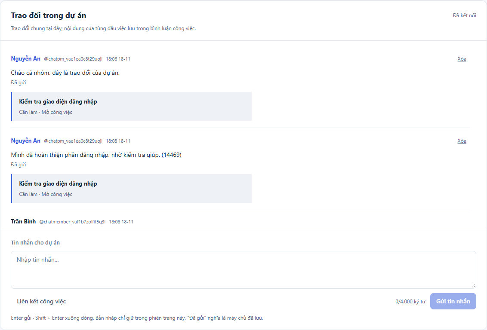
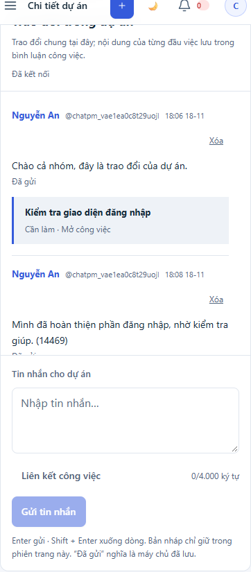

# Báo cáo triển khai trao đổi trong dự án

Ngày: 18/11/2026. Bản triển khai trong source, chưa tự commit/push hoặc triển khai vào database đang dùng.

## Những gì đã hoàn thành

- Thêm tab **Trao đổi** trong dự án và số tin chưa đọc.
- Lưu tin văn bản vào PostgreSQL, gửi qua API, nhận tín hiệu qua SSE đang có; không thêm dịch vụ hoặc dependency.
- Gửi lại cùng định danh không tạo bản sao; xung đột nội dung được từ chối.
- Lịch sử phân trang, tải bù khi kết nối lại và đồng bộ dấu xóa của tin cũ.
- Liên kết công việc chọn theo tên; không lộ tên/link cho người không có quyền xem công việc đó.
- Xóa tin của mình có xác nhận; quản lý xóa tin người khác phải có lý do. API che nội dung đã xóa.
- Dấu đã đọc đơn điệu, không tính tin tự gửi hoặc tin đã xóa; giữ vị trí khi đọc lịch sử.
- Bản nháp trong bộ nhớ được tách theo tài khoản/dự án và xóa khi mất quyền; nội dung không vào bộ nhớ lưu trữ lâu dài của trình duyệt.
- Giao diện tiếng Việt, dùng bàn phím và điện thoại; không gửi nhầm khi đang thao tác bộ gõ.

## Quy trình thực hiện

1. Rà kế hoạch đã lưu, luồng thành viên, xác thực, trạng thái dự án, realtime, bình luận, bộ chọn và migration.
2. Chọn PostgreSQL sẵn có, bổ sung migration V18 và khóa/ràng buộc cho thứ tự, gửi lại và đã đọc.
3. Viết API có kiểm tra quyền, giới hạn nội dung/gửi, che nội dung nhạy cảm và phát sự kiện sau commit.
4. Gắn giao diện chat vào dự án; dùng bộ chọn công việc hiện có và kết nối SSE dùng chung.
5. Bổ sung tín hiệu riêng khi gỡ thành viên để đóng phòng và cập nhật quyền ở người bị gỡ.
6. Kiểm thử bằng PostgreSQL riêng tại loopback cổng **55447**, backend riêng **8086**, web riêng **5183**; không dùng database development/production.
7. Nghiệm thu hai trình duyệt với hai tài khoản thật trong database kiểm thử, chụp vùng giao diện máy tính/điện thoại và lưu bằng chứng.

## Kết quả xác minh

| Kiểm tra | Kết quả | Phạm vi |
| --- | --- | --- |
| TypeScript | Đạt | Toàn bộ web |
| Lint | Đạt | Không có lỗi hoặc cảnh báo lint |
| Kiểm thử web | 82/82 đạt, 28 tệp | Hồi quy và 10 tình huống chat, gồm sửa bản gửi lỗi |
| Backend tập trung | 25 đạt, 0 lỗi, 0 bỏ qua | 11 kiểm thử tích hợp PostgreSQL, 2 validation, 3 kiến trúc và 9 workspace/project đọc thật qua repository mock |
| Đóng gói backend | Đạt | Maven package, Java 21 |
| Bản dựng web | Đạt | Vite production build; còn cảnh báo kích thước gói trên 500 kB |
| Hai trình duyệt thật | 6 nhóm nghiệm thu đạt | Backend thật, PostgreSQL thật trong môi trường kiểm thử riêng; không mock API |
| Máy tính/điện thoại | Đạt | Kiểm tra rộng 1440/1280 px và 390 px, không tràn ngang trang |

Lệnh backend: `mvnw.cmd -B -o -pl app -Dtest=ProjectChatIT,ProjectChatValidationTest,ArchRulesTest,WorkspaceProjectRealReadTest package`. Database kiểm thử riêng được tạo từ cluster `.run/chat/pgdata`; Flyway áp dụng V1–V18. Không chạy toàn bộ suite backend cần các dịch vụ khác hoặc Testcontainers.

Hai lượt gửi quan sát trong nghiệm thu trình duyệt xuất hiện ở phía nhận trong **236 ms** và **284 ms**. Đây là hai mẫu trên môi trường cục bộ, không phải benchmark hoặc số liệu p95.

Đã kiểm tra thực tế: nhận qua SSE không tải lại trang; gửi lại sau lỗi mạng; mốc đã đọc trong database; xóa tin và che body; mất mạng rồi tải bù; gỡ thành viên làm đóng phòng và API từ chối. Không có lỗi JavaScript được ghi nhận trong lượt nghiệm thu.

## Giao diện thực tế

Ảnh dưới đây chụp ứng dụng đang chạy với backend và PostgreSQL kiểm thử thật, dữ liệu/tài khoản chỉ để nghiệm thu.

### Máy tính

### Điện thoại

## Tài liệu và giới hạn

[Hướng dẫn sử dụng, quyền, API và triển khai](PROJECT-CHAT.md) · [Bằng chứng trình duyệt](screenshots/project-chat/ket-qua.json)

Chưa đo tải lớn hoặc thử nhiều backend. Chưa bổ sung trả lời theo nhánh, nhắc tên, tệp, trạng thái đang gõ, nhắn riêng hoặc gọi thoại/video. Backend mới cần migration V18; PostgreSQL thực tế cần volume bền vững và sao lưu, không chỉ mốc Git.
