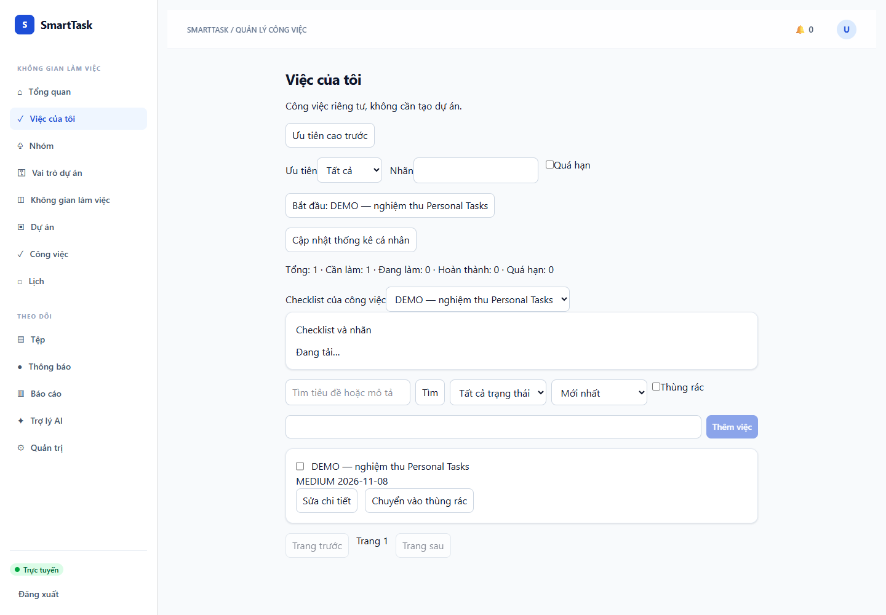
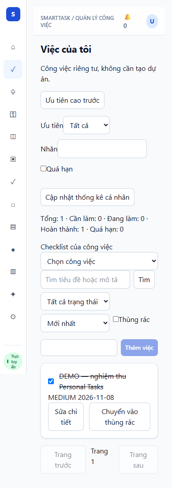

# Personal Tasks — bàn giao và nghiệm thu

Ngày 01/11/2026. Hoàn thành luồng Personal Tasks đã triển khai; không phải nghiệm thu toàn bộ V2.

## Chức năng đã triển khai

- /my-tasks: tạo nhanh chỉ cần tiêu đề, không cần Workspace/Project; sửa tiêu đề, mô tả, ghi chú, ưu tiên và lịch.
- TODO → IN_PROGRESS; hoàn thành/bỏ hoàn thành với completedAt, audit và version.
- Checklist riêng từng task, thêm/tick, tiến độ; không tự hoàn thành Task. Nhãn được chuẩn hóa và chống trùng.
- Tìm theo tiêu đề/mô tả; lọc state/priority/tag/overdue; sort ngày tạo, deadline, title và priority theo URGENT/HIGH/MEDIUM/LOW; phân trang database tối đa 100.
- Xóa mềm, thùng rác, khôi phục giữ nội dung. Chỉ owner truy cập; ngoài phạm vi trả 404.
- Summary GROUP BY/COUNT tại database, được kiểm thử với >100 task.
- Idempotency create trên store hiện có và advisory transaction lock, hai retry đồng thời chỉ tạo một task. Replay cùng key khác title trả 409. Frontend giữ key trong vòng đời component khi retry.
- If-Match/version và row lock bảo vệ mutation; chấp nhận numeric/quoted/W-quoted tương thích API cũ. DTO TaskView tách response Task khỏi entity JPA.
- Hạn chỉ có ngày dùng múi giờ IANA, tính cuối ngày trước nửa đêm kế tiếp; test ngày DST mùa xuân và mùa thu. Giao diện date-only hiển thị ngày, datetime hiển thị theo giờ địa phương.
- Loading/error/empty, bảo vệ response cũ khi đổi filter, refresh checklist theo version và nút tải lại sau conflict; giao diện desktop/mobile.

## API

Tất cả dưới /api/v1/me/tasks: GET list, POST create (Idempotency-Key), GET /summary, GET /{id}, PATCH /{id}, DELETE /{id}, POST /{id}/restore, POST /{id}/start, PATCH /{id}/completion, POST /{id}/checklist, PATCH /{id}/checklist/{itemId}, PUT /{id}/labels. Mutation theo Task yêu cầu If-Match. Trạng thái giữ COMPLETED theo API hiện hữu.

## Database và tương thích

V13__personal_tasks.sql mở rộng task: scope mặc định PROJECT cho dữ liệu cũ, owner_user_id, notes; nới project_id nhưng có CHECK phạm vi và owner, index owner. Giữ tất cả liên kết Project cũ; dùng lại checklist_item, task_tag, audit và idempotency_record. Không xóa bảng hoặc dữ liệu.

V13 đã chạy từ V12 trên DB test và từ DB integration sạch cùng V1–V13. Chưa chạy production. Backup PostgreSQL/MinIO và thử restore trước deploy. Rollback application chỉ thực hiện với schema mở rộng còn nguyên và Personal Tasks bị ẩn; không ép project_id NOT NULL khi đã có task cá nhân.

## Kiểm thử thực chạy

| Kiểm tra | Kết quả |
| --- | --- |
| Maven backend default suite | 326 tests, 0 failures, 0 errors, 2 skipped; BUILD SUCCESS |
| PersonalTaskServiceTest + PersonalTaskApiIT + TaskVersionTest | 10/10 PASS |
| Frontend Vitest | 5 suites, 17/17 PASS |
| npm run build | PASS |
| Edge headless browser E2E | PASS |

Default suite không tự bao gồm *IT; integration được chạy riêng. Hai test skip là AI live/benchmark. DB thực tế PostgreSQL 18.6 trên cụm test riêng ở loopback 5433; Flyway cảnh báo phiên bản PostgreSQL mới hơn phạm vi đã được thư viện kiểm chứng. Không coi kết quả này thay nghiệm thu PostgreSQL 16/Docker.

E2E: đăng nhập UI → tạo task → sửa ghi chú/date-only → checklist → labels → hoàn thành → reload giữ trạng thái → xóa mềm → thùng rác → khôi phục → ảnh mobile. Fixture có tiền tố DEMO, trên smarttask_itg, được giữ lại; không có dữ liệu production. Test API riêng kiểm tra 401/404/409, phạm vi owner, replay/concurrency, checklist không tự hoàn thành Task và dữ liệu giữ sau khôi phục.

Bằng chứng backend: backend/app/target/surefire-reports (output build có thể bị ghi lại ở lần chạy sau). Browser script: web/scripts/personal-tasks-e2e.mjs. Playwright cài riêng .tools/browser, không thêm dependency production hoặc skill mới. npm cài tạm trong web lần đầu lỗi; phương án thư mục công cụ riêng thành công.

Lệnh chính:

```powershell
$env:JAVA_HOME='C:\Program Files\Java\jdk-21'
& .\.tools\apache-maven-3.9.11\bin\mvn.cmd -B -f backend/pom.xml test
& .\.tools\apache-maven-3.9.11\bin\mvn.cmd -B -f backend/app/pom.xml '-Dtest=PersonalTaskServiceTest,PersonalTaskApiIT,TaskVersionTest' test
cd web
npm.cmd run build
npm.cmd test
node scripts/personal-tasks-e2e.mjs
```

Browser script cần Edge, Playwright tại .tools/browser và backend local 8181 + Vite 5174 với VITE_API_PROXY_TARGET=http://127.0.0.1:8181. Vite mặc định vẫn proxy 8080. Backend dùng DB test smarttask_itg; không chạy script vào production. Dịch vụ 8080 của người dùng không bị dừng.

## Ảnh runtime

Ảnh có dữ liệu demo, không có token/mật khẩu. Đã xem ảnh mobile và sửa min-width sidebar gây chật nội dung.





## Giới hạn nghiệm thu

- Docker Compose/Ubuntu/PostgreSQL 16 chưa chạy; không khẳng định đã nghiệm thu môi trường đó.
- Browser chạy Edge desktop và viewport mobile, chưa chạy trên thiết bị điện thoại thật.
- Summary là toàn bộ việc cá nhân, không tự đổi phạm vi theo filter danh sách.
- Retry create trả cùng ID và dữ liệu Task hiện tại, không phải bản sao byte-for-byte response lúc tạo; pending key không tồn tại qua reload.
- If-Match thiếu header hiện do Spring xử lý, chưa thống nhất 428 với mọi API cũ. Date-only input dùng timestamp mang ngày + dueIsDateOnly/dueTimezone; cần giữ hợp đồng này ở client ngoài web.
- Không có chuyển Personal Task sang Project hoặc chuyển owner trong giao diện. Không tự động thay phạm vi riêng tư.
- Các đợt Teams, notification/reminder và dashboard/view toàn hệ thống tiếp tục độc lập; chưa hoàn thành V2.

Không commit/push/deploy trong đợt này.
