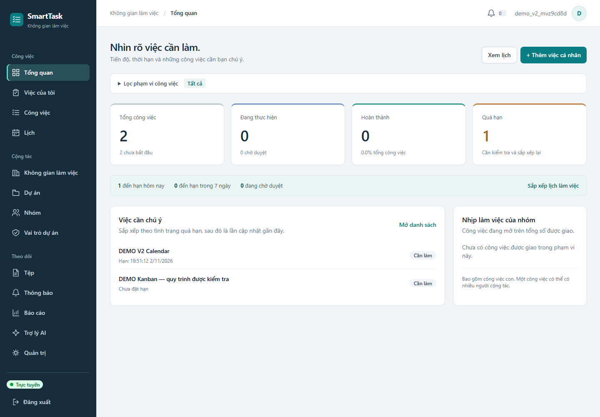
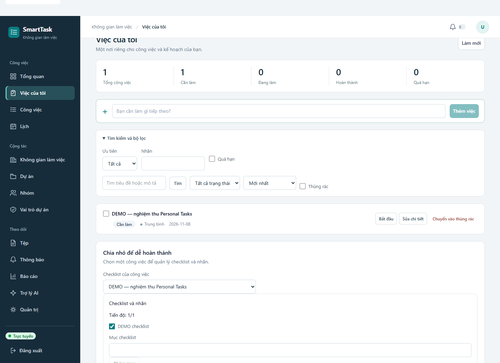
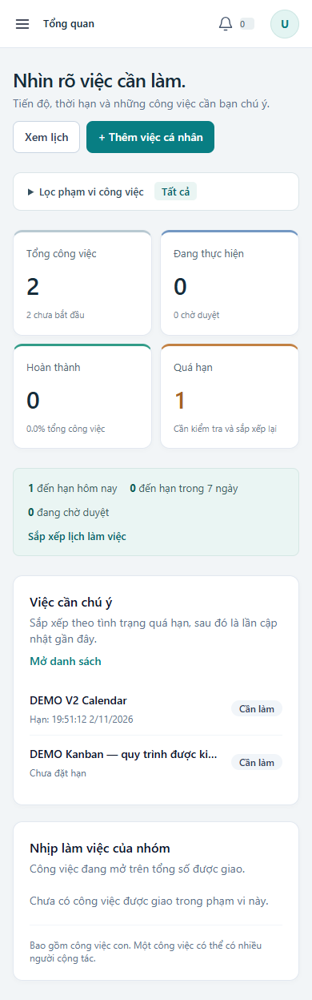
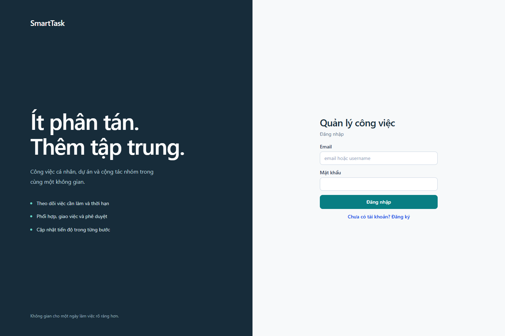

# Thiết kế lại giao diện SmartTask — 02/11/2026

## Phạm vi và kỹ năng

Đã cài frontend-design từ anthropics/skills vào C:/Users/PC/.codex/skills/frontend-design. Mục đích: tổ chức bố cục, hệ màu, chữ, khoảng cách, nội dung thao tác và đánh giá ảnh thực tế. Không thêm thư viện UI vào ứng dụng.

Thiết kế dành cho công việc cá nhân và phối hợp nhóm: thanh điều hướng chia Công việc/Cộng tác/Theo dõi; phần nội dung ưu tiên thông tin cần xử lý thay cho các khối trang trí. Palette: navy #172c3a (điều hướng), teal #087e83 (hành động chính), mist #f2f5f7 (nền), white #ffffff (nội dung), amber #c28143 (thời hạn), muted #607783 (thông tin phụ). Chữ Segoe UI/Helvetica Neue/Arial hỗ trợ tiếng Việt, không tải font ngoài. Nội dung căn trái; Dashboard có số liệu và danh sách công việc; Personal Tasks có danh sách thao tác theo từng dòng.

Điểm nhấn tập trung ở điều hướng; màu cảnh báo phục vụ thời hạn, không dùng gradient trang trí. Đã xem ảnh Dashboard desktop/mobile, Personal Tasks mobile, Teams desktop và Kanban để điều chỉnh lại khoảng cách và kích thước cột.

## Đã thực hiện

- Layout: sidebar mới, icon SVG thống nhất, tên trang chính xác cho Personal Tasks/Teams/Roles, breadcrumb, chuông thông báo; mobile dùng menu có tên trang, nút mở/đóng, Escape và tự đóng khi chuyển trang. Có liên kết bỏ qua điều hướng, focus nhìn thấy và tôn trọng reduced motion.
- Dashboard: bốn chỉ số chính, dải thời hạn/chờ duyệt, bộ lọc có thể thu gọn, việc cần chú ý và khối lượng theo thành viên bằng meter từ dữ liệu thật. Giữ đủ tổng/todo/in-progress/pending/completed/overdue/today/soon/rate.
- Personal Tasks: thống kê riêng, tạo nhanh, bộ lọc theo nhóm, trạng thái tiếng Việt, thông tin hạn/ưu tiên, hành động theo từng dòng, checklist và hướng dẫn khi danh sách trống. Giữ notes, labels, start/completion, soft delete/restore, phân trang, date-only/timezone và chống ghi đè version.
- Tasks/Kanban: năm cột theo chiều ngang, cuộn trong bảng trên màn hình nhỏ; tên trạng thái và sắp xếp dễ hiểu. Chọn dự án theo tên bằng API có cursor; không gửi UUID dự án đang nhập dở. Bộ lọc người phụ trách kiểm tra UUID và áp dụng khi submit.
- Workflow: nút tiếng Việt, lọc thao tác theo trạng thái hiện tại, giữ lý do tối thiểu 3 ký tự cho yêu cầu sửa/mở lại. Quyền cuối cùng luôn do backend kiểm tra.
- Calendar: tiêu đề, mô tả timezone, mode Ngày/Tuần/Tháng/Chưa lên lịch bằng tiếng Việt và form đồng bộ.
- Login: bố cục hai vùng trên desktop, thu gọn phù hợp mobile; giữ đăng nhập bằng username hoặc email.
- Hệ thống thành phần: nút, input, select, bảng, form, badges và trạng thái lỗi đồng bộ; áp dụng chung cho Team, Role, Project, Workspace, thông báo và trang còn lại. Thông báo đọc/chưa đọc dùng nhãn tiếng Việt.

## Đối chiếu API

| Luồng | Contract được giữ/điều chỉnh ở frontend |
| --- | --- |
| Dashboard | GET /dashboard, scope/projectId/teamId/from/to/timezone; hiển thị summary/focus/workload thật |
| Personal Tasks | /me/tasks và /summary, PATCH nội dung/completion, POST start/restore, DELETE; giữ field camelCase và If-Match |
| Bộ chọn dự án | GET /projects?limit=20&cursor=...; dùng id làm value và name làm nhãn; GET /tasks vẫn gửi project_id |
| Bộ lọc người phụ trách | GET /tasks gửi assignee_id chỉ sau submit hợp lệ; API danh sách member hiện không có display_name nên chưa chuyển thành picker tên người |
| Kanban/workflow | POST /tasks/{id}/workflow/{action}, If-Match/Idempotency-Key; dùng to_state/version thực và rollback khi API từ chối |
| Calendar/reminders | Giữ view day/week/month/unscheduled khi gửi API, date/timezone/page/size và chuyển thời điểm nhắc sang ISO UTC |
| Thông báo/realtime | Giữ unread-count, quyền mở target, ticket SSE và refetch khi có sự kiện; không đặt Bearer trong URL |

Không sửa backend, migration, auth hoặc cấu trúc API trong đợt thiết kế này. Không coi ẩn nút ở frontend là kiểm soát bảo mật.

## Kiểm chứng

- npm run build: PASS; log .tools/v2-redesign-build-final.log.
- npm test: **24/24 PASS, 10 suites**; log .tools/v2-redesign-tests-final.log. Test mới kiểm tra hành động theo trạng thái và endpoint/If-Match/Idempotency-Key.
- Personal Tasks browser: PASS tạo/sửa/date-only/checklist/labels/completion/reload/delete/restore; log .tools/v2-redesign-personal-final.log.
- Smoke browser desktop/mobile: PASS Dashboard, Team, bộ chọn dự án, validation UUID, Kanban denial/rollback, Calendar, quiet-hours persistence, Roles, offline/reconnect với ticket mới, không tràn ngang; log .tools/v2-redesign-browser-final3.log.
- Workflow hai tài khoản: PASS role grant/revoke, tạo/sửa/giao task, worker notification, checklist/start/submit/approve, Dashboard/Kanban/Calendar, logout/relogin; log .tools/v2-redesign-workflow.log.
- Login desktop/mobile: chụp ảnh thực và kiểm tra không tràn ngang.
- git diff --check: PASS.

Một lượt smoke chạy dồn gặp rate limit429; không nới rate limiter production. Fixture chốt tách X-Forwarded-For theo chặng giống integration/workflow fixture, vì đây là kiểm tra chức năng chứ không phải benchmark tải. Một lượt chụp PNG gặp lỗi ghi đồng thời, đã chạy lại riêng thành công. Log các lượt cũ vẫn giữ trong .tools.

Bộ backend478 test là kết quả trước đợt giao diện này, không chạy lại khi backend không đổi. Các mục Docker/MinIO/provider chưa nghiệm thu trong báo cáo V2 vẫn còn nguyên. Calendar vẫn hiển thị danh sách theo khoảng ngày; chưa bổ sung lưới tháng hoặc kéo thả deadline trong đợt này.

## Ảnh runtime

Ảnh còn lại: docs/screenshots/v2/. Dữ liệu demo, không chứa token/mật khẩu.

Thay đổi source nằm trong working tree trên commit nền3d35760; chưa tạo commit/push cho đợt thiết kế giao diện này. Các log và công cụ cục bộ không đưa vào source.
